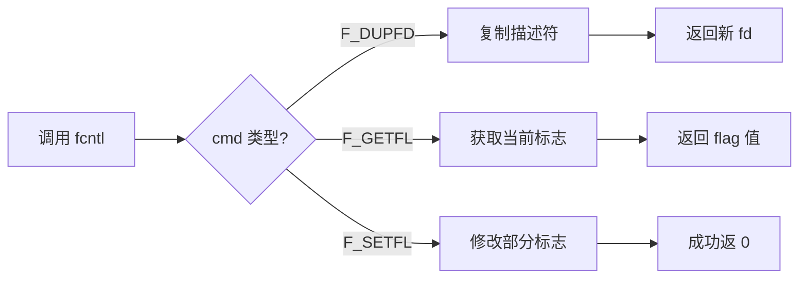

# 文件控制fcntl()函数（文件描述符复制、状态标志修改等）

# 文件控制 fcntl() 函数

在 Linux 文件 I/O 中，`open()` 仅能设置初始标志。若需在运行时动态修改文件状态（如非阻塞切换）或操作文件描述符，必须依赖 `fcntl()`。其原型为：
```c
int fcntl(int fd, int cmd, ... /* arg */ );
```
==核心功能==：对已打开的文件描述符执行各种控制操作，返回值为新描述符或状态标志，出错返回 -1。

## 为什么需要 fcntl？

试想：程序运行中途，如何让一个原本阻塞的 socket 变为非阻塞？或者如何在不关闭文件的情况下，让两个描述符指向同一文件表项？`open()` 无法做到“中途变卦”，而 `dup()` 功能单一。`fcntl()` 提供了通用的控制接口，是处理==文件描述符复制==与==状态标志修改==的标准手段。

## 核心命令详解

### 1. 文件描述符复制 (F_DUPFD)
`fcntl(fd, F_DUPFD, arg)` 用于复制文件描述符。它寻找大于等于 `arg` 的最小可用描述符进行复制。
- **特点**：新旧描述符共享==文件表项==（偏移量、状态标志）。
- **区别**：与 `dup2(oldfd, newfd)` 相比，`F_DUPFD` 允许指定最小描述符值，且若 `newfd` 已打开，`fcntl` 不会自动关闭它（需手动处理），而 `dup2` 会原子性地关闭并重用。

### 2. 获取/设置状态标志 (F_GETFL / F_SETFL)
这是考试高频点。用于修改 `O_NONBLOCK`、`O_APPEND` 等标志。
- **注意**：`F_SETFL` ==只能修改== 访问模式标志（如非阻塞、追加写），==不能修改== 文件访问权限（如 `O_RDONLY`）。



> [!IMPORTANT]
> 修改标志的正确步骤：
> 1. `val = fcntl(fd, F_GETFL, 0);` 获取旧标志。
> 2. `val |= O_NONBLOCK;` 位运算修改。
> 3. `fcntl(fd, F_SETFL, val);` 写回新标志。
> **切勿直接覆盖**，否则会丢失原有标志（如 `O_WRONLY`）。

## 常见坑与辨析

| 特性 | fcntl(F_DUPFD) | dup2() |
| :--- | :--- | :--- |
| **目标 fd** | ≥ arg 的最小可用 | 精确指定 newfd |
| **原子性** | 否（若 newfd 占用需先 close） | 是（自动关闭 newfd） |
| **灵活性** | 高（可指定范围） | 低（固定替换） |

> [!WARNING]
> **易错点**：`F_SETFL` 无法修改 `O_RDONLY`/`O_WRONLY`。若需改变读写权限，必须 `close()` 后重新 `open()`。

## 典型例题解析

**题目**：将文件描述符 `fd` 设置为非阻塞模式，并复制到一个新的描述符 `newfd`（假设 `newfd` 未使用）。

**正确代码逻辑**：
```c
// 1. 设置非阻塞
int flags = fcntl(fd, F_GETFL, 0);
if (flags == -1) { perror("getfl"); exit(1); }
flags |= O_NONBLOCK; // ==关键：位或操作==
if (fcntl(fd, F_SETFL, flags) == -1) { perror("setfl"); exit(1); }

// 2. 复制描述符 (假设要求最小为 10)
int newfd = fcntl(fd, F_DUPFD, 10);
if (newfd == -1) { perror("dupfd"); exit(1); }
```
此例展示了 `fcntl` 在状态修改与描述符管理中的标准用法，务必掌握位运算修改标志的流程。
