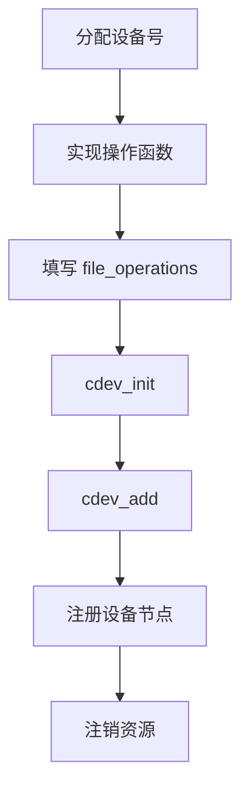

# file_operations结构体与设备驱动接口注册

## 它是什么

`file_operations` 是 Linux 内核为字符设备、块设备等文件接口提供的==操作函数集合==。当用户程序执行 `open()`、`read()`、`write()`、`ioctl()`、`mmap()` 等系统调用时，内核会通过设备号找到已注册的驱动，并调用 `file_operations` 中对应的函数。


它不是“设备驱动本身”，而是==VFS 与具体驱动之间的接口表==。

## 为什么需要

同一套 `open/read/write` 接口可以操作普通文件、管道、终端和设备文件。若每种设备都自行设计接口，应用程序就必须了解硬件细节，Linux 的统一文件抽象也会被破坏。

因此，驱动开发的核心工作之一是：实现硬件操作函数，填写 `file_operations`，再把该结构体注册到内核。

## 怎么做

常见字符设备驱动的基本流程如下：



典型代码框架：

```c
#include <linux/fs.h>

static int my_open(struct inode *inode, struct file *filp)
{
    return 0;
}

static ssize_t my_read(struct file *filp, char __user *buf,
                       size_t count, loff_t *ppos)
{
    return 0;
}

static ssize_t my_write(struct file *filp, const char __user *buf,
                        size_t count, loff_t *ppos)
{
    return count;
}

static const struct file_operations my_fops = {
    .owner   = THIS_MODULE,
    .open    = my_open,
    .read    = my_read,
    .write   = my_write,
};

static struct cdev my_cdev;
static dev_t my_devno;

static int __init my_init(void)
{
    int ret;

    ret = alloc_chrdev_region(&my_devno, 0, 1, "mydev");
    if (ret < 0)
        return ret;

    cdev_init(&my_cdev, &my_fops);
    my_cdev.owner = THIS_MODULE;

    ret = cdev_add(&my_cdev, my_devno, 1);
    if (ret < 0)
        goto err_region;

    ret = device_create(my_class, NULL, my_devno, NULL, "mydev");
    if (ret < 0)
        goto err_cdev;

    return 0;

err_cdev:
    cdev_del(&my_cdev);
err_region:
    unregister_chrdev_region(my_devno, 1);
    return ret;
}
```

其中，`.owner = THIS_MODULE` 便于内核进行模块引用计数管理；`cdev_add()` 将字符设备加入内核；`device_create()` 配合设备节点自动创建设备文件。

## 与相近概念的区别

| 对象 | 作用 | 常见使用场景 |
|---|---|---|
| `file_operations` | 描述文件接口如何执行 | 字符设备、块设备 |
| `cdev` | 表示内核中的字符设备 | 动态分配多个连续设备号 |
| `struct device` | 描述设备及属性 | 创建设备节点、电源管理 |
| `struct file` | 表示一次打开得到的文件对象 | 保存打开标志、私有数据等 |
| `struct inode` | 表示文件系统中的索引节点 | 保存设备号、权限等信息 |

还要区分：注册的是**操作接口表**，而不是直接注册硬件；用户访问设备节点后，VFS 才会依据设备号找到驱动。

## 常见坑

> [!WARNING]
> 驱动函数参数中的 `buf` 通常是用户空间地址，不能直接解引用。

一般应使用 `copy_from_user()`、`copy_to_user()`、`get_user()`、`put_user()` 传输数据。直接访问可能触发缺页异常，甚至破坏内核。

> [!CAUTION]
> `read/write` 的返回值语义不同。

成功时，`read` 返回实际读取的字节数，`write` 返回实际写入的字节数；返回值小于请求长度不一定表示出错。还要正确维护偏移量 `*ppos`，否则连续读写可能出现数据重复或丢失。

> [!IMPORTANT]
> 退出驱动时必须按相反顺序释放资源。

通常应先删除设备节点，再执行 `cdev_del()`，最后释放设备号区域，并处理前面步骤失败时的回滚路径。

## 一个算对了的例子

假设用户执行：

```c
n = read(fd, buf, 100);
```

驱动本次只取得 50 字节，则 `my_read()` 应返回 `50`，并把有效数据写入 `buf` 的前 50 字节。VFS 会把 `50` 作为本次 `read()` 的结果返回给用户程序。

如果驱动错误地返回 `0`，用户会认为已到达文件末尾；若直接解引用用户地址 `buf`，则可能造成内核异常。==返回实际字节数并正确处理用户内存==才是正确实现。
