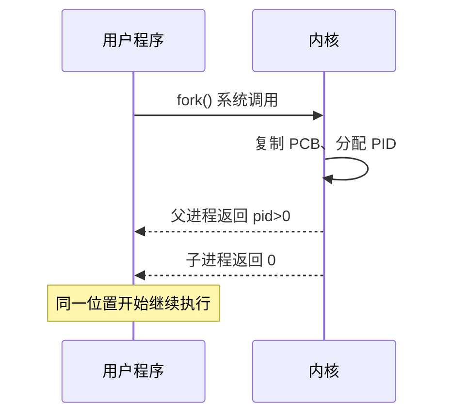
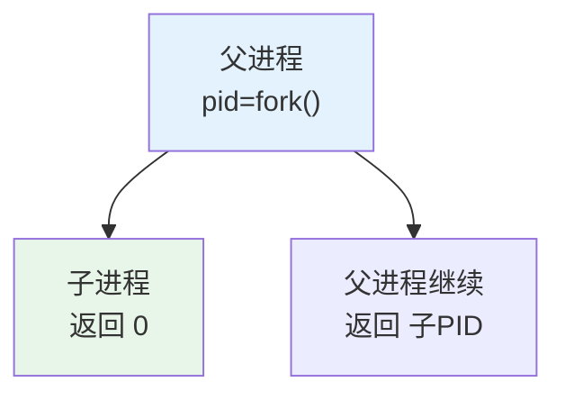

# fork()系统调用创建子进程及其返回值

## fork() 是什么

在 Linux 中，除了 0 号和 1 号进程，所有进程都是由其父进程创建的。`fork()` 就是**创建新进程**的系统调用，它会为调用它的进程（父进程）生成一个几乎一模一样的子进程。

它的函数原型非常简洁：

```c
#include <unistd.h>
pid_t fork(void);
```

调用一次 `fork()`，会创建一个子进程。子进程是父进程的**副本**，它获得父进程的数据空间、堆和栈的副本（通过写时复制 COW 优化），但父子进程并不共享这些空间。

## 为什么说“一次调用，两次返回”

`fork()` 最神奇、也最容易让人困惑的地方在于它的返回值。

```c
pid_t pid = fork();
```

这行代码执行后，**同一个程序会在两个进程中各返回一次**：

| 返回值 | 意义 |
|---|---|
| $-1$ | 创建失败（如进程数超限） |
| $0$ | 子进程返回的代码路径 |
| $> 0$ | 父进程返回的代码路径，值是**子进程的 PID** |



> [!IMPORTANT]
> ==`fork()` 被调用一次，但会返回两次==：在父进程中返回子进程 PID，在子进程中返回 0。

区分的关键就在于返回值——**父进程通过返回值 > 0 得知自己生了孩子**，**子进程通过返回值 = 0 得知自己是被创建的**。

## 父子进程的区别与联系

| 特性 | 父进程 | 子进程 |
|---|---|---|
| 返回值 | 子进程 PID（$> 0$） | $0$ |
| PID | 原有 PID | 新分配的 PID |
| PPID | 不变 | 父进程 PID |
| 内存空间 | 原有 | 独立副本（不共享） |
| 执行流 | 从 fork() 返回处继续 | 从 fork() 返回处继续 |
| 文件描述符 | 原有 | 继承父进程已打开的文件 |



> [!WARNING]
> ==子进程和父进程并不共享内存空间==。父子进程各自有一份数据副本，修改互不影响。这是与线程的本质区别之一。

## 典型代码模式

```c
#include <stdio.h>
#include <unistd.h>
#include <sys/types.h>

int main(void)
{
    pid_t pid;
    pid = fork();
    if (pid < 0) {
        perror("fork failed");
        return -1;
    }
    if (pid == 0) {
        /* 子进程执行 */
        printf("I am child, PID=%d, PPID=%d\n", getpid(), getppid());
        execl("/bin/ls", "ls", NULL);  /* 常配合 exec 使用 */
    } else {
        /* 父进程执行 */
        printf("I am parent, my child PID=%d\n", pid);
    }
    return 0;
}
```

> [!TIP]
> 判断谁是谁，就看 `pid == 0` 还是 `pid > 0`——==0 是子进程，正数是父进程==。

## 一个典型的坑

**多次 fork() 进程数爆炸**：

```c
fork();
fork();
```

这段代码最终会产生 $2^2 = 4$ 个进程（含原始父进程）。因为第一次 fork 产生 2 个进程，每个进程又各自 fork 一次。

> [!CAUTION]
> 计算 fork() 后的总进程数时，不要忽略每一次 fork 都会被当前**所有存活进程**执行。

## 与 exec 系列配合

`fork()` 只是复制了一个“自己”，要想让子进程执行完全不同的程序，需要在子进程中调用 `exec` 系列函数（如 `execl`、`execvp`）来替换进程的代码段和数据段。这就是 Shell 执行命令的基本原理：**fork + exec**。
