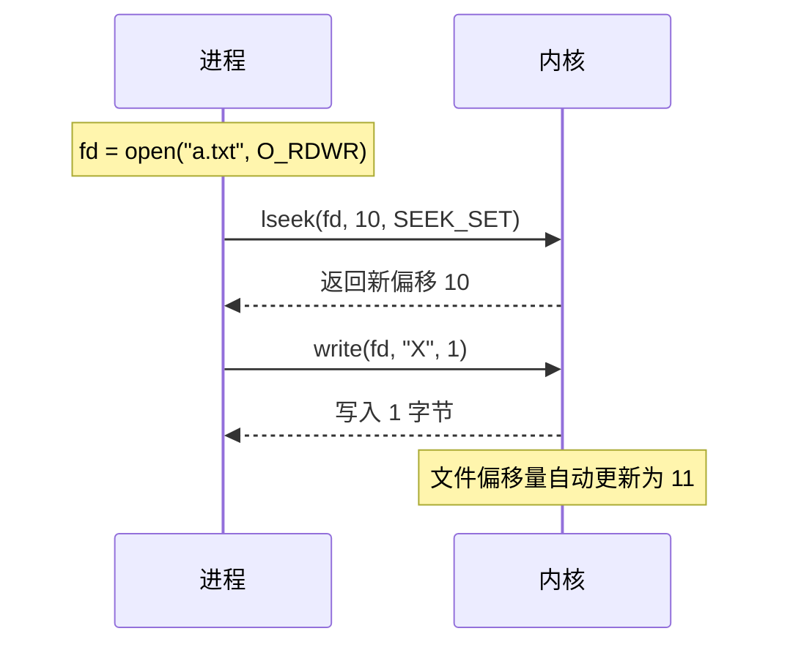

# 文件偏移量设置lseek()系统调用

## 文件偏移量设置：lseek()

在 Linux 中，打开一个文件会得到一个文件描述符，内核为每个打开的文件维护一个“当前文件偏移量”（file offset）。它标识了下一次 `read()` 或 `write()` 将从文件的哪个位置开始。通常，顺序读写会让偏移量自动递增，但若需要**随机读写**，就必须通过 `lseek()` 系统调用来主动调整偏移量。

```c
#include <sys/types.h>
#include <unistd.h>

off_t lseek(int fd, off_t offset, int whence);
```

| whence 参数 | 含义 | offset 含义 |
| :--- | :--- | :--- |
| `SEEK_SET` | 文件开头 | 偏移量为 offset（通常 ≥0） |
| `SEEK_CUR` | 当前偏移量 | 偏移量为当前值 + offset（可正可负） |
| `SEEK_END` | 文件末尾 | 偏移量为文件长度 + offset（常≤0） |

> [!IMPORTANT]
> `lseek()` **仅将内核中的文件偏移量记录移动，不产生任何 I/O 操作，不修改文件内容**。

### 为什么需要 lseek？

如果没有随机访问能力，读取文件中间某段数据就必须从头顺序读到目标位置，效率极低。`lseek()` 配合 `read/write` 可实现：

- 跳到指定位置修改文件（如修改文件头部的元数据）
- 读取大文件中的任意片段
- 在文件末尾追加写（`lseek(fd, 0, SEEK_END)` 等价于以 `O_APPEND` 方式打开，但不自动）

### 返回值与常见陷阱

`lseek()` 成功时返回==**新的文件偏移量**==（相对于文件开头的字节数），失败返回 `-1` 并设置 `errno`。

> [!WARNING]
> 一个极易犯的错误是认为 `lseek` 返回 0 代表失败。实际上返回 0 是完全合法的，表示偏移回到了文件开头。==**必须用返回值是否等于 (off_t)-1 来判断失败**==。

> [!CAUTION]
> `lseek` 的返回类型是 `off_t`，在 32 位系统中可能为 32 位有符号数。**若文件偏移量可能超过 2 GB，编译时需定义 `_FILE_OFFSET_BITS=64`**，否则 `lseek` 会因溢出而报错。

### 与 fseek 的区别

| | `lseek` | `fseek` |
| :--- | :--- | :--- |
| 操作对象 | 文件描述符（fd） | 标准C库文件指针（`FILE *`） |
| 函数类别 | POSIX 系统调用 | 标准C库函数 |
| 缓冲区影响 | 不影响用户态缓冲（没有缓冲） | 需注意其与 `stdio` 缓冲区的交互 |

### 操作流程示意

随机写入文件某位置的典型序列：



### 算对一例

**题目**：设文件 `test.txt` 原大小为 100 字节。执行下列代码后，文件大小是多少？第二次 `read` 读取的字节数？

```c
int fd = open("test.txt", O_RDWR);
lseek(fd, 30, SEEK_SET);
write(fd, "hello", 5);
char buf[10];
int n1 = read(fd, buf, 10);
int n2 = read(fd, buf, 10);
```

**推导过程**：

1. 打开文件，偏移量初始为 0。
2. `lseek` 跳到 30，写入 5 字节，==文件偏移自动更新为 35==。文件大小保持 100（未超出原大小）。
3. 执行 `read(fd, buf, 10)`：从偏移 35 开始读 10 字节（字节 35～44）。`n1 = 10`，偏移量变为 45。
4. 再次执行 `read`：从偏移 45 继续读，还剩 55 字节可读。`n2 = 10`，继续向下。

> [!NOTE]
> 若在写入的地方新增内容（比如跳到文件末尾之后写入），会形成“文件空洞”（hole），空洞部分读出来的全是 `\0`，但它不占用物理磁盘块。
