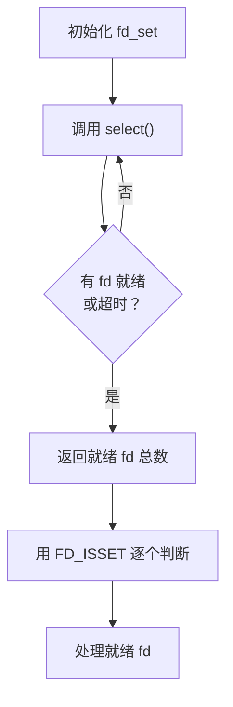

# I/O多路复用select()函数的使用

## 为什么需要 select()

先想一个问题：一个服务器要同时处理很多客户端，如果给每个连接开一个进程/线程，开销太大。能不能用**一个进程**同时监视多个文件描述符，谁就绪就处理谁？

==select() 就是 I/O 多路复用的经典实现：单进程监视多个 fd，有 fd 就绪才返回，避免阻塞在单个 I/O 上。==

## select() 原型与参数

```c
#include <sys/select.h>
int select(int nfds,
           fd_set *readfds, fd_set *writefds, fd_set *exceptfds,
           struct timeval *timeout);
```

- `nfds`：监视的 fd 中**最大值 + 1**（不是 fd 个数！）
- `readfds / writefds / exceptfds`：分别监视"可读 / 可写 / 异常"的 fd 集合
- `timeout`：超时时间；`NULL` 表示永久阻塞

调用流程：



## 关键：fd_set 的"传入传出"特性

==select() 返回后，fd_set 里只剩下"已就绪"的 fd，原来的集合被内核改写了。==

所以每次循环都要重新设置：

```c
fd_set readfds;
while (1) {
    FD_ZERO(&readfds);              // 清空
    FD_SET(sockfd, &readfds);       // 重新加入
    FD_SET(STDIN_FILENO, &readfds); // 重新加入
    maxfd = sockfd + 1;             // 最大值+1

    ret = select(maxfd, &readfds, NULL, NULL, NULL);
    if (ret < 0) { perror("select"); break; }

    if (FD_ISSET(sockfd, &readfds))      // 判断谁就绪
        handle_socket(sockfd);
    if (FD_ISSET(STDIN_FILENO, &readfds))
        handle_input();
}
```

> [!IMPORTANT]
> 核心结论：==nfds = 最大 fd 值 + 1==，因为内核要线性扫描 `[0, nfds)` 区间。

> [!WARNING]
> 常见坑：忘记在循环内重新 `FD_ZERO` + `FD_SET`，导致第二次 select 永远阻塞或行为异常。

## 配套宏函数

| 宏 | 作用 |
|---|---|
| `FD_ZERO(&set)` | 清空集合 |
| `FD_SET(fd, &set)` | 把 fd 加入集合 |
| `FD_CLR(fd, &set)` | 把 fd 移出集合 |
| `FD_ISSET(fd, &set)` | 判断 fd 是否在集合中（返回后用于判断就绪） |

## 和相近概念对比

| 特性 | select | poll | epoll |
|---|---|---|---|
| fd 上限 | `FD_SETSIZE`（通常 1024） | 无 | 无 |
| 集合是否被修改 | ==是，需每次重置== | 是 | 否 |
| 时间复杂度 | $O(n)$ 线性扫描 | $O(n)$ | $O(1)$ 事件通知 |
| 适用规模 | 小规模 | 中等 | 大规模高并发 |

## 一个算对了的例子

题目：某进程用 select 监视 fd 3、5、7 的可读事件，问 `nfds` 应传多少？

- 最大 fd = 7
- $nfds = 7 + 1 = 8$

> [!TIP]
> 记忆口诀：==nfds 是"最大 fd 加一"，不是 fd 个数==。比如只监视 fd 7 一个，nfds 也要传 8。
