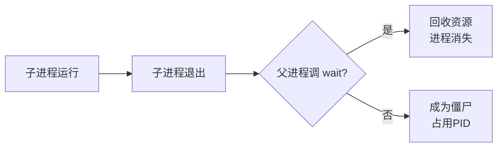

# wait()与waitpid()回收子进程及僵尸进程

## 为什么需要“收尸”

进程调用 `exit()` 或从 `main` 返回后，内核并不会立即把它从进程表中删除。此时进程已停止运行，但其退出状态、CPU 时间等残留信息仍占用内核资源，直到父进程读取这些信息。这种“死而不葬”的进程称为==僵尸进程（zombie）==。

如果父进程迟迟不回收，僵尸会一直占用 PCB 表项；大量僵尸最终会耗尽系统进程号（PID），导致无法创建新进程。因此，父进程有责任调用 `wait()` 或 `waitpid()` 来“收尸”。



## wait() 与 waitpid() 的函数原型

两个函数都定义在 `<sys/wait.h>` 中：

```c
pid_t wait(int *status);
pid_t waitpid(pid_t pid, int *status, int options);
```

- `status`：若不为 `NULL`，内核把子进程的退出状态写入该地址。
- 返回值：成功时返回被回收子进程的 PID；失败返回 `-1`，并设 `errno`。

解析退出状态用以下宏（对 `status` 操作）：

| 宏 | 含义 |
|---|---|
| `WIFEXITED(status)` | 子进程正常退出则为真 |
| `WEXITSTATUS(status)` | 正常退出时的 `exit(n)` 的 `n`（低 8 位） |
| `WIFSIGNALED(status)` | 子进程被信号杀死则为真 |
| `WTERMSIG(status)` | 杀死子进程的信号编号 |

## 两者的区别

| 特性 | `wait()` | `waitpid()` |
|---|---|---|
| 等待对象 | 任意一个子进程 | 指定 PID 的子进程 |
| 阻塞行为 | 若没有子进程退出则一直阻塞 | 可用 `WNOHANG` 非阻塞轮询 |
| 适用场景 | 只有一个子进程、父进程无其他事可做 | 多子进程、需要非阻塞检查 |

`waitpid` 的 `pid` 参数：

- `pid > 0`：等待 PID 等于该值的子进程。
- `pid == -1`：等待任一子进程（等价于 `wait()`）。
- `pid == 0`：等待同进程组的任一子进程。
- `pid < -1`：等待进程组 ID 等于 `|pid|` 的任一子进程。

## 一个算对了的例子

父进程创建两个子进程，分别返回 `10` 和 `20`：

```c
#include <stdio.h>
#include <stdlib.h>
#include <unistd.h>
#include <sys/wait.h>

int main(void) {
    pid_t pid1, pid2;

    pid1 = fork();
    if (pid1 == 0) {
        exit(10);                 // 子进程1直接退出
    }

    pid2 = fork();
    if (pid2 == 0) {
        exit(20);                 // 子进程2直接退出
    }

    int status;
    pid_t done;

    done = wait(&status);          // 回收最先退出的那个
    if (WIFEXITED(status))
        printf("回收子进程 %d, 退出码 %d\n",
               done, WEXITSTATUS(status));

    done = wait(&status);          // 回收剩下的那个
    if (WIFEXITED(status))
        printf("回收子进程 %d, 退出码 %d\n",
               done, WEXITSTATUS(status));

    return 0;
}
```

可能的输出：

```text
回收子进程 12345, 退出码 10
回收子进程 12346, 退出码 20
```

> [!WARNING]
> `wait()` 回收的顺序是“先退出先回收”，不是创建顺序。两个子进程谁先被调度退出不确定，所以输出中先出现 `10` 还是 `20` 都可能。

## 非阻塞回收与防僵尸

若父进程在等待期间还要做其他事情，可循环调用 `waitpid(-1, &status, WNOHANG)`：

```c
while (waitpid(-1, &status, WNOHANG) > 0)
    ;   // 把所有已退出的子进程全部回收
```

配合信号 `SIGCHLD` 使用，可以在子进程退出时立即收到通知，再批量回收。这种做法在并发服务器中非常常见——==不阻塞父进程，又能及时清理僵尸==。

> [!IMPORTANT]
> 只要父进程还活着却不调用 `wait`/`waitpid`，子进程退出后就是僵尸；`kill -9` 杀不死僵尸，因为它已经“死”了，只能等父进程回收或父进程自身退出后由 `init`（或 systemd）收养并释放。

## 常见的坑

> [!CAUTION]
> 只 `fork()` 不 `wait()`，每创建一轮就泄漏一个 PCB 表项；循环几百次后 `fork()` 返回 `EAGAIN`，进程号耗尽。这是 Linux 下 C 编程最经典的资源泄漏之一。

> [!TIP]
> 看见“父进程比子进程先退出”的情形，子进程会成为孤儿进程被 `init` 收养，由 `init` 负责回收——此时不会产生长期僵尸。僵尸的根源是==父进程活着却不收尸==。
