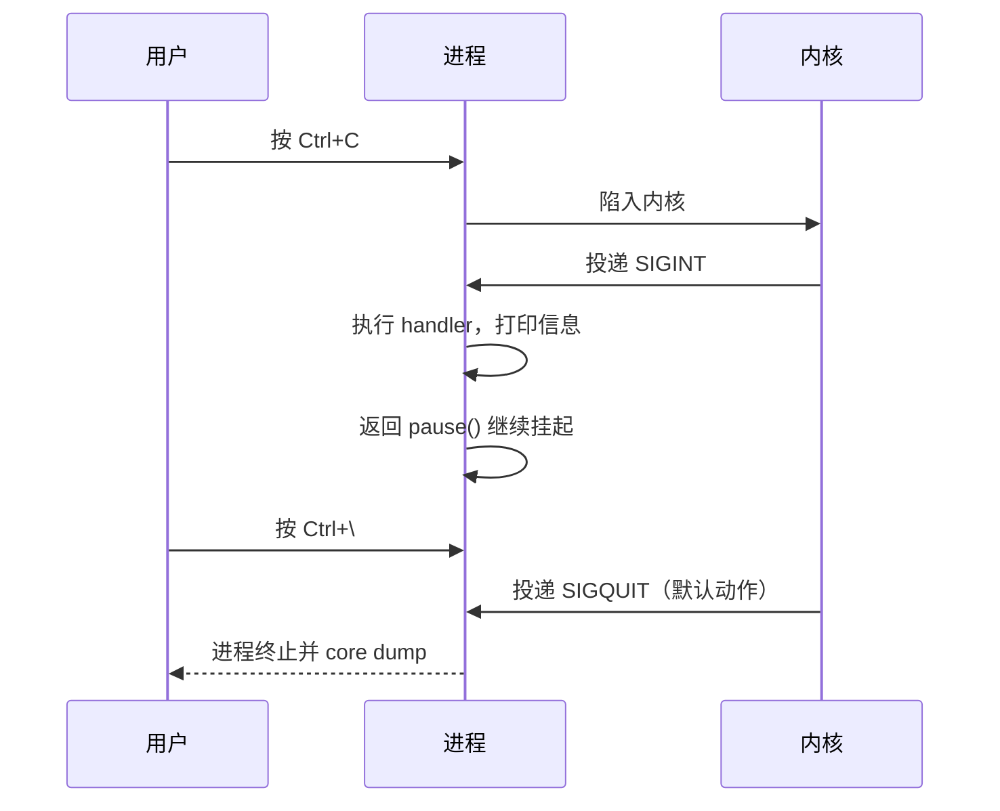

# 信号的概念、常用信号类型及signal()处理

## 信号是什么

信号（Signal）是 UNIX/Linux 中一种**软件中断**：内核或进程可以在任意时刻向目标进程发送一个信号，目标进程收到后暂时打断当前执行流，转去执行信号处理函数（或执行默认动作），处理完再回到被中断处继续执行。


> [!IMPORTANT]
> 信号本质上是**异步事件通知机制**：发送方不与接收方同步等待，接收方也不一定立即处理（信号可能被暂时屏蔽）。它不同于硬件中断，它由内核/进程主动“递送”给用户态代码。

## 为什么需要信号

多进程环境下必须处理两类事件：

- **外部事件**：用户按 Ctrl+C 希望终止前台进程；定时器超时需要通知进程。
- **内部错误**：段错误（`SIGSEGV`）、浮点异常（`SIGFPE`）、非法指令（`SIGILL`）、管道写端关闭（`SIGPIPE`）等，内核必须让进程知晓并做出反应。

没有信号机制，进程只能靠不断轮询检查状态，既低效又无法及时响应中断类事件。

## 常用信号类型

| 信号名 | 编号（x86/Linux） | 默认动作 | 典型来源 |
| --- | --- | --- | --- |
| `SIGINT` | 2 | 终止 | 用户按 Ctrl+C |
| `SIGQUIT` | 3 | 终止并 core dump | 用户按 Ctrl+\\ |
| `SIGKILL` | 9 | 终止，不可捕获 | `kill -9 pid` |
| `SIGSEGV` | 11 | 终止并 core dump | 访问非法地址 |
| `SIGALRM` | 14 | 终止 | `alarm()` 定时器超时 |
| `SIGCHLD` | 17 | 忽略 | 子进程退出时通知父进程 |
| `SIGPIPE` | 13 | 终止 | 向已关闭的管道写数据 |
| `SIGUSR1` | 10 | 终止 | 用户自定义用途 |

> [!WARNING]
> `SIGKILL`（9）和 `SIGSTOP`（19）**不能被捕获、阻塞或忽略**，这是内核的强制约束。如果想让进程“体面退出”，不要用 `kill -9`，而应发送可处理的信号如 `SIGTERM`，由进程自行清理资源后退出。

## signal() 怎么用

函数原型：

```c
#include <signal.h>
typedef void (*sighandler_t)(int);
sighandler_t signal(int signum, sighandler_t handler);
```

`handler` 有三种写法：

- `SIG_IGN`：忽略该信号
- `SIG_DFL`：恢复默认动作
- 自定义函数指针：`void my_handler(int sig)`，函数名即可作为地址传入

### 例子：捕获 SIGINT，让 Ctrl+C 不杀进程

```c
#include <stdio.h>
#include <signal.h>
#include <unistd.h>

void on_sigint(int sig) {
    printf("收到 SIGINT（编号 %d），但我不会退出\n", sig);
}

int main(void) {
    signal(SIGINT, on_sigint);   // 注册自定义处理函数
    while (1) {
        printf("运行中……按 Ctrl+C 试试\n");
        sleep(1);
    }
    return 0;
}
```

运行后按 Ctrl+C，进程不会终止，而是打印处理消息后继续循环。

## 信号处理的常见坑

> [!CAUTION]
> **信号处理函数中不要调用不可重入函数**。`printf`、`malloc`、`fopen` 等标准库函数内部使用了全局缓冲区，若信号恰好打断了这些函数自身的执行，处理函数再次调用同一函数会造成缓冲区状态错乱或死锁。处理函数里应只做最简单的事：设置 `volatile sig_atomic_t` 标志位、调用 `write` 或 `_exit` 等异步安全函数。

另一个坑：**signal() 不可靠**。标准 Linux 中，signal 的行为是 BSD 风格的（永久注册），但为避免语义混淆，新代码应统一使用 `sigaction()`。`signal()` 适合教学和简单场景。

## 算对了的例子

题目：假定 `main` 中先 `signal(SIGINT, handler)`，然后调用 `pause()` 挂起等待信号。用户按 Ctrl+C，进程收到 `SIGINT`，执行 `handler` 打印一行信息后返回 `pause()` 继续挂起，程序不退出。此时再按一次 Ctrl+\\（发出 `SIGQUIT`），由于未捕获 `SIGQUIT`，执行默认动作：终止进程并产生 core dump。



> [!TIP]
> 记忆口诀：“**软中断、异步到；KILL STOP 抓不到；SIGINT 是 Ctrl+C，SIGQUIT 是 Ctrl+反斜杠；处理函数别 printf，volatile 标志最安全。**”

## 与相近概念的区别

| 概念 | 特点 |
| --- | --- |
| 信号（Signal） | 进程间异步通知，轻量、固定类型，不能携带自定义数据（`sigqueue` 除外） |
| 中断（Interrupt） | CPU 级别的硬件/软件事件，在内核态处理，用户进程无感知 |
| 消息队列 | 进程间传递**数据块**，发送方写队列、接收方读队列，是有格式的数据通信 |

信号只传递“发生了某件事”这一个信息，不传递业务数据；这是它与消息队列、管道等 IPC 机制最本质的区别。==需要传数据时，应选择管道、消息队列或共享内存，而不是信号==。
