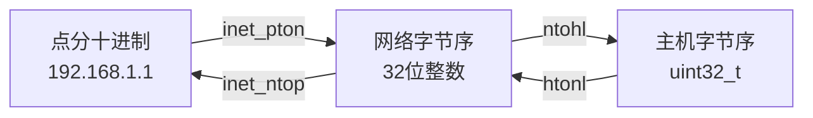

# 网络字节序与主机字节序及转换函数（htonl、htons、inet_pton等）

## 为什么需要字节序转换

不同的计算机体系结构采用不同的字节序（Byte Order）来存储多字节数据。**主机字节序**因 CPU 而异：x86 架构采用**小端序**（Little-Endian，低位字节存低地址），而某些 RISC 处理器采用**大端序**（Big-Endian，高位字节存低地址）。

> [!IMPORTANT]
> ==网络字节序是固定的“大端序”==。网络协议（如 TCP/IP）规定，数据在传输时必须统一使用大端序，确保不同架构的主机能正确解析报文首部。

当两台字节序不同的主机通信时，若直接发送多字节整数（如端口号、IP 地址），接收方会解读出错误数值。例如，小端主机发送十六进制数 `0x1234`，内存布局为 `34 12`，大端主机接收后会误认为是 `0x3412`。

## 转换函数详解

Linux 提供以下核心函数进行转换：

| 函数 | 功能 | 数据类型 | 典型用途 |
|------|------|----------|----------|
| `htonl()` | **h**ost **to** **n**etwork **l**ong | 32 位无符号整数 | 转换 IP 地址 |
| `htons()` | **h**ost **to** **n**etwork **s**hort | 16 位无符号整数 | 转换端口号 |
| `ntohl()` | **n**etwork **to** **h**ost **l**ong | 32 位无符号整数 | 接收后还原 IP |
| `ntohs()` | **n**etwork **to** **h**ost **s**hort | 16 位无符号整数 | 接收后还原端口 |

> [!TIP]
> 记忆口诀：==`h` 开头表示“到网络”==（host→network），`n` 开头表示“回主机”（network→host）。发送前用 `hton*`，接收后用 `ntoh*`。

对于 IP 地址字符串与网络字节序整数的互转，使用 `inet_pton()`（**p**resentation **to** **n**etwork）和 `inet_ntop()`（**n**etwork **to** **p**resentation）。它们支持 IPv4/IPv6，且自动处理字节序，比老旧的 `inet_addr()` 更安全。



## 典型代码示例

```c
struct sockaddr_in serv_addr;
serv_addr.sin_family = AF_INET;
serv_addr.sin_port = htons(8080);           // 端口：主机→网络
inet_pton(AF_INET, "192.168.1.100", 
          &serv_addr.sin_addr);              // IP：字符串→网络字节序
```

若需手动转换 IP（如从 `struct in_addr` 获取后）：
```c
uint32_t ip_host = ntohl(serv_addr.sin_addr.s_addr);
printf("%u.%u.%u.%u\n", 
       (ip_host >> 24) & 0xFF,
       (ip_host >> 16) & 0xFF,
       (ip_host >> 8) & 0xFF,
       ip_host & 0xFF);
```

## 常见陷阱与辨析

> [!WARNING]
> **单字节数据无需转换**。`char` 类型或 8 位字段（如 `sin_family`）不受字节序影响，调用 `htons()` 反而会导致错误。

**相近概念辨析**：
- **`htons` vs `htonl`**：端口是 16 位，必须用 `htons`；IPv4 地址是 32 位，用 `htonl`。混用会导致数据截断或错位。
- **`inet_pton` vs `inet_addr`**：`inet_addr` 已淘汰，它返回 `in_addr_t` 但无法处理 `255.255.255.255`（与错误码冲突）；`inet_pton` 通过返回值区分成功/失败，且支持 IPv6。

> [!CAUTION]
> 接收数据后，**先转换再使用**。若忘记调用 `ntohs()` 解析端口，小端机器上会看到完全错误的端口号（如发送 8080，收到 36895）。

**计算示例**：若主机字节序为小端，端口值为 `8080`（十六进制 `0x1F90`），调用 `htons(8080)` 后，内存中的网络字节序表示为多少？

**解答**：小端主机内存原布局为 `90 1F`，网络字节序（大端）应为 `1F 90`。转换后数值仍为 `8080`（因为 `htons` 返回的是网络序的数值表示，在小端机器上该数值对应的字节序已调整），但内存字节顺序已变为 `1F 90`，可直接用于网络传输。
