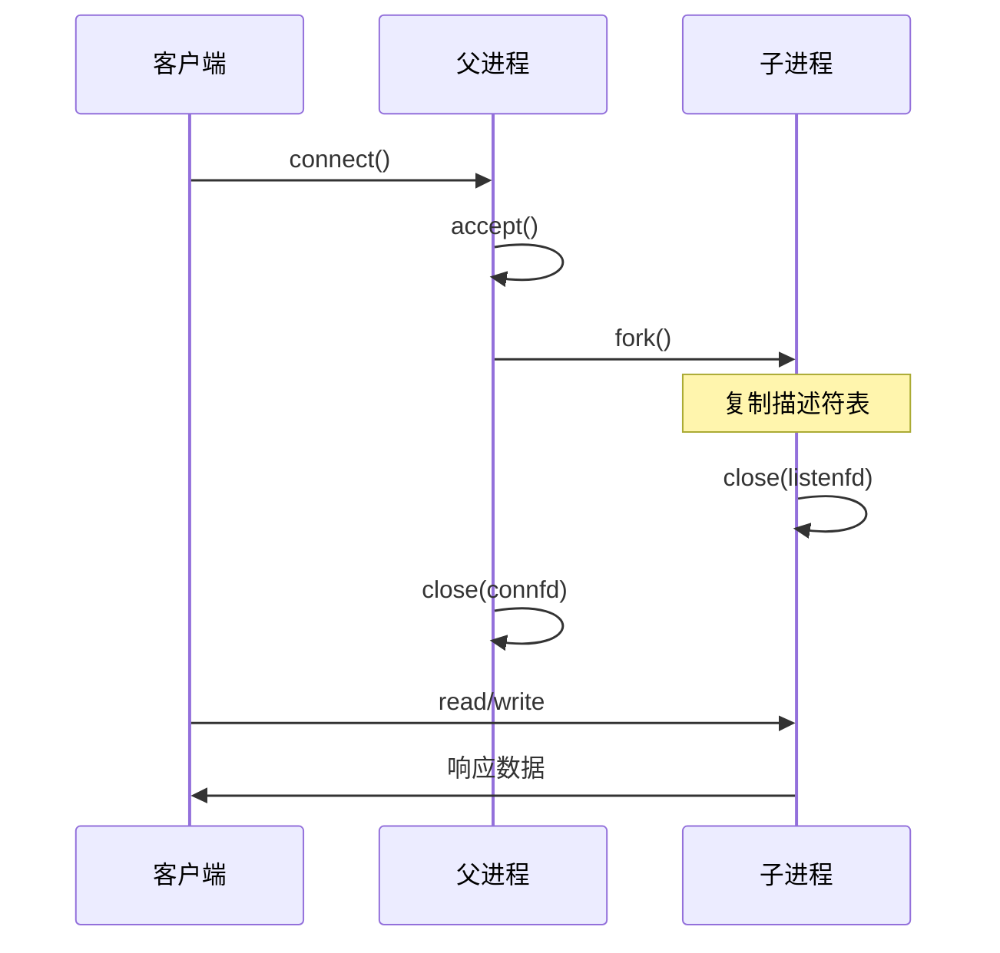
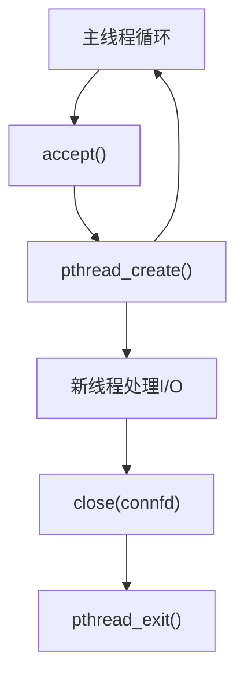

# 并发服务器的实现模型（多进程、多线程）

一个 TCP 服务器调用 `accept()` 拿到新连接后，如果直接在主进程里处理业务逻辑，会发生什么？——在漫长的 I/O 等待中，其他客户端的 `connect()` 请求只能排队干等。这就是迭代服务器的致命缺陷。

为让多个客户端“同时”得到服务，我们需要==并发服务器==：主进程/线程只负责监听和 `accept()`，把实际的数据收发交给独立的执行流去处理。Linux 编程中最经典的两种模型是**多进程**与**多线程**。

## 多进程并发模型

核心思路：每次 `accept()` 成功后，调用 `fork()` 派生子进程。子进程关闭监听套接字专心通信，父进程关闭已连接套接字继续监听。



> [!IMPORTANT]
> `fork()` 之后，父子进程各自拥有独立的文件描述符表副本。==必须遵循“谁不用谁关闭”原则==：父进程不需要 `connfd`，子进程不需要 `listenfd`。

## 多线程并发模型

核心思路：`accept()` 后调用 `pthread_create()` 创建新线程，将 `connfd` 作为参数传入线程函数。



> [!WARNING]
> 线程共享进程的地址空间和文件描述符表。传给新线程的 `connfd` ==绝对不能在主线程中关闭==，否则新线程读写该描述符将直接报错。通常需将 `connfd` 的值通过 `malloc` 拷贝到堆上再传参，避免主线程下一次循环覆盖栈变量。

## 两种模型对比

| 维度 | 多进程 (`fork`) | 多线程 (`pthread_create`) |
| :--- | :--- | :--- |
| **资源开销** | 大（复制 PCB、页表） | 小（共享地址空间） |
| **切换速度** | 慢 | 快 |
| **数据隔离** | 天然隔离，安全性高 | 共享内存，==需加锁防竞态== |
| **僵尸问题** | 不回收会产生僵尸进程 | 无此概念 |
| **适用场景** | 计算密集、高可靠性要求 | I/O 密集、高并发连接 |

## 常见踩坑点

> [!CAUTION]
> 多进程模型中若不调用 `waitpid()` 或未设置 `signal(SIGCHLD, SIG_IGN)`，退出的子进程会变成僵尸进程，最终耗尽系统 PID 资源导致 `fork()` 失败。

> [!NOTE]
> 无论哪种模型，单个客户端断开连接时，其对应的执行流只需 `close(connfd)`，绝不能误关 `listenfd`，否则整个服务器停止服务。

## 代码示例：多进程并发回显

以下是一个算对了的多进程 Echo 服务器关键片段：

```c
int listenfd = socket(AF_INET, SOCK_STREAM, 0);
bind(listenfd, (struct sockaddr*)&servaddr, sizeof(servaddr));
listen(listenfd, 5);

/* 忽略 SIGCHLD 防止僵尸进程 */
signal(SIGCHLD, SIG_IGN);

while (1) {
    int connfd = accept(listenfd, NULL, NULL);
    if (connfd < 0) continue;

    pid_t pid = fork();
    if (pid == 0) {
        /* 子进程 */
        close(listenfd);       // 子进程无需监听
        char buf[1024];
        ssize_t n;
        while ((n = read(connfd, buf, sizeof(buf))) > 0) {
            write(connfd, buf, n); // 回显
        }
        close(connfd);         // 通信结束关闭
        exit(0);               // 子进程退出
    } else if (pid > 0) {
        /* 父进程 */
        close(connfd);         // 父进程无需通信
    }
}
```

> [!TIP]
> 记忆口诀：**fork 分两家，listen 留给爸，conn 交给娃；用完记得 close，SIGCHLD 别忘挂。**
