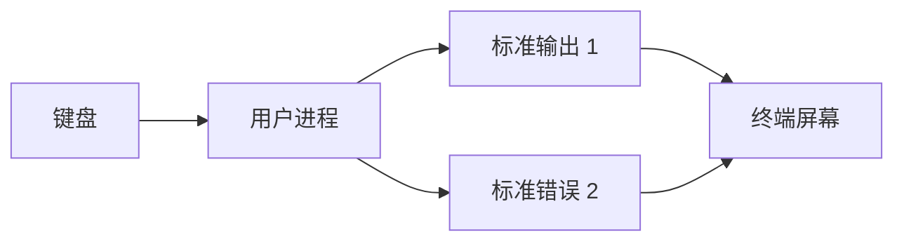

# 文件描述符的概念与标准输入输出错误（0、1、2）

在 Linux 中，进程访问文件、终端、管道等 I/O 对象时，通常不直接操作文件名，而是使用一个非负整数——==文件描述符==（file descriptor，fd）。可以把它理解为进程“文件打开表”中的编号：系统调用把 fd 作为参数，内核据此找到对应的打开文件及读写位置。

## 三个默认打开的文件描述符

每个用户进程启动后，通常已经有三个标准文件描述符：

| 文件描述符 | 宏 | 标准流 | 默认设备 | 主要用途 |
|---:|---|---|---|---|
| $0$ | `STDIN_FILENO` | `stdin` | 键盘 | 标准输入 |
| $1$ | `STDOUT_FILENO` | `stdout` | 终端屏幕 | 标准输出 |
| $2$ | `STDERR_FILENO` | `stderr` | 终端屏幕 | 标准错误 |

因此，考题“哪个描述符对应键盘”选 **A（0）**；“哪个描述符输出错误信息”选 **C（2）**。注意：$1$ 和 $2$ 默认都显示在屏幕上，但它们是==两条不同的输出通道==。



## 为什么需要文件描述符

统一的 fd 接口让 `read()`、`write()`、`close()` 等系统调用可以操作不同类型的 I/O 对象。例如：

```c
#include <unistd.h>

int main(void)
{
    char buf[128];
    ssize_t n = read(0, buf, sizeof(buf));  /* 从标准输入读 */
    if (n > 0)
        write(1, buf, n);                 /* 写到标准输出 */
    return 0;
}
```

这里 `read()` 的返回值为实际读到的字节数，出错则返回 $-1$；`write()` 也不能想当然地认为一定写完，应检查返回值。

## 重定向与管道

Shell 可以修改这些描述符的连接对象：

```bash
./prog < in.txt > out.txt 2> err.txt
```

含义是：fd $0$ 改接 `in.txt`，fd $1$ 改接 `out.txt`，fd $2$ 改接 `err.txt`。而管道符 `|` 会把==左边命令的标准输出==接到==右边命令的标准输入==，所以“接受一个命令的输出并转化成另一个命令的输入”选 **C（`|`）**。

| 符号 | 作用 |
|---|---|
| `>` | 重定向标准输出，覆盖文件 |
| `>>` | 重定向标准输出，追加文件 |
| `<` | 重定向标准输入 |
| `2>` | 只重定向标准错误 |
| `|` | 连接两条命令的标准输出与标准输入 |

> [!WARNING]
> `cmd > out.txt 2>&1` 表示 stdout 和 stderr 都进入 `out.txt`；若写成 `cmd 2>&1 > out.txt`，stderr 仍指向原来的 stdout，结果不同。`>` 也不等于管道，它连接的是文件，不是下一条命令。

## 一个做对的综合例子

生成斐波那契数列前 $20$ 项并写入文件：

```bash
#!/bin/bash
a=1; b=1
: > fib.txt
for ((i=1; i<=20; i++)); do
    echo "$a" >> fib.txt
    t=$((a+b)); a=$b; b=$t
done
```

运行命令：

```bash
chmod +x fib.sh
./fib.sh
cat fib.txt
```

这里 `echo` 默认写 fd $1$，每次 `>> fib.txt` 都把标准输出追加到文件，因此得到 $1,1,2,3,5,\ldots$。若用 C 语言，也可直接 `printf()` 后执行 `./fib > fib.txt`，无需在程序中自行打开文件。

> [!TIP]
> 记忆：**0 入、1 出、2 错；`>` 去文件，`|` 给命令。**
