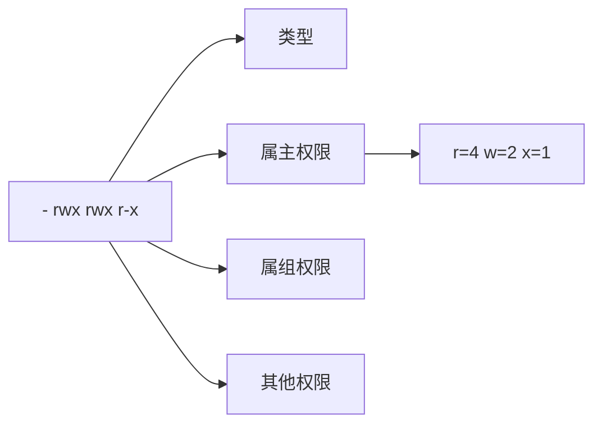

# 文件访问权限与umask掩码

## 文件访问权限  

在 Linux 系统中，每个文件和目录都有一组访问权限，决定了谁能读、写或执行它。用 `ls -l` 查看时，你会看到类似 `-rwxrwxr-x` 的字符串。第一位是文件类型（`-` 普通文件，`d` 目录，`p` 管道文件），后面每三位一组，分别代表**属主**、**属组**和**其他用户**的权限。每组按 `r`（读，4）、`w`（写，2）、`x`（执行，1）的数字叠加表示，例如 `rwx` 就是 7，`r-x` 就是 5。

为什么需要这样设计？多用户系统中，不是所有人都应该修改你的代码，也不能随意运行别人的脚本。权限机制就是一道门禁。

> [!IMPORTANT]  
> 目录的 `x` 权限不是“执行”，而是**能否进入目录**。只有 `r` 权限只能看到文件名，无法 `cd` 进去。

---

## umask 掩码与默认权限  

新创建的文件或目录，默认权限由 `umask`（用户文件创建掩码）决定。Linux 里，文件默认最大权限是 `666`（`rw-rw-rw-`），目录是 `777`（`rwxrwxrwx`）。系统用这个最大值**减去** umask 值，得到最终默认权限。  

但减法不是十进制减法，而是==逐位做按位“屏蔽”==：`默认权限 = 最大权限 & (~umask)`。简单记：umask 里出现的权限位，都会被**关掉**。  

常见坑：文件默认最大值是 `666`，因此即使 umask 是 `000`，新文件也不会有执行权限——这是保护机制，防止你无意中创建可执行文件。

> [!WARNING]  
> umask 每位数字是八进制，范围 0-7。计算时一定要用八进制思维：`666 - 045` 不是 `621`，而是 `622`。040 屏蔽了属组的读，005 屏蔽了其他用户的读和执行。

## 动手算一算  

假设 umask = `045`。  
目录最大权限 `777`，计算 `777 - 045`：  
属主 7-0=7（`rwx`），属组 7-4=3（`-wx`），其他 7-5=2（`-w-`），结果 732。  
文件最大权限 `666`，计算 `666 - 045`：  
属主 6-0=6（`rw-`），属组 6-4=2（`-w-`），其他 6-5=1（`--x`），结果 621？不对！八进制其他位 `6-5` 不够借位，实际按位屏蔽结果是 622——属组抵消 `r`，其他抵消 `r` 和 `x`，剩余 `rw- -w- rw-`，即 ==622==。  

再看 umask = `054`：文件 `666 - 054` = `rw- -w- -w-`，即 **622**。目录 `777 - 054` = `723`（`rwx -wx -wx`）。  

> [!TIP]
> 口诀：文件不看执行位，减法不会直接借。记不住就背“umask 三位，文件默认六六六，逐位关权限”。

## chmod 修改权限与特殊位  

用 `chmod [ugoa] [+-=] [rwxst]` 可以精细调整权限。`u`属主、`g`属组、`o`其他、`a`全部。除了基本 `rwx`，还有三个特殊位：  

| 位 | 含义 | 符号 |
|---|---|---|
| SUID | 执行时以属主身份运行 | `u+s` |
| SGID | 执行时以属组身份运行 | `g+s` |
| Sticky | 目录内仅文件属主能删除 | `+t` |

例如初始权限 `rwxrwxr-x`：  
1. 去掉所有执行权：`chmod a-x` → `rw- rw- r--`  
2. 去掉属组写权限：`chmod g-w` → `rw- r-- r--`  
3. 添加 sticky：`chmod +t` → `rw- r-- r-T`（大写 T 表示其他用户无 x）  
4. 增加属主执行：`chmod u+x` → `rwx r-- r-T`  
5. 添加 SUID：`chmod u+s` → `rws r-- r-T`  

`ls -al` 输出中，权限位第一位若出现 `s` 或 `t` 替代 `x`，说明特殊位生效。
