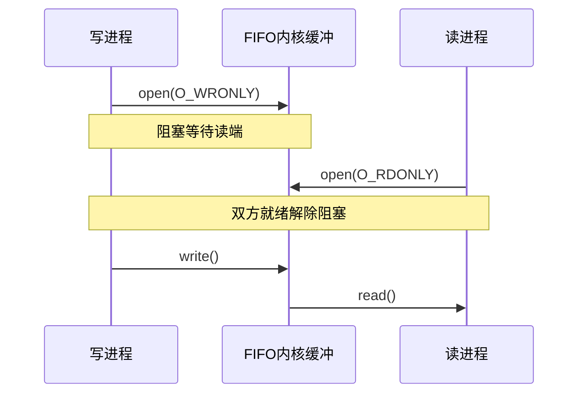

# 有名管道FIFO的创建与无亲缘关系进程通信

## 什么是有名管道 FIFO

如果两个进程没有父子或兄弟关系，还能用匿名管道通信吗？答案是否定的。匿名管道依赖文件描述符继承，而无亲缘进程无法共享这一资源。此时需要一种==与文件系统路径绑定==的通信机制，即有名管道（FIFO）。它本质上是一个存在于磁盘目录中的特殊文件，但==数据仅在内存中流动，不占用实际存储空间==，为任意进程提供了基于路径名的通信 rendezvous 点。

## 创建方式与文件特征

FIFO 可通过命令 `mkfifo` 或系统调用 `mkfifo()` 创建。在 `ls -al` 输出中，其最显著特征是文件类型位为 `p`：

```text
prw-rw-r-- 1 ubuntu ubuntu 0 12月 4 19:39 stone
```

> [!IMPORTANT]
> ==首字符 `p` 是识别 FIFO 的唯一标志==。后续权限位决定哪些用户可读写该管道，大小字段恒为 0，因为 FIFO 不持久化存储数据。

## 阻塞特性与数据流模型

向 FIFO 写入或读取时，若对端未就绪，操作将默认阻塞。这是考试与编程中最易踩坑的行为：



> [!WARNING]
> 只写打开（`O_WRONLY`）时若无读端，`open()` 本身就会阻塞；反之只读打开无写端也会阻塞。避免死锁的关键是==确保读写两端按序打开或使用 `O_NONBLOCK`==。

## 与匿名管道的核心区别

| 对比维度 | 匿名管道 pipe | 有名管道 FIFO |
| :--- | :--- | :--- |
| 亲缘要求 | 必须有血缘关系 | 任意进程 |
| 标识方式 | 文件描述符 | 文件系统路径名 |
| 生命周期 | 随进程结束销毁 | 需手动 unlink 删除 |
| 可见性 | 仅进程族内可见 | 受文件权限控制 |

## 真题场景解析

针对课件程序题，执行 `mkfifo -m 644 mypipe` 后依次重定向写入：

```bash
$ ls -a > mypipe      # 写入 . .. mypipe（阻塞直到有读者）
$ echo * >> mypipe    # 追加写入 mypipe（*展开为非隐藏文件）
```

> [!TIP]
> FIFO 是==字节流通道而非消息队列==。两次写入的数据在内核缓冲区中无缝拼接。若有读端执行 `cat mypipe`，预期输出为四行：`.`、`..`、`mypipe`、`mypipe`。注意 `echo *` 在当前目录仅有 `mypipe` 时等价于 `echo mypipe`，不会递归展开子目录内容。

> [!CAUTION]
> 切勿认为 FIFO 文件“内容为空”就是错误。`ls -l` 显示大小为 0 是正常现象，==数据只在传输瞬间存在于内核管道缓冲区中==，从未落盘到该文件节点。
