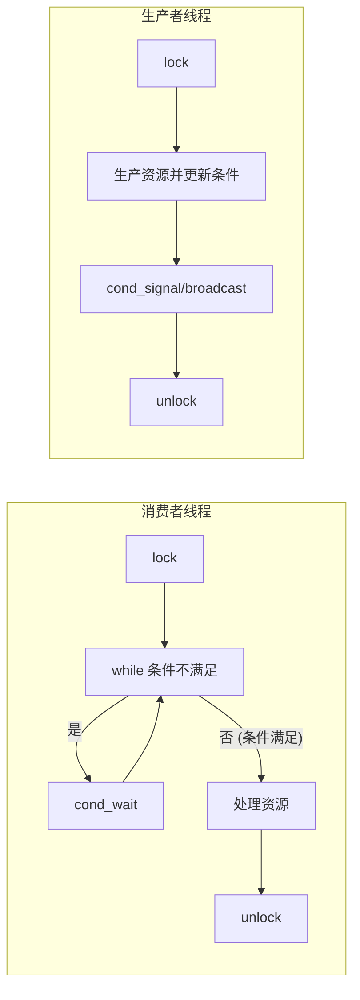

# 条件变量pthread_cond_t的等待wait与通知signal/broadcast

好的，我们直接来看条件变量的使用。

在多线程编程中，单纯使用互斥锁（`pthread_mutex_t`）只能解决“临界资源”安全访问的问题，却无法优雅地处理线程间的**同步**与**等待**。比如，一个线程需要等待某个“条件”成立（如队列非空）才能继续执行。如果用轮询，会白白消耗 CPU；如果用 `sleep`，又无法及时响应。

`pthread_cond_t` 就是为了解决这个问题。它允许线程在条件不满足时**原子性地**释放锁并进入等待（阻塞），直到另一个线程改变了条件并发信号将其唤醒。唤醒后，线程会**重新获取锁**，然后再次检查条件。因此，条件变量==必须与互斥锁`pthread_mutex_t`搭配使用==。

> [!IMPORTANT]
> 被唤醒后必须重新检查条件，因为存在“虚假唤醒”的可能（线程可能因操作系统信号等意外被唤醒，此时条件并未真正满足）。这决定了我们**总是要在 `while` 循环中等待条件**，而非 `if`。

## 核心操作

核心操作就三个，我们结合生产者-消费者模型来理解。



- **等待 `pthread_cond_wait`**：
  1. 必须先持有锁 `m`。
  2. 函数将当前线程放入条件变量的等待队列并==原子性地释放锁 `m`==，让出 CPU。
  3. 当被信号唤醒时，在线程返回前，会==自动尝试重新获取锁 `m`==。
  4. 获取锁成功后，函数返回。

- **通知 `pthread_cond_signal`**：唤醒**一个**在此条件变量上等待的线程。若没有等待线程，则什么也不发生，信号不会被保留。
- **广播 `pthread_cond_broadcast`**：唤醒**所有**在此条件变量上等待的线程。这通常用于一次状态改变能使一组等待线程都受益的场景，比如“结束程序”的信号。

## 常见误区与辨析

> [!WARNING]
> 丢失信号问题：如果在 `cond_wait` 之前就已经 `signal` 了，而条件变量不保留信号，等待的线程将永远看不到这次通知。
> 正确做法：信号的发送与接收，必须依赖于某个**能被双方互斥访问检查的共享状态**（即“条件”），而非仅靠信号本身传递信息。

`pthread_cond_signal` 和 `pthread_cond_broadcast` 的区别好比：
`signal` 是指定一个线程可以干活了，适用于只有一个工作单元可用的场景。
`broadcast` 是告诉所有阻塞的线程“世界变了，你们都醒来看一眼”，常见于全局状态切换或读写锁中。

## 实例演示：所有进程就绪后统一启动

这是一个经典场景，模拟主线程等待所有子线程完成初始化，然后一声令下，一起开始工作。

- **共享变量**：
  - `ready_cnt`：标记已准备好的线程数。
  - `start_flag`：是否为“开始”状态。
- **设计**：子线程初始化后，增加 `ready_cnt`，若达到总数，则设置 `start_flag` 并广播唤醒所有线程。被唤醒的线程看到 `start_flag` 为真才跳出等待循环。

```c
#include <pthread.h>
#include <stdio.h>
#include <unistd.h>

#define THREAD_NUM 5
pthread_mutex_t m = PTHREAD_MUTEX_INITIALIZER;
pthread_cond_t  c = PTHREAD_COND_INITIALIZER;
int ready_cnt = 0;
int start_flag = 0;  // 真正的“条件”

void* worker(void* arg) {
    int id = *(int*)arg;
    // 模拟各线程初始化时间不同
    sleep(id);
    printf("线程 %d 已就绪\n", id);

    pthread_mutex_lock(&m);
    ready_cnt++;
    // 如果自己是最后一个就绪的，设置启动标志并广播全员
    if (ready_cnt == THREAD_NUM) {
        start_flag = 1;                     // 满足条件
        pthread_cond_broadcast(&c);         // 唤醒所有人
    } else {
        // 不是最后一个，必须等待启动信号
        while (start_flag == 0) {           // 关键：while循环检查
            pthread_cond_wait(&c, &m);      // 原子释放锁 & 等待
        }
    }
    pthread_mutex_unlock(&m);

    printf("线程 %d 开始执行任务！\n", id);
    return NULL;
}

int main() {
    pthread_t tids[THREAD_NUM];
    int ids[THREAD_NUM];
    for (int i = 0; i < THREAD_NUM; i++) {
        ids[i] = i + 1;
        pthread_create(&tids[i], NULL, worker, &ids[i]);
    }
    for (int i = 0; i < THREAD_NUM; i++)
        pthread_join(tids[i], NULL);
    return 0;
}
```

**执行结果示例**：
线程 1 已就绪
线程 2 已就绪
线程 3 已就绪
线程 4 已就绪
线程 5 已就绪
线程 5 开始执行任务！
线程 3 开始执行任务！
线程 1 开始执行任务！
线程 2 开始执行任务！
线程 4 开始执行任务！

`broadcast` 唤醒了第三到第五行中卡在 `cond_wait` 的线程，它们醒来后检查 `start_flag == 1` 成立，于是解除阻塞，交替输出开始信息。

> [!TIP]
> 口诀：`cond` 配合 `mutex` 用，`wait` 前一定 `lock`，内部循环 `while` 守，`signal` 点亮走一走。`broadcast` 一把叫醒所有，`mutex` 内外锁要管够。
