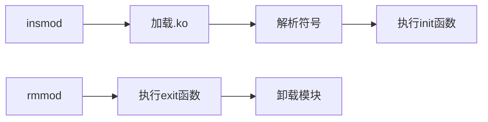

# 内核模块的编写、insmod加载与rmmod卸载

## 内核模块的本质与加载机制

如果每次修改驱动都要重新编译整个内核并重启，开发效率将极低。Linux 如何解决这个问题？答案就是==内核模块（Kernel Module）==。它是一段可以动态加载到内核地址空间、独立编译的代码，无需重编内核即可扩展系统功能。`insmod` 负责将 `.ko` 文件链接进内核符号表并执行初始化函数；`rmmod` 则反向操作，调用清理函数并释放内存。

> [!IMPORTANT]
> 模块不是独立进程，而是==运行在内核态的代码片段==，与内核共享同一地址空间，无独立栈和保护机制。

## 编写规范与生命周期

一个最小可加载模块必须包含哪两个入口？答案是 `module_init()` 和 `module_exit()` 宏指定的初始化与清理函数。它们分别在 `insmod` 和 `rmmod` 时被内核自动调用。



编写时需严格遵循以下结构：

-   包含 `<linux/module.h>` 等头文件
-   使用 `MODULE_LICENSE("GPL")` 声明许可证
-   初始化函数返回 `int`，成功返回 0，失败返回负错误码
-   清理函数返回类型为 `void`，==不可有返回值==

| 特性 | 用户态程序 | 内核模块 |
| :--- | :--- | :--- |
| 入口函数 | `main()` | `module_init()` 指定 |
| 退出方式 | `return` / `exit()` | `module_exit()` 指定 |
| 内存分配 | `malloc/free` | `kmalloc/kfree` |
| 打印信息 | `printf` | `printk` |
| 运行空间 | 用户空间 | 内核空间 |

## 常见陷阱与正确示例

为什么模块里不能用 `printf`？因为内核没有 libc 支持，必须用 `printk`。为什么 `rmmod` 后系统崩溃？往往是因为清理函数未释放已申请的资源或未注销设备号。

> [!WARNING]
> 初始化失败时==必须回滚已分配资源==，否则会导致内核内存泄漏或状态不一致。

下面是一个经过验证的最小模块示例：

```c
#include <linux/module.h>
#include <linux/init.h>

static int __init hello_init(void)
{
    printk(KERN_INFO "Hello, NJUPT!\n");
    return 0; /* 返回0表示加载成功 */
}

static void __exit hello_exit(void)
{
    printk(KERN_INFO "Goodbye, NJUPT!\n");
    /* void函数，无返回值 */
}

module_init(hello_init);
module_exit(hello_exit);
MODULE_LICENSE("GPL");
```

> [!TIP]
> 编译命令固定为 `make -C /lib/modules/$(uname -r)/build M=$(pwd) modules`，加载后用 `dmesg | tail` 查看 `printk` 输出，卸载前务必确认无进程正在使用该模块。

> [!CAUTION]
> 模块代码中的==空指针解引用或越界访问会直接导致内核 panic==，调试时优先检查指针有效性与边界条件，切勿假设用户传入参数合法。
