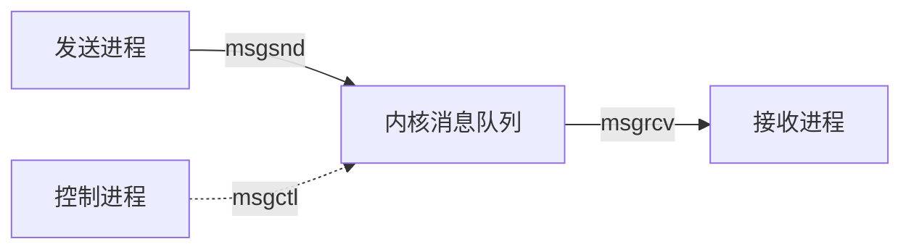

# 消息队列的创建msgget、发送msgsnd、接收msgrcv与控制msgctl

如果两个毫无亲缘关系的进程需要交换结构化数据，用匿名管道行不行？不行，因为管道要求进程有血缘关系。用信号呢？信号只能通知事件，带不了多少数据。System V IPC 给出的答案是：**消息队列**。

## 它是什么与为什么需要

消息队列是内核中维护的一个==按类型组织的链表==，每个节点是一条消息。相比无名管道，它允许无亲缘关系的进程通过 `key` 找到同一个队列；相比信号，它能携带任意长度的数据块并支持按类型选择性接收。



## 怎么做：四个核心函数

### 创建或获取 msgget

```c
int msgget(key_t key, int msgflg);
```

- `key`：通常用 `ftok(pathname, proj_id)` 生成，保证不同进程拿到同一把“钥匙”。
- `msgflg`：`IPC_CREAT` 表示不存在则创建，常与权限位或运算（如 `0666 | IPC_CREAT`）；加 `IPC_EXCL` 可确保独占创建。
- 成功返回 ==消息队列标识符 msqid==（非负整数），失败返回 $-1$。

### 发送 msgsnd

```c
int msgsnd(int msqid, const void *msgp, size_t msgsz, int msgflg);
```

`msgp` 指向用户自定义结构体，**首成员必须是 `long mtype`**（正值），后面紧跟数据：

```c
struct mymsg {
    long mtype;       /* 消息类型，必须 > 0 */
    char mtext[256];  /* 消息正文 */
};
```

- `msgsz` 是 `mtext` 的字节数，==不含 `mtype` 的大小==。
- `msgflg` 设为 $0$ 时，若队列满则阻塞；设 `IPC_NOWAIT` 则立即返回 $-1$。

### 接收 msgrcv

```c
ssize_t msgrcv(int msqid, void *msgp, size_t msgsz, long msgtyp, int msgflg);
```

`msgtyp` 决定了取哪条消息，这是消息队列最灵活的地方：

| `msgtyp` 取值 | 行为 |
| :---: | :--- |
| $= 0$ | 取队列中第一条消息（FIFO） |
| $> 0$ | 取第一条类型等于 `msgtyp` 的消息 |
| $< 0$ | 取类型值 $\le \lvert msgtyp \rvert$ 的最小类型消息 |

成功返回实际读到的 `mtext` 字节数。

### 控制 msgctl

```c
int msgctl(int msqid, int cmd, struct msqid_ds *buf);
```

常用 `cmd`：`IPC_STAT`（读取属性）、`IPC_SET`（修改属性）、==`IPC_RMID`（删除队列）==。删除时 `buf` 传 `NULL` 即可。

> [!IMPORTANT]
> 消息队列不会随进程终止而自动销毁！若忘记调用 `msgctl(..., IPC_RMID, NULL)`，队列将残留于内核，直到系统重启或手动清理。

## 与相近概念的区别

| 特性 | System V 消息队列 | 无名管道 | POSIX 消息队列 |
| :--- | :--- | :--- | :--- |
| 亲缘要求 | 无需，靠 `key` | 必须有 | 无需，靠名字 |
| 数据边界 | 有（按条） | 无（字节流） | 有（按条） |
| 优先级/类型 | 支持 `mtype` | 不支持 | 支持优先级 |
| 生命周期 | 随内核 | 随进程 | 随内核 |

## 常见的坑

> [!WARNING]
> `msgsz` 只算数据部分！若写成 `sizeof(struct mymsg)` 会把 `mtype` 的 8 字节也算进去，导致发送失败或越界。正确写法是 `sizeof(msg.mtext)` 或直接写字节数。

> [!CAUTION]
> `mtype` 必须严格大于 $0$，否则 `msgsnd` 直接报错 `EINVAL`。

## 一个算对了的例子

假设发送端构造如下消息并发送：

```c
struct mymsg msg = {3, "NJUPT"}; // mtype=3, 数据5字节+'\0'共6字节
msgsnd(msqid, &msg, 6, 0);        // msgsz = 6，不含 mtype
```

接收端想专门接收类型为 $3$ 的消息：

```c
struct mymsg rmsg;
ssize_t n = msgrcv(msqid, &rmsg, sizeof(rmsg.mtext), 3, 0);
// n 的返回值 = 6
// rmsg.mtype = 3, rmsg.mtext = "NJUPT"
```

> [!TIP]
> 记忆口诀：**get 拿句柄，snd 塞数据，rcv 挑类型，ctl 做善后**。考试写代码时先检查 `mtype > 0` 和 `msgsz` 是否排除了头部大小。
