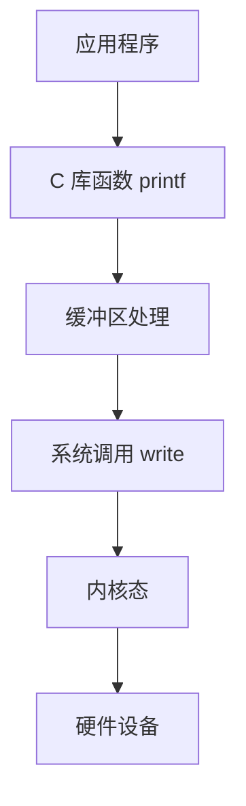

# 系统调用与C库函数的区别与联系

## 从一道题说起

先看一个最常见的困惑：C 语言里写 `printf("hello\n")` 能输出到屏幕，Linux shell 里敲 `echo hello` 也能输出到屏幕。它们是一回事吗？

答案藏在“谁在干活”这个问题里。`printf` 最终会调用 Linux 内核里的 `write()` 系统调用；而 `echo` 是 shell 的一个内置命令，shell 自己完成输出，不直接碰内核的 `write()`。这就引出了本节的核心概念。

## 系统调用与 C 库函数各是什么

**系统调用（System Call）** 是操作系统内核对外提供的编程接口，是用户态程序请求内核服务的唯一合法入口。比如 `open()`、`read()`、`write()`、`close()`、`fork()`。当你调用 `write(1, "hello", 5)` 时，程序从用户态陷入内核态，由内核真正操作硬件完成输出。

**C 库函数（C Library Function）** 是 C 标准库（glibc）提供的函数，比如 `printf()`、`fopen()`、`fread()`、`fclose()`。它们运行在用户态，内部根据需要调用系统调用。



> [!IMPORTANT]
> ==C 库函数是封装层，系统调用是底层入口。== 库函数可以一个都不调用系统调用（如 `strlen`），也可以调用多个（如 `printf` 内部可能多次 `write`）。

## 为什么需要库函数

如果每次输出都要自己拼 `write()` 的参数，处理格式化、缓冲、错误恢复，代码会非常繁琐。库函数提供了：

- **格式化**：`%d`、`%s` 自动转换
- **缓冲**：减少系统调用次数，提升性能
- **可移植性**：屏蔽不同操作系统系统调用的差异

> [!TIP]
> 记忆口诀：**“库函数管格式，系统调用管内核。”** 前者让你写得爽，后者让你真干活。

## 关键区别对比

| 维度 | 系统调用 | C 库函数 |
|------|---------|---------|
| 运行态 | 内核态 | 用户态 |
| 调用开销 | 大（陷入内核） | 小（普通函数调用） |
| 是否必须 | 必须经过才能操作硬件 | 不一定，也可绕过 |
| 典型例子 | `open` `read` `write` | `fopen` `fread` `fprintf` |
| 是否带缓冲 | 无缓冲 | 有缓冲（`FILE*` 流） |
| 是否标准 | 操作系统相关 | C 标准定义 |

## 常见的坑：缓冲导致的“丢失”

看一个例子：

```c
printf("hello");
_exit(0);   // 直接退出，不刷新缓冲区
```

运行后**什么也不会输出**。`printf` 把内容放进了用户态缓冲区，还没来得及调用 `write()` 进程就结束了。改成 `exit(0)` 或 `printf("hello\n")` 就能正常输出（`\n` 触发行缓冲刷新）。

> [!WARNING]
> 使用 `_exit()` 直接退出进程时，C 库函数的缓冲区不会被刷新，==缓冲内容会丢失==。系统调用 `write()` 则没有这个问题，数据直接到达内核。

## 算一个对的例子

用 `write` 和 `printf` 分别写入文件 `out.txt`：

```c
#include <stdio.h>
#include <unistd.h>
#include <fcntl.h>

int main() {
    // 方式一：系统调用
    int fd = open("out.txt", O_WRONLY | O_CREAT | O_TRUNC, 0644);
    write(fd, "syscall\n", 8);
    close(fd);

    // 方式二：库函数
    FILE *fp = fopen("out.txt", "a");
    fprintf(fp, "library\n");
    fclose(fp);   // fclose 会刷新缓冲区并调用 close
    return 0;
}
```

编译运行：

```bash
gcc -o demo demo.c
./demo
cat out.txt
```

输出：

```text
syscall
library
```

两行都写入了文件。`write` 直接生效；`fprintf` 的内容在 `fclose` 时被刷新到内核，再由内核写入文件——这就是“库函数封装系统调用”的完整链路。

## 小结

系统调用是内核的“门”，C 库函数是你进门前的“前台”。前台帮你整理资料（格式化、缓冲），但最终必须敲门（系统调用）才能办事。理解这条链路，写文件 I/O 时你就能判断：什么时候该用 `open`/`write` 追求精确控制，什么时候该用 `fopen`/`fprintf` 追求方便。
