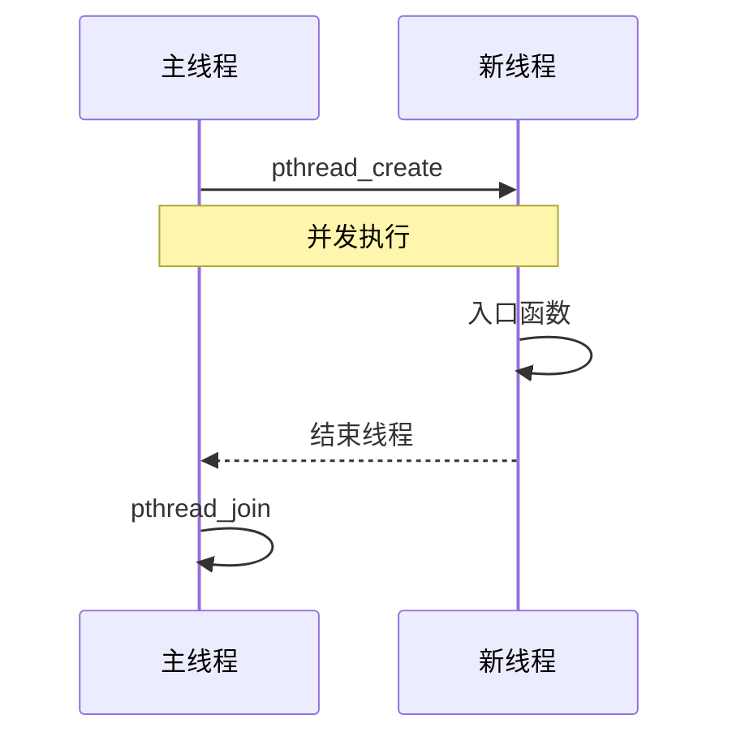

# pthread_create()创建线程与pthread_exit()终止线程

## 为什么要创建线程

进程切换开销较大，而同一进程内的线程共享地址空间、全局变量和打开的文件，适合并行处理相互关联的任务。例如，主线程继续接收请求，新线程负责计算或读写文件。

线程由 `pthread_create()` 创建；线程执行完毕后，应通过 `return` 或 `pthread_exit()` 结束，并正确回收其资源。

## pthread_create()：创建线程

函数原型为：

```c
#include <pthread.h>

int pthread_create(pthread_t *thread,
                   const pthread_attr_t *attr,
                   void *(*start_routine)(void *),
                   void *arg);
```

四个参数分别表示：

| 参数 | 作用 | 常见用法 |
|---|---|---|
| `thread` | 保存新线程的线程 ID | 传入 `pthread_t` 变量的地址 |
| `attr` | 设置线程属性 | 通常传 `NULL`，使用默认属性 |
| `start_routine` | 新线程的入口函数 | 函数类型为 `void *f(void *)` |
| `arg` | 传给入口函数的参数 | 无参数时传 `NULL` |

==返回值是错误码：成功返回 `0`，失败返回非 `0`，不能按返回 `-1` 判断。==

创建后，主线程和新线程==并发执行==，不能默认主线程一定先运行，也不能默认新线程一定先运行。



## pthread_exit()：终止当前线程

函数原型为：

```c
#include <pthread.h>

void pthread_exit(void *retval);
```

它只终止==调用它的当前线程==，`retval` 是线程的退出状态，可由 `pthread_join()` 获取：

```c
void *result;
pthread_join(tid, &result);
```

线程入口函数执行 `return value;`，效果相当于以 `value` 为退出状态调用 `pthread_exit()`。若主线程调用 `pthread_exit(NULL)`，主线程结束，但进程通常不会立即结束，其余线程仍可继续运行。

| 操作 | 作用范围 | 主要含义 |
|---|---|---|
| `return` | 当前线程入口函数 | 结束线程并给出返回值 |
| `pthread_exit()` | 当前线程 | 主动结束线程 |
| `exit()` | 整个进程 | 终止进程及其全部线程 |
| `pthread_join()` | 不终止线程 | 等待目标线程结束并回收资源 |

> [!IMPORTANT]
> `pthread_create()` 负责“创建”，`pthread_exit()` 负责“结束当前线程”，`pthread_join()` 负责“等待并回收”。三者不要混淆。

## 一个正确的例子

下面的程序向新线程传入整数，线程计算其平方后退出，主线程等待并取得结果：

```c
#include <pthread.h>
#include <stdio.h>
#include <stdlib.h>

void *worker(void *arg)
{
    int n = *(int *)arg;
    int *result = malloc(sizeof(int));

    if (result == NULL)
        pthread_exit(NULL);

    *result = n * n;
    pthread_exit(result);
}

int main(void)
{
    pthread_t tid;
    int n = 6;
    void *ret;

    if (pthread_create(&tid, NULL, worker, &n) != 0) {
        fprintf(stderr, "create thread failed\n");
        return 1;
    }

    if (pthread_join(tid, &ret) != 0)
        return 1;

    if (ret != NULL) {
        printf("%d\n", *(int *)ret);  /* 输出 36 */
        free(ret);
    }
    return 0;
}
```

这里 `n` 一直有效，因为主线程在 `pthread_join()` 返回前不会退出；结果使用动态内存，因此新线程退出后主线程仍能读取。

## 常见的坑

> [!WARNING]
> 不要返回线程局部变量的地址，例如 `int x; return &x;`。线程退出后该栈空间失效，主线程再访问属于未定义行为。

- **参数生命周期错误**：循环创建线程时都传 `&i`，多个线程可能读到变化后的同一个 `i`。可为每个线程准备独立参数，或确保主线程不会提前修改、释放它。
- **忘记检查返回值**：创建失败后仍调用 `pthread_join()`，会使用无效的线程 ID。
- **忘记回收**：可连接线程结束后，通常应调用 `pthread_join()`；不关心返回值时，第二个参数可传 `NULL`，也可使用分离线程。
- **误用 `exit()`**：在线程函数中调用 `exit()` 会直接结束整个进程，而不是只结束当前线程。
- **编译遗漏线程选项**：Linux 下通常使用 `gcc demo.c -o demo -pthread` 编译链接。
