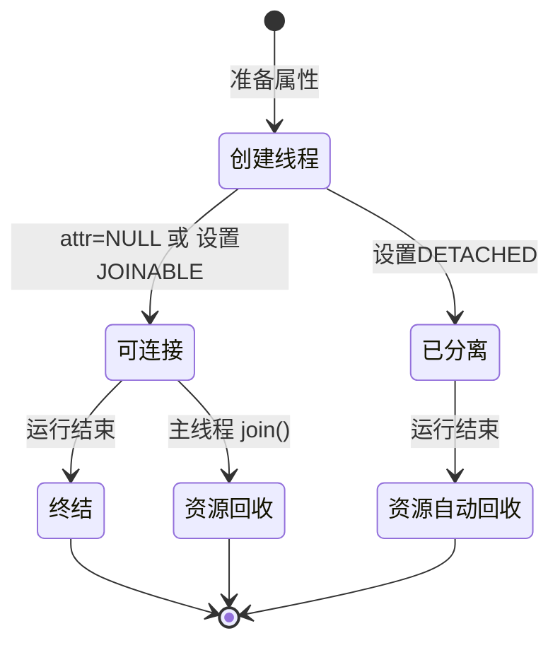

# 线程属性设置与分离状态（detachstate）

## 线程属性设置与分离状态

在默认情况下，创建的线程在结束时并不会自动释放其占用的资源。这导致了一个问题：谁应该负责回收这个退出的线程？在 Linux 的多线程编程中，这涉及到一个核心概念——==线程的分离状态==。

### 为什么需要“分离”？
假设我们创建了一个线程去处理后台日志写入，主线程并不关心它何时结束，也不需要它的返回值。如果我们不对该线程进行特殊处理，当它运行结束时，它的状态信息、线程堆栈等资源会一直保留在内存中。这就像进程里的“僵尸进程”，虽然不运行了，但仍占着系统资源表。

直到其他线程调用 `pthread_join()` 来“连接”它并获取退出状态，或者整个进程结束，这些资源才会被系统回收。

但很多时候，我们并不想费心去“连接”一个线程。此时，我们就需要将这个线程设置为==分离状态（detached）==。

### 两种状态：可连接 vs 已分离

一个线程在生存期内可以处于以下两种状态之一：

| 状态 | 标识宏 | 特点 | 资源回收方式 |
| :--- | :--- | :--- | :--- |
| ==可连接（Joinable）== | `PTHREAD_CREATE_JOINABLE` | **默认状态**。线程退出后保留状态，等待被 `pthread_join()` 回收。 | 由其他线程显式调用 `pthread_join()` 回收。 |
| ==已分离（Detached）== | `PTHREAD_CREATE_DETACHED` | 线程结束后，其所有资源由系统**自动回收**。 | 自动回收，**不能被 `pthread_join()` 连接**。 |

### 如何设置分离状态
设置线程分离有**两种时机**，对应两种方法：

#### 方法一：创建时直接设置属性
在线程创建前，通过线程属性对象（`pthread_attr_t`）设定，这是最清晰的用法。

```c
pthread_t tid;
pthread_attr_t attr;

// 1. 初始化属性对象
pthread_attr_init(&attr);

// 2. 设置分离状态为 DETACHED
pthread_attr_setdetachstate(&attr, PTHREAD_CREATE_DETACHED);

// 3. 创建线程
pthread_create(&tid, &attr, thread_func, NULL);

// 4. 销毁属性对象（释放其占用的资源）
pthread_attr_destroy(&attr);
```

#### 方法二：在线程运行中“自我分离”
如果一个线程已经在运行，可以在其执行函数内部调用 `pthread_detach()` 动态分离自身。

```c
void *thread_func(void *arg) {
    // 将当前线程标记为分离状态
    pthread_detach(pthread_self());
    // ... 执行任务 ...
    return NULL;
}
```

### 常见的“坑”与辨析
[!WARNING]
> **对已分离线程调用 `pthread_join` 未定义**
> 试图对一个处于 `DETACHED` 状态的线程调用 `pthread_join()` 是编程大忌。操作可能会返回错误（如 `EINVAL`），但行为并不总是可靠，可能导致程序崩溃。

[!CAUTION]
> **默认状态陷阱**
> 很多开发者忘记 `pthread_create` 创建的线程**默认是可连接的**。如果不 `join` 也不 `detach`，会导致线程退出后资源泄漏。

[!TIP]
> **属性对象必须初始化**
> `pthread_attr_t` 在使用前必须调用 `pthread_attr_init` 初始化，使用后必须用 `pthread_attr_destroy` 销毁，否则会造成内存泄漏或未定义行为。

下面用一张状态图来概括线程的整个分离策略：


### 算对了一个例子
假设我们需要一个线程专门处理文件压缩，处理完成后主线程不需要任何返回值，也不等待它。请写出正确的创建代码。

**分析**：
1.  ⁠既然是“不等待、不要返回值”，必须设为**分离态**。
2.  创建时需要用到属性对象。
3.  公共的“坑”：属性参数不需要时，要记得销毁。

**代码清单**：
```c
#include <pthread.h>
#include <stdio.h>
#include <unistd.h>

void *compress_task(void *arg) {
    printf("压缩任务开始...\n");
    // 模拟耗时操作
    sleep(2);
    printf("压缩完毕，线程自动释放。\n");
    return NULL;
}

int main() {
    pthread_t tid;
    pthread_attr_t attr;

    /* 1. 必须初始化 */
    pthread_attr_init(&attr);

    /* 2. 核心考点：设为 DETACHED */
    if (pthread_attr_setdetachstate(&attr, PTHREAD_CREATE_DETACHED) != 0) {
        perror("设置分离状态失败");
        return 1;
    }

    /* 3. 创建分离线程 */
    if (pthread_create(&tid, &attr, compress_task, NULL) != 0) {
        perror("线程创建失败");
    }

    /* 4. 必须销毁属性 (不销毁会造成内存泄漏) */
    pthread_attr_destroy(&attr);

    // 主线程继续做其他事，不需要 join。
    // 如果这里写 pthread_join(tid, NULL) 就错了！
    
    // 给主线程时间，以便观察子线程运行结果
    sleep(3); 
    printf("主线程退出。\n");
    return 0;
}
