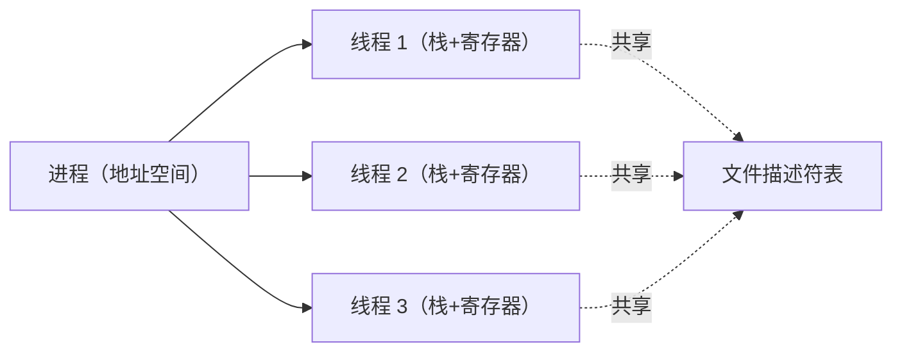
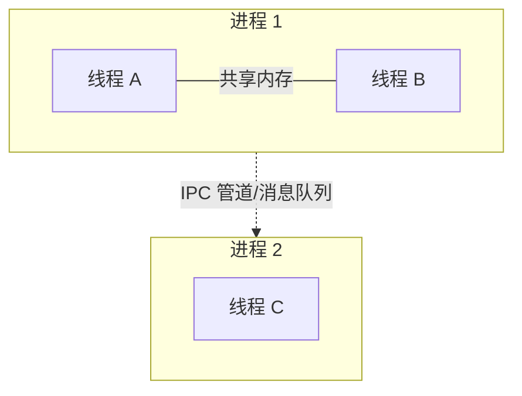

# 线程的概念及与进程的区别

## 线程是什么

在 Linux 中，进程是资源分配的基本单位，而线程是 CPU 调度的基本单位。一个进程可以包含多个线程，这些线程共享进程的地址空间、文件描述符表、信号处理器等资源，但各自拥有独立的栈、寄存器、程序计数器和线程局部存储。

> [!IMPORTANT]
> ==线程没有独立的地址空间==，它寄生在进程内部。因此 Linux 中线程也常被称为“轻量级进程”（LWP）。

## 为什么需要线程

考虑一个网络服务器：它需要同时处理多个客户端的连接。如果只用进程，每次 `fork()` 都要复制整个地址空间，开销大、通信麻烦（需要 IPC）。而用线程：

- 创建和切换开销远小于进程（不需要切换页表、刷新 TLB）；
- 共享地址空间使得数据交换只需读写公共变量；
- 能充分利用多核 CPU 的并行能力。

## 线程与进程的区别

| 维度 | 进程 | 线程 |
|---|---|---|
| 资源拥有 | 独立的地址空间、文件表、信号处理 | 共享所属进程的资源 |
| 调度单位 | 是 | 是（实际调度的实体） |
| 创建/切换开销 | 大 | 小 |
| 通信方式 | 管道、消息队列、共享内存等 IPC | 直接读写共享变量 |
| 崩溃影响 | 互不影响 | 一个线程崩可能拖垮整个进程 |
| 独立性 | 强隔离 | 弱隔离 |

## 常见的坑

> [!CAUTION]
> **多线程共享数据不是免费的午餐。** 两个线程同时执行 `i++` 可能互相覆盖结果，因为 `i++` 在汇编层面是“读—改—写”三步，不是原子操作。必须用互斥锁、条件变量等同步机制保护临界区。

> [!WARNING]
> `fork()` 在多线程程序里要小心：子进程只会继承调用 `fork()` 的那一个线程，其他线程会“消失”。如果其他线程当时持有锁，子进程中这把锁将永远无法释放，造成死锁。

> [!NOTE]
> Linux 下创建线程用 `pthread_create()`，编译时需加 `-lpthread`。线程函数必须返回 `void*` 并接收一个 `void*` 参数——这跟普通 C 函数签名不同，是新手最常犯的编译错误。

## 一个算对了的例子

假设某多线程程序的执行时间由以下部分组成：

- 串行部分占 40%，并行部分占 60%；
- 运行在 4 核 CPU 上。

根据 **Amdahl 定律**，加速比：

$$
S = \frac{1}{(1-P) + \frac{P}{N}} = \frac{1}{0.4 + \frac{0.6}{4}} = \frac{1}{0.55} \approx 1.82
$$

这意味着即使有 4 个核，整体也只能加速约 1.82 倍。如果串行部分占 90%，则加速比仅为 $\frac{1}{0.9 + 0.1/4} \approx 1.08$，几乎无提升。

> [!TIP]
> 记忆口诀：**“共享数据，独立运行；同步靠锁，加速有限。”** 判断一个多线程程序值不值得优化，先算 Amdahl 加速比，串行占比高就别指望线程数堆上去有用。
