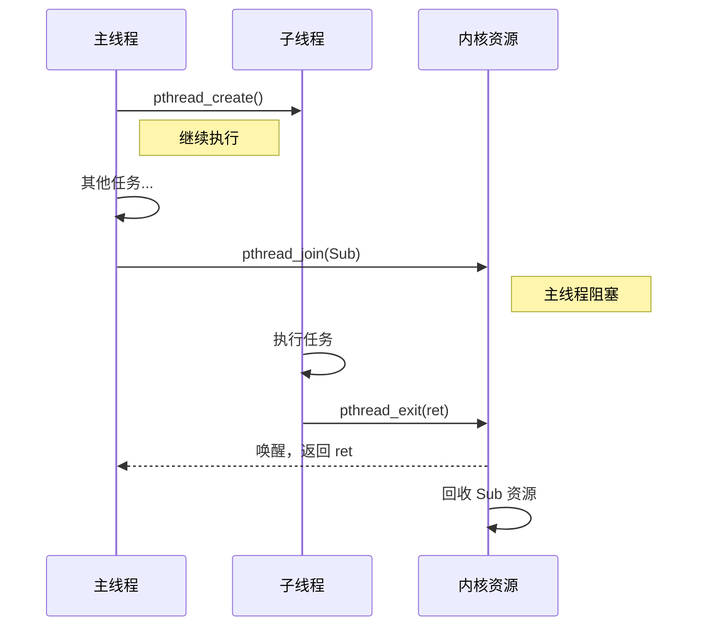

# pthread_join()阻塞等待线程结束并回收资源

# pthread_join() 阻塞等待线程结束并回收资源

## 它是什么与为什么需要

在 Linux 多线程编程中，`pthread_join()` 是一个**同步原语**。它的核心作用有两个：
1. **阻塞等待**：调用线程会挂起，直到目标线程终止。
2. **资源回收**：获取目标线程的退出状态，并释放其占用的系统资源（如栈空间、线程描述符）。

> [!IMPORTANT]
> ==核心结论==：若不调用 `pthread_join()` 或 `pthread_detach()`，终止的线程会变成“僵尸线程”，导致内存泄漏。

试想一下：如果主线程创建子线程后立即退出，子线程会发生什么？通常整个进程会终止，子线程被迫中断。若需确保子线程完整执行完毕并拿到结果，必须使用 `pthread_join()`。

## 函数原型与用法

```c
int pthread_join(pthread_t thread, void **retval);
```

- `thread`：要等待的目标线程 ID。
- `retval`：二级指针，用于接收目标线程通过 `pthread_exit()` 返回的值。若不需要返回值，可传 `NULL`。



## 常见误区与辨析

很多初学者容易混淆 `join` 与 `detach`，或者忽略返回值处理。

| 特性 | pthread_join() | pthread_detach() |
| :--- | :--- | :--- |
| **行为** | 阻塞等待线程结束 | 立即返回，线程后台运行 |
| **资源回收** | join 返回时自动回收 | 线程结束时自动回收 |
| **获取返回值** | 支持 (`retval`) | 不支持 |
| **适用场景** | 需同步或取结果 | 守护线程/无需交互 |

> [!WARNING]
> ==高危误区==：
> 1. **重复 Join**：对同一线程调用两次 `pthread_join()` 会导致未定义行为（通常报错 `EINVAL`）。
> 2. **Join 自身**：线程不能 join 自己，否则死锁。
> 3. **返回局部变量地址**：子线程返回指向栈上局部变量的指针，主线程读取时数据已失效。应使用 `malloc` 或全局变量。

## 典型例题解析

**题目**：下列代码片段中，主线程如何正确获取子线程计算的整数结果？

```c
void *thread_func(void *arg) {
    int *res = malloc(sizeof(int));
    *res = 42;
    pthread_exit((void *)res); // 注意：强制转换为 void*
}

int main() {
    pthread_t tid;
    void *ret;
    pthread_create(&tid, NULL, thread_func, NULL);
    
    // 填空处
    pthread_join(tid, &ret);
    
    printf("Result: %d\n", *(int *)ret);
    free(ret); // 记得释放堆内存
    return 0;
}
```

> [!TIP]
> 记忆口诀：**Join 必回收，Detach 不等待；返回用堆区，局部不可赖。**

在此例中，`pthread_join` 阻塞主线程直到子线程结束，并将 `res` 指针通过 `ret` 传回。关键在于子线程不能使用 `return &local_var`，因为栈帧在函数结束后即销毁，必须使用动态分配内存或全局存储。
