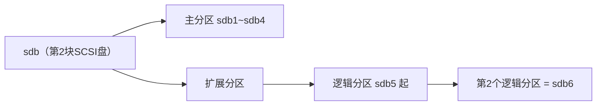

# 字符设备、块设备与网络设备文件的分类与主次设备号

## 设备文件：字符、块与网络设备

先想一个问题：你在终端里执行 `echo "hello" > /dev/null`，shell 把字符串写进了一个“文件”，但这个文件并不对应磁盘上的任何数据块。Linux 是如何做到这一点的？答案就是**设备文件**——它不是普通文件，而是内核中某个设备驱动的“入口”。

在 Linux 中，几乎所有硬件设备都被抽象成文件，存放在 `/dev` 目录下。用户程序通过标准的 `open() / read() / write() / close()` 系统调用操作设备文件，内核再根据设备文件的类型和编号，把请求路由到对应的驱动程序。

> [!IMPORTANT]
> Linux 设备文件按数据访问方式分为三类：==字符设备==（按字节流顺序读写，如键盘、串口）、==块设备==（按固定大小的块随机读写，如磁盘、U 盘）、==网络设备==（不映射为 `/dev` 下的文件，而是通过套接字接口访问，如 `eth0`）。

---

## 为什么需要分类和编号

设备文件本身不存储数据，它只记录**元信息**：设备类型、主设备号、次设备号。内核靠这两个编号找到驱动：

- **主设备号（major）**：标识设备对应的驱动程序。例如主设备号 `8` 通常对应 SCSI/SATA 磁盘驱动。
- **次设备号（minor）**：标识该驱动管理的具体设备实例。例如 `8:0` 表示第一块 SCSI 磁盘整体，`8:1` 表示它的第一个分区。

用 `ls -l /dev/sda*` 可以看到设备文件的类型字符（`c` 为字符设备，`b` 为块设备）以及逗号分隔的主次设备号：

```text
brw-rw---- 1 root disk 8, 0  Jan  1 00:00 /dev/sda
brw-rw---- 1 root disk 8, 1  Jan  1 00:00 /dev/sda1
```

这里的 `b` 说明是块设备，`8, 0` 就是“主设备号 8，次设备号 0”。

字符设备同理，例如终端设备：

```text
crw--w---- 1 root tty 4, 0 Jan  1 00:00 /dev/tty0
```

`c` 表示字符设备，`4, 0` 是主次设备号。

---

## 三类设备的对比

| 特性 | 字符设备 | 块设备 | 网络设备 |
|------|---------|--------|---------|
| 访问方式 | 按字节流顺序读写 | 按块（如 512B/4KB）随机读写 | 按网络报文收发 |
| 是否有缓冲区 | 通常无 | 有页缓存，支持随机定位 | 由协议栈缓冲 |
| `/dev` 下是否有文件 | 有 | 有 | ==无==，用 `ip link` 查看 |
| 典型例子 | `/dev/tty0`、`/dev/null`、`/dev/lp0` | `/dev/sda`、`/dev/nvme0n1`、`/dev/loop0` | `eth0`、`wlan0`、`lo` |
| 系统调用 | `read/write` 逐字节 | `read/write` 按块，可 `lseek` | `socket/send/recv` |

> [!NOTE]
> 网络设备比较特殊：它**没有对应的设备文件**。用户不能直接 `open("/dev/eth0")`，而要通过套接字 API（`socket()`、`bind()` 等）与协议栈交互。字符设备和块设备则都有 `/dev` 下的节点，且能用 `ls -l` 看到类型字母 `c` 或 `b`。

---

## 磁盘设备命名与分区号

这是考试的高频点，规则并不复杂，但容易在“第几块盘”和“第几个分区”之间绕晕。

### 命名规则

- **IDE 硬盘（老式）**：`hda`（第一块）、`hdb`（第二块）、`hdc`、`hdd`。
- **SCSI/SATA/USB 硬盘（现代）**：`sda`（第一块）、`sdb`（第二块）、`sdc`……
- **NVMe SSD**：`nvme0n1`（第一个控制器第一个命名空间）、`nvme1n1`……

### 分区编号规则

- 前 4 个分区号（1～4）保留给**主分区或扩展分区**。
- **逻辑分区编号从 5 开始**，不管前面实际有几个主分区。

所以“第 2 个 SCSI 磁盘的第 2 个逻辑分区”：

1. 第二块 SCSI 盘 → `sdb`
2. 第 2 个逻辑分区 → 逻辑分区从 5 开始编号，第 1 个逻辑分区是 5，第 2 个是 ==6==
3. 组合起来：`sdb6`



> [!TIP]
> 记忆口诀：==逻辑分区从 5 起跳==。不管磁盘上有 0 个还是 3 个主分区，第一个逻辑分区永远是编号 5。

再验证一题：第 2 个 IDE 磁盘的第 2 个逻辑分区。第二块 IDE 盘是 `hdb`，第二个逻辑分区是 6，答案是 ==`hdb6`==。

---

## 常见的坑

> [!WARNING]
> 题目问“逻辑分区”时，==不要从 2 开始数==。分区编号 1～4 是主/扩展分区，逻辑分区固定从 5 起步。“第 2 个逻辑分区”就是 `5 + 1 = 6`。

> [!CAUTION]
> 区分“第 n 块盘”和“第 n 个分区”。`sdb2` 是**第二块 SCSI 盘的第 2 个主分区**，不是逻辑分区；`sdb6` 才是第二块盘的第 2 个逻辑分区。字符设备与块设备看 `ls -l` 的首字母，`c` 不是“character”的考试提示，而是真的能通过 `open` 读写；但网络设备连文件都没有，别去 `/dev` 里找 `eth0`。
