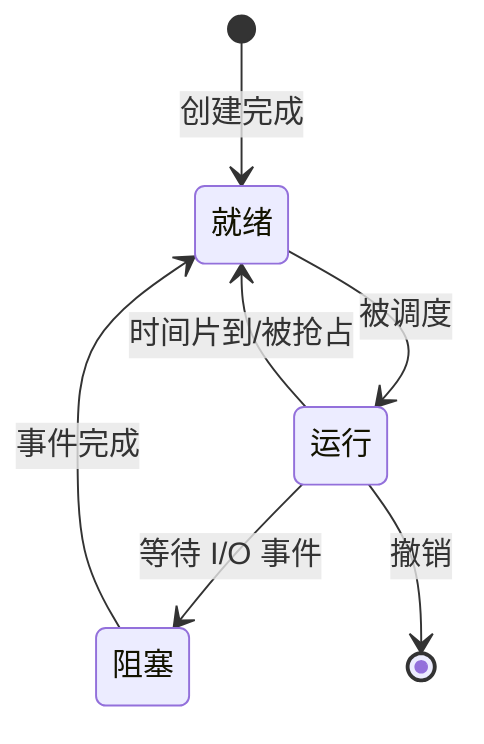

# 进程的概念、状态转换与PCB（进程控制块）

进程（process）是==程序的一次执行==，是 Linux 系统进行资源分配和调度的最小单位。程序是静态的可执行文件，进程是动态的执行过程：同一个程序 `ls`，每敲一次就产生一个新进程。

## 为什么需要进程

单道程序时代，一个程序跑完才能跑下一个，CPU 大量时间在等 I/O。引入多道程序后，系统要同时容纳多个程序的执行，必须回答两个问题：

- 谁来描述一个正在跑的程序？——**PCB（进程控制块）**
- 系统怎么知道谁该上 CPU？——**进程状态转换**

## PCB：进程的"身份证"

PCB 是操作系统为每个进程建立的数据结构，随进程创建而建立、随进程撤销而回收。它至少包含：

| 字段 | 含义 |
| --- | --- |
| PID | 进程标识符，唯一 |
| 状态 | 运行/就绪/阻塞等 |
| PC（程序计数器） | 下一条要执行的指令地址 |
| 寄存器值 | 上下文信息 |
| 内存指针 | 进程地址空间 |
| 资源清单 | 打开的文件、设备等 |

> [!IMPORTANT]
> ==进程 = 程序代码 + 数据 + PCB==。操作系统只认 PCB，谁拥有 PCB 谁就是进程；PCB 在进程就消失。

## 三态模型与状态转换

最经典的是三态：**就绪（Ready）、运行（Running）、阻塞（Blocked）**。

要点：

- ==就绪→运行==是**调度**（短程调度）触发的；==运行→就绪==是**CPU 不给它了**，但进程自身没毛病。
- ==运行→阻塞==只能由进程**自己**引起（主动等 I/O、等信号）；==阻塞→就绪==由**外部事件**引起。
- 没有"阻塞→运行"这条边：阻塞中的进程必须先回就绪队列排队。

> [!WARNING]
> 常见错答："进程从阻塞态直接转到运行态"——==不存在这条边==。也不存在"就绪→阻塞"。

## 与相近概念的区别

| 概念 | 说明 |
| --- | --- |
| 程序 | 静态，存放在外存上的指令序列 |
| 进程 | 动态，有生命周期，有 PCB |
| 线程 | 进程内的执行单位，共享进程资源，自己只有少量私有数据 |
| 作业 | 用户提交的任务，可能对应多个进程 |

> [!TIP]
> 记忆：**程序是剧本，进程是演出，PCB 是演员证**。剧本只有一份，演出可以多场。

## 相关命令与管道

`pstree` 用树状图显示各进程的**继承关系**（父子进程），`ps` 列出当前进程快照，`kill` 发信号，`fg` 把后台作业调回前台。

Shell 中，`|` 把==前一个命令的输出作为后一个命令的输入==，`>` 重定向到文件，`&` 放后台运行。

环境变量由父进程继承给子进程，作用范围==能延伸至所有子进程==，但子进程的修改不会传回父进程。

> [!NOTE]
> 会话（session）≠ 程序运行周期。会话开始于用户登录、结束于用户退出（登出），与某程序的运行无关——常考判断题。

## 例题

**判断**：会话开始于程序启动运行，结束于程序运行完毕。
**答案**：错（F）。会话以登录/登出为界，程序运行周期只是其中一段。
