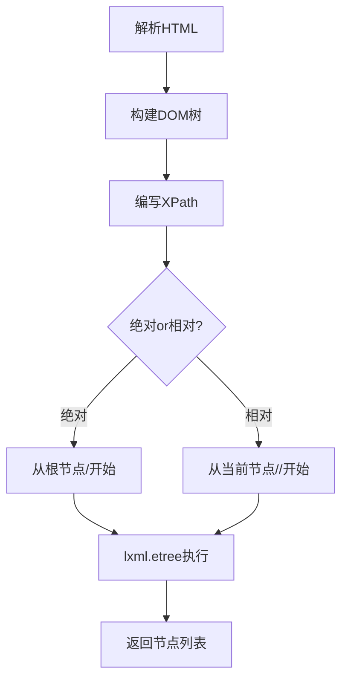

# 使用Xpath进行页面定位

## 什么是 XPath 定位

XPath（XML Path Language）是一种在 XML/HTML 文档中查找信息的==路径语言==。如果把 HTML 文档看作一棵树，XPath 就是在这棵树中精准导航的“地址系统”。相比正则表达式，它结构化更强；相比 CSS 选择器，它能通过文本内容、属性组合及层级关系进行更灵活的定位，是 Python 爬虫中提取复杂数据的核心工具。

> [!IMPORTANT]
> XPath 的本质是**基于树结构的路径查询**，而非字符串匹配。理解 DOM 树模型是掌握 XPath 的前提。

## 为什么需要 XPath

当目标数据没有唯一 id/class，或需根据文本内容反查父节点时，CSS 选择器往往无能为力。例如提取“包含‘南京邮电大学’文字的 `<a>` 标签的 href”，XPath 可一步到位：`//a[contains(text(),'南京邮电大学')]/@href`。这种==语义化定位能力==使其成为处理非规范网页的首选。

## 核心语法与使用流程



常用语法速记：

| 表达式        | 含义                     | 示例                      |
| ------------- | ------------------------ | ------------------------- |
| `/`           | 从根节点选取（绝对路径） | `/html/body/div`          |
| `//`          | 全文档匹配（相对路径）   | `//div[@class='info']`    |
| `@attr`       | 选取属性                 | `//img/@src`              |
| `text()`      | 获取文本内容             | `//p/text()`              |
| `[predicate]` | 条件筛选                 | `//li[position()=1]`      |
| `contains()`  | 模糊匹配                 | `//a[contains(@href,'njupt')]` |

> [!TIP]
> 浏览器开发者工具中按 `Ctrl+F` 输入 XPath 可实时验证，但注意其自动补全可能生成冗余绝对路径，建议手动简化为相对路径。

## 与 CSS 选择器的区别

| 维度         | XPath                  | CSS 选择器             |
| ------------ | ---------------------- | ---------------------- |
| 文本内容定位 | ✅ 支持 `text()`       | ❌ 不支持              |
| 向上/轴遍历  | ✅ 支持 `parent::` 等  | ❌ 仅向下              |
| 性能         | 较慢（需遍历树）       | 较快（浏览器原生优化） |
| 学习曲线     | 较陡                   | 平缓                   |

==优先用 CSS，复杂场景再上 XPath==，避免过度工程化。

## 常见坑与注意事项

> [!WARNING]
> `text()` 只获取直接子文本，不含后代节点文本。若需全部文本，应使用 `string(.)` 或拼接多个 `text()`。

> [!CAUTION]
> 绝对路径 `/html/body/...` 对页面结构变化极度敏感，==生产环境禁用==。始终使用 `//` 开头的相对路径配合属性锚点。

## 正确示例：提取课程列表

假设 HTML 片段如下：

```html
<ul class="course-list">
  <li><a href="/cs/python">Python程序设计</a></li>
  <li><a href="/cs/network">计算机网络</a></li>
</ul>
```

目标：提取所有课程名称及链接。

```python
from lxml import etree

html = '<ul class="course-list"><li><a href="/cs/python">Python程序设计</a></li><li><a href="/cs/network">计算机网络</a></li></ul>'
tree = etree.HTML(html)

# 正确写法：相对路径 + 属性锚点
items = tree.xpath('//ul[@class="course-list"]/li/a')
result = [(item.text, item.get('href')) for item in items]
# 输出: [('Python程序设计', '/cs/python'), ('计算机网络', '/cs/network')]
```

> [!NOTE]
> `etree.HTML()` 会自动修复不闭合标签，但修复后的 DOM 可能与源码不一致。若定位失败，先用 `etree.tostring(tree, pretty_print=True)` 查看实际解析结果。
