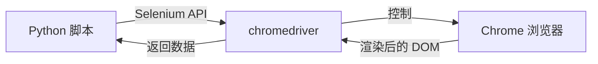

# 使用chromedriver模拟浏览器操作

## 使用 chromedriver 模拟浏览器操作

### 为什么需要 chromedriver

前面学习的 `requests` 库能直接向服务器发送 HTTP 请求、拿到响应文本，但很多网页的内容并非服务器一次性返回的。现代网页大量使用 JavaScript 动态渲染——页面加载后还要执行脚本，才能把数据填入表格、渲染图表或触发 XHR/Fetch 请求获取 JSON。`requests` 拿到的只是“半成品”HTML，看不到最终显示的文本。

> [!NOTE]  
> 动态渲染的典型信号：右键“查看网页源代码”里搜不到页面上明明白白显示的内容，或鼠标悬停、滚动后才出现新数据。

要抓取这类页面，有两种思路：一是人工分析出背后的接口 URL，再用 `requests` 直接请求；二是让一个真实的浏览器去加载、执行 JavaScript，等页面完全渲染后再从浏览器里取 HTML。第二种思路的工具之一就是 **chromedriver**。

### 它是什么

Chromedriver 是 Chrome 浏览器官方提供的 WebDriver 实现。Selenium 库通过 chromedriver 与 Chrome 通信，从而用 Python 控制一个真实的浏览器实例：打开网页、点击按钮、滚动页面、填写表单、等待元素出现、执行自定义 JavaScript，最后把渲染后的 DOM 交还给 Python。



整个流程可以理解为：==Python 调用 Selenium → Selenium 驱动 chromedriver → chromedriver 指挥真实的 Chrome==。抓到的内容是浏览器完整渲染后的结果，与用户肉眼看到的页面几乎一致。

### 基本用法

安装与配置三件套：安装 `selenium` 库、下载与 Chrome 版本**严格匹配**的 chromedriver、把 chromedriver 所在目录加入 PATH 或直接指定路径。

```python
from selenium import webdriver
from selenium.webdriver.common.by import By

driver = webdriver.Chrome()
driver.get("https://example.com")

# 等待元素出现后取文本
element = driver.find_element(By.ID, "result")
print(element.text)

driver.quit()
```

常用操作：

- `driver.get(url)`：打开网页
- `driver.find_element(By.ID / By.CLASS_NAME / By.CSS_SELECTOR / By.XPATH, ...)`：定位元素
- `element.click()`、`element.send_keys("文本")`：模拟点击与输入
- `driver.page_source`：获取渲染后的完整 HTML
- `driver.execute_script("return document.title")`：在页面上下文执行 JS

`time.sleep` 是新手最常用的等待方式，但网页加载速度不稳定时容易取不到元素。更可靠的做法是显式等待：

```python
from selenium.webdriver.support.ui import WebDriverWait
from selenium.webdriver.support import expected_conditions as EC

WebDriverWait(driver, 10).until(
    EC.presence_of_element_located((By.ID, "content"))
)
```

### 与 requests 的对比

| 维度 | `requests` | `chromedriver + Selenium` |
|---|---|---|
| 执行 JS | 不执行 | 完整执行 |
| 抓取内容 | 服务器最初返回的 HTML | 浏览器渲染后的 DOM |
| 速度 | 快（毫秒级） | 慢（秒级，每次都要加载整个页面） |
| 资源占用 | 极低 | 高（真实浏览器进程） |
| 适用场景 | 静态页面、可逆推的 API | 动态渲染、需要模拟用户交互 |
| 抓取优先级 | 优先使用 | 备选方案 |

> [!TIP]  
> 解题顺序建议：先尝试 `requests` + 分析网络请求。如果接口签名复杂、加密严重或页面逻辑高度依赖 JS，再上 chromedriver。考试简答题的核心就是==说明它用于动态渲染页面，能执行 JavaScript、模拟用户操作==。

### 常见陷阱

> [!WARNING]  
> chromedriver 版本与 Chrome 版本不匹配会直接报 `SessionNotCreatedException`。考试中要写出“版本需保持一致”这一关键点。

> [!CAUTION]  
> 忘记调用 `driver.quit()` 会导致浏览器进程残留在后台，反复运行会吃光内存。`quit()` 关闭整个浏览器并清理会话，`close()` 只关闭当前标签页。

另一个高频错误是**元素还没加载出来就去定位**。页面刚 `get` 完不代表目标元素已经渲染，尤其在网络慢、异步请求多的情况下，必须配合显式等待。

### 一个完整例子

假设要抓取某网站搜索结果页，结果通过 JS 异步加载，页面上有一个 `id="result-list"` 的容器，每个结果在 `li` 里，标题在 `span.title` 中。

```python
from selenium import webdriver
from selenium.webdriver.common.by import By
from selenium.webdriver.support.ui import WebDriverWait
from selenium.webdriver.support import expected_conditions as EC

driver = webdriver.Chrome()
driver.get("https://example.com/search?q=python")

# 最多等 10 秒，直到结果容器出现
WebDriverWait(driver, 10).until(
    EC.presence_of_element_located((By.ID, "result-list"))
)

titles = driver.find_elements(By.CSS_SELECTOR, "#result-list li span.title")
for t in titles:
    print(t.text)          # 这里取到的是渲染后的完整文本

driver.quit()
```

`requests` 直接请求该 URL 时，`result-list` 里很可能还没有任何 `li`；而 chromedriver 等到 JS 执行完毕，`span.title` 的文本已经全部生成，这就是两者最本质的区别。

### 考试记忆版

> [!IMPORTANT]  
> chromedriver 是 Chrome 的自动化驱动，Selenium 借助它控制真实浏览器，==用于抓取需要执行 JavaScript 动态渲染的页面==；能模拟点击、输入、滚动、等待元素等用户操作；核心局限是速度慢、资源消耗大，且 chromedriver 与 Chrome 版本必须严格匹配。
