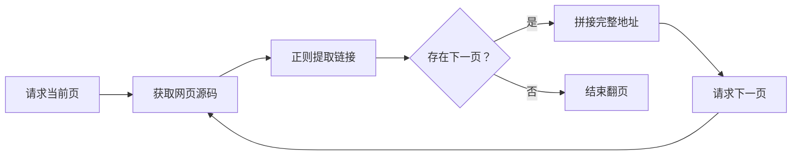

# 使用正则表达式实现翻页功能

## 它是什么

使用正则表达式实现翻页功能，是指用正则表达式从网页源码中提取“下一页”链接，再让爬虫继续请求该链接，从而连续抓取多页数据。

翻页的核心不是“把页码加一”，而是==从当前页面找到下一页地址，并正确拼接、请求和停止==。

## 为什么需要

很多网站的数据分布在多个页面中，只请求第一页，爬虫只能得到少量结果。例如页面底部可能出现：

```html
<a href="/news/list_2.html">下一页</a>
```

如果提取出 `/news/list_2.html`，就可以继续访问第二页；重复这一过程，便能依次抓取后续页面。



## 怎么做

先观察网页源码，确认“下一页”链接位于哪个标签中，再编写尽量精确的正则表达式：

```python
import re
import requests
from urllib.parse import urljoin

url = "https://example.com/news/list_1.html"

while url:
    response = requests.get(url, timeout=10)
    response.encoding = response.apparent_encoding
    html = response.text

    # 在这里提取当前页所需的数据
    print("正在处理：", url)

    match = re.search(
        r'<a[^>]+href=["\']([^"\']+)["\'][^>]*>\s*下一页\s*</a>',
        html
    )

    if match:
        url = urljoin(url, match.group(1))
    else:
        url = None
```

其中：

- `[^>]+`：匹配 `a` 标签中的其他属性；
- `["\']`：匹配单引号或双引号；
- `([^"\']+)`：用捕获组保存 `href` 地址；
- `match.group(1)`：取得第一个捕获组，即下一页链接；
- `urljoin()`：把相对地址转换为完整地址。

> [!IMPORTANT]
> 正则表达式负责==定位和提取链接==，`requests` 负责请求网页，`urljoin()` 负责处理相对地址，三者不能混为一谈。

## 一个正确的例子

当前页面地址为：

```text
https://example.com/news/list_1.html
```

网页中包含：

```html
<a class="next" href="list_2.html">下一页</a>
```

正则表达式提取到：

```python
match.group(1) == "list_2.html"
```

使用：

```python
urljoin(url, match.group(1))
```

得到：

```text
https://example.com/news/list_2.html
```

随后请求第二页。若最后一页没有匹配的“下一页”链接，`match` 为 `None`，将 `url` 设为 `None`，循环正常结束。

## 和相近方法的区别

| 方法 | 基本思路 | 适用情况 | 主要问题 |
|---|---|---|---|
| 正则提取“下一页” | 从当前页取得后续链接 | 链接结构不固定、页码不连续 | 正则写宽了可能误匹配 |
| 按页码拼接 URL | 修改 `page=1` 等参数 | 地址规律明确且稳定 | 不易判断最后一页 |
| 提取全部页码链接 | 一次取得各页地址 | 页码链接完整出现在页面中 | 动态加载时可能取不到 |

> [!NOTE]
> 如果浏览器能看到“下一页”，但 `response.text` 中找不到，链接可能由 JavaScript 动态生成。此时继续修改正则通常无效，应检查接口请求或使用动态页面处理方法。

## 常见的坑

> [!WARNING]
> 不要直接用当前网址与相对路径做字符串相加。例如 `url + "list_2.html"` 可能得到错误地址，应使用 `urljoin()`。

- **正则过宽**：只写 `href="(.*?)"`，可能提取到首页、尾页或其他栏目链接。
- **贪婪匹配**：在复杂 HTML 中使用 `.*` 可能跨越多个标签，优先使用 `[^>]*`、`[^"\']+` 等受限写法。
- **忽略链接状态**：有些最后一页仍保留“下一页”文字，但没有有效 `href`，应检查实际源码。
- **重复翻页**：网站始终返回相同链接时可能死循环，可记录已访问 URL，发现重复立即停止。
- **编码异常**：网页中文显示为乱码时，“下一页”可能匹配失败，应先正确设置编码。
- **把 `.` 当作普通字符**：正则中的 `.` 默认匹配除换行符外的任意字符；匹配网址中的句点时应写成 `\.`。

> [!TIP]
> 解题时按“看源码—写正则—取分组—拼地址—判结束”五步检查，尤其确认提取的是 `group(1)`，而不是包含其他内容的整个匹配结果。
