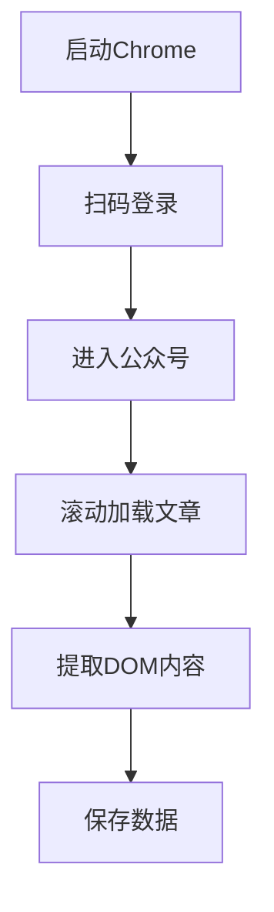

# 使用chromedriver爬取微信公众号文章

## 为什么需要 chromedriver

微信公众号文章采用动态渲染与反爬机制，传统 `requests` 库只能获取空壳 HTML。若直接请求 URL，返回内容往往缺失正文、阅读量等关键数据。此时必须借助浏览器自动化工具模拟真实用户行为。==chromedriver 通过 WebDriver 协议控制 Chrome 浏览器执行 JS 渲染==，是突破微信动态加载与登录验证的核心手段。

## 核心工作流程

使用 chromedriver 爬取公众号文章并非简单访问链接，而是模拟完整交互链路：



> [!IMPORTANT]
> ==必须先完成手动或半自动登录==，未登录状态下无法获取文章列表与正文内容。

具体实现依赖 `selenium.webdriver.Chrome` 类，配合 `By` 定位器与显式等待（`WebDriverWait`）确保元素加载完成。例如定位文章标题需等待 `.weui-msg-card__title` 出现，而非立即查找。

## 与 requests + BeautifulSoup 的区别

| 对比维度       | requests + BS4         | chromedriver               |
| -------------- | ---------------------- | -------------------------- |
| 渲染能力       | 仅静态 HTML            | 完整 JS/CSS 渲染           |
| 登录支持       | 需手动维护 Cookie      | 可交互式扫码登录           |
| 反爬对抗       | 易被识别为机器人       | 模拟真实浏览器指纹         |
| 资源消耗       | 轻量                   | 高（启动完整浏览器进程）   |
| 适用场景       | 公开静态页面           | 动态加载、需认证的封闭平台 |

> [!NOTE]
> 对于已公开且无 JS 依赖的公众号历史文章归档站，仍优先选用 requests；chromedriver 仅用于官方动态接口。

## 常见陷阱与规避策略

> [!WARNING]
> Chrome 与 chromedriver 版本必须严格匹配，否则抛出 `SessionNotCreatedException`。建议使用 `webdriver-manager` 自动管理驱动版本。

> [!CAUTION]
> 频繁操作触发微信风控，导致账号临时封禁。务必设置随机延时（`time.sleep(random.uniform(2,5))`），避免固定间隔请求。

> [!TIP]
> 使用 `--headless=new` 参数可隐藏浏览器窗口，但部分反爬检测会识别 headless 特征。建议首次调试关闭该选项，稳定后再启用。

## 正确示例：提取单篇文章标题与摘要

```python
from selenium import webdriver
from selenium.webdriver.common.by import By
from selenium.webdriver.support.ui import WebDriverWait
from selenium.webdriver.support import expected_conditions as EC

driver = webdriver.Chrome()
driver.get("https://mp.weixin.qq.com/s/xxxxx")  # 替换为实际文章链接

# 显式等待正文容器加载
wait = WebDriverWait(driver, 10)
content_div = wait.until(EC.presence_of_element_located((By.ID, "js_content")))

title = driver.find_element(By.ID, "activity-name").text.strip()
summary = content_div.text[:200]  # 截取前200字作为摘要

print(f"标题：{title}\n摘要：{summary}")
driver.quit()
```

此例中，==使用 `EC.presence_of_element_located` 替代隐式等待==，精准捕获动态渲染完成时机，避免因网络波动导致元素未加载即提取而返回空值。注意 `js_content` 是微信正文固定 ID，但需在登录后才可见。
