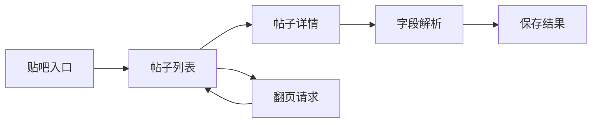

# 百度贴吧进阶实例

## 是什么

百度贴吧进阶实例，是《Python程序设计》第10章“Python网络爬虫”中，在基础网页抓取之上完成的综合爬取任务。它通常以某个贴吧页面为入口，连续获取帖子列表、进入帖子详情页、提取标题、正文、作者等信息，并把结果保存到文件或数据结构中。

> [!IMPORTANT]
> 核心不是“用 `requests` 下载一个网页”，而是完成“==入口分析→列表翻页→详情请求→字段提取→数据保存==”的完整流程。

## 为什么需要

真实网站的数据通常分散在多级页面中：贴吧首页只提供帖子摘要，正文、作者、回复数等字段位于详情页；数据还可能跨多个分页。因此，爬虫必须处理页面间跳转、分页和字段缺失。



与“下载网页”相比，它增加了页面遍历和结构化提取；与普通静态页面解析相比，它还要处理分页、编码、异常请求及动态加载等问题。

## 怎么做

### 抓取入口与列表

使用 `requests` 发送 GET 请求，以合适请求头模拟浏览器访问。通过 `BeautifulSoup` 或 `lxml` 定位帖子链接。

```python
import requests
from bs4 import BeautifulSoup

HEADERS = {"User-Agent": "Mozilla/5.0"}
url = "https://tieba.baidu.com/f?kw=python"

r = requests.get(url, headers=HEADERS, timeout=10)
r.raise_for_status()
r.encoding = r.apparent_encoding
soup = BeautifulSoup(r.text, "html.parser")
```

> [!TIP]
> 调试时先检查 `r.status_code`、`r.url` 和 `r.text`，确认拿到的是目标页面，而不是登录页或验证页。

### 遍历详情页

从列表中取得帖子链接，逐个请求详情页，再按标签和类名提取字段：

```python
def parse_post(url):
    resp = requests.get(url, headers=HEADERS, timeout=10)
    resp.raise_for_status()
    resp.encoding = resp.apparent_encoding

    page = BeautifulSoup(resp.text, "html.parser")
    title_tag = page.select_one("h1")
    content_tag = page.select_one(".d_post_content")

    return {
        "title": title_tag.get_text(strip=True) if title_tag else "",
        "content": content_tag.get_text("\n", strip=True) if content_tag else ""
    }
```

生产代码还应增加重试、延时、异常处理，并限制并发和请求频率。

### 翻页与保存

分页时不要反复拼“下一页”按钮，因为按钮可能是 JavaScript 事件。更稳妥的方法是观察 URL 的 `pn` 参数。例如：

```python
for pn in range(1, 6):
    page_url = f"https://tieba.baidu.com/f?kw=python&pn={pn}"
    # 请求列表页并解析帖子
```

解析结果可保存为 JSON：

```python
import json

with open("tieba.json", "w", encoding="utf-8") as f:
    json.dump(posts, f, ensure_ascii=False, indent=2)
```

## 相近概念的区别

| 方法 | 主要特点 | 适用情况 |
|---|---|---|
| `urllib` | 标准库，底层接口较繁琐 | 简单请求、课程基础示例 |
| `requests` | API 简洁，支持会话、参数和超时 | 贴吧爬取常用 |
| `BeautifulSoup` | 按标签和类名解析 HTML | 页面结构较稳定 |
| `Selenium` | 驱动浏览器，可执行 JavaScript | 动态渲染或交互复杂 |

> [!NOTE]
> `requests` 只能取得服务器返回的原始内容；若帖子正文由 JavaScript 异步加载，HTML 中可能根本没有正文，此时要考虑浏览器自动化或网站提供的接口。

## 常见坑

> [!WARNING]
> 不要假设所有帖子都有相同结构。置顶、删除、广告帖可能缺字段，应使用 `get()`、`select_one()` 并做空值判断。

- **编码错误**：百度页面可能不是 UTF-8，出现乱码时应检查 `r.encoding` 与 `r.apparent_encoding`。
- **请求参数丢失**：使用 `params={"kw": "python", "pn": pn}` 比手工拼接 URL 更安全。
- **链接不完整**：帖子地址可能以 `//` 开头，可用 `urllib.parse.urljoin(base_url, href)` 补全。
- **无限翻页**：终止条件应依据页码、帖子链接去重或“下一页”是否存在，而不是只判断解析结果非空。
- **访问过密**：高频请求可能触发验证码或封禁，应设置 `timeout`、适当延时并遵守网站规则。

## 一个算对了的例子

假设列表页中某帖链接为：

```text
https://tieba.baidu.com/p/1234567890
```

详情页解析结果为：

```python
{
    "title": "Python爬虫学习",
    "content": "requests负责请求，BeautifulSoup负责解析。"
}
```

若下一页对应：

```text
https://tieba.baidu.com/f?kw=python&pn=50
```

正确处理应是：列表页取出帖子链接 → 请求详情页 → 提取标题和正文 → 以帖子编号 `1234567890` 去重 → 保存 JSON；若发现 `pn=100` 返回的帖子集合与 `pn=50` 相同，或没有有效新帖子，则停止翻页。这样得到的数据才是结构完整、来源可追溯的贴吧帖子记录。
