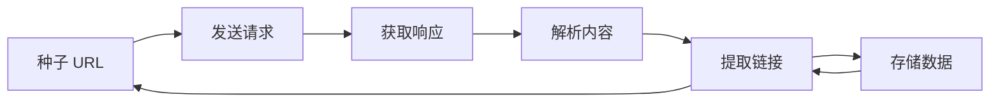

# 网络爬虫基本原理与应用场景
网络爬虫（Web Crawler / Spider）是一段**自动抓取网页内容**的程序：它像蜘蛛一样沿着超链接在网页间爬行，把看到的内容下载下来，再交给后续处理。对大多数学生而言，它最直接的用途是——自动收集数据，而不是一个个网页手动复制粘贴。



### 它是什么，为什么需要

想象你要统计新浪新闻首页所有标题：手工打开、复制、关闭，100 条新闻就是 100 次重复劳动。爬虫把这套动作交给程序，几秒钟完成。本质上，爬虫做的是：

> [!IMPORTANT]
> ==爬虫 = 自动模拟浏览器发 HTTP 请求 → 拿响应 → 从 HTML 中提取目标数据 → 保存或继续爬取==

核心价值：**自动化、规模化、可重复**地获取公开网页数据。它是搜索引擎、数据新闻、舆情分析、比价平台的基础。

### 基本原理：一次完整的爬取过程

**第一步：发请求**。爬虫向目标 URL 发送 HTTP GET/POST 请求。这一步用 Python 的 `requests` 库：

```python
import requests
resp = requests.get("https://example.com", timeout=5)
print(resp.status_code)     # 200 表示成功
print(resp.encoding)        # 查看编码
html = resp.text            # 拿到的 HTML 源代码
```

[!TIP]
> 记忆口诀：**请（请求）回（响应）解（解析）存（存储）**。四步走完，就能爬下一个。

**第二步：解析响应**。HTML 源码是给浏览器看的，爬虫要用 `BeautifulSoup`、`XPath` 或正则表达式把目标数据抽出来。常见做法：

```python
from bs4 import BeautifulSoup
soup = BeautifulSoup(html, "html.parser")
titles = soup.select("a.news-title")   # CSS 选择器
for t in titles:
    print(t.get_text(strip=True))
```

**第三步：提取新链接，继续爬**。从当前页面解析出的 `<a href="...">` 加入待爬队列，按广度优先或深度优先继续。

**第四步：存储**。写入 CSV、JSON 或数据库。

### 应用场景

| 场景 | 说明 | 典型实现 |
|------|------|---------|
| 搜索引擎 | 抓取全网建立索引 | 谷歌、百度爬虫 |
| 舆情监控 | 定时抓取新闻、微博 | 关键词过滤 |
| 比价电商 | 自动抓各平台商品价格 | 定时爬取 |
| 学术数据 | 收集论文元数据 | 遵守 robots 协议 |
| 招聘分析 | 抓取职位信息做统计 | 数据清洗后分析 |

### 爬虫 vs 普通 HTTP 请求

普通调用 API 拿 JSON 数据**不算严格意义的爬虫**——因为数据以结构化方式直接提供。爬虫的难点在于：网页是给**人**看的 HTML，数据藏在标签里，你要**解析**出来。这就是为什么爬虫比调 API“脏”得多：

> [!WARNING]
> 爬虫拿到的 HTML 经常变结构。网站一改版，你的解析代码就失效。所以解析逻辑要写成可配置、易修改的形式，别把选择器写死在循环深处。

### 常见的坑

**坑一：编码错误**。中文网页可能有 GBK/UTF-8/ISO-8859-1 等编码，直接 `resp.text` 可能乱码。正确做法：

```python
resp.encoding = resp.apparent_encoding   # 让 requests 自动判断
html = resp.text
```

**坑二：请求被拒**。服务器会检查 `User-Agent`，没有浏览器标识的请求可能被 403。加请求头：

```python
headers = {"User-Agent": "Mozilla/5.0 (Windows NT 10.0; Win64; x64)"}
resp = requests.get(url, headers=headers, timeout=5)
```

**坑三：频率过快被封 IP**。==生产环境必须加延时与重试==。

**坑四：忽略 robots.txt**。这是网站声明“哪些路径禁爬”的协议。合法爬虫应遵守。

### 一个算对了的例子

**题目**：用 `requests` 抓取 `https://httpbin.org/get?name=python`，要求超时 3 秒，并输出响应中的 `name` 字段值。

**正确写法**：

```python
import requests

url = "https://httpbin.org/get"
params = {"name": "python"}
resp = requests.get(url, params=params, timeout=3)

data = resp.json()          # 响应是 JSON，直接解析
print(data["args"]["name"])  # 输出 python
```

**为什么对？**

- 参数用 `params` 字典传入，`requests` 自动拼成 `?name=python`，避免手工拼 URL 出错。
- `timeout=3` 防止无限等待。
- 响应 `Content-Type` 是 JSON 时，用 `resp.json()` 一步解析，比正则硬抠可靠。

> [!CAUTION]
> 不要一上来就 `resp.text` 再字符串查找。JSON 数据请用解析器，HTML 数据请用 `BeautifulSoup` 或 lxml。否则遇到转义字符、嵌套结构就会出错。

爬虫的本质是**模拟浏览器行为**，流程固定（请求→解析→存储），但它和大多数“干净”的 Python 程序不同：==它依赖外部网页的结构，因此必须有容错与维护意识==。掌握这个基本原理后，再学 Scrapy 框架、反爬对抗，就是在此之上叠加工厂化、分布式的思维。
