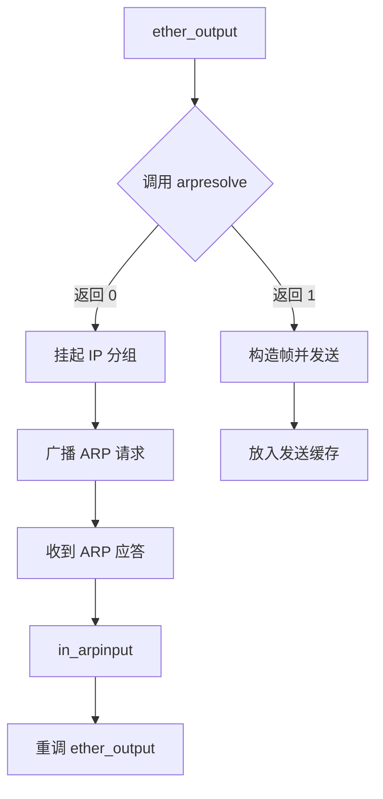

# ARP 协议在以太网接口中的地址解析作用

> [!IMPORTANT]
> 在以太网中，IP 层只知道下一跳的 IP 地址，但网卡真正发送帧需要的是 ==48 bit 的 MAC 地址==。ARP（Address Resolution Protocol）就是用来完成这个“IP → MAC”映射的桥梁。

## 为什么需要 ARP？

思考一个问题：当你的主机要发一个 IP 数据报到同网段的另一台主机时，`ether_output` 已经拿到了目的 IP，但它能直接把这个 IP 塞进以太网帧头吗？

不能。因为以太网硬件只认 MAC 地址。如果没有 ARP，每一台主机都得手动维护一张庞大的“IP-MAC 对照表”，这在实际网络中完全不现实。因此，协议栈在 `AF_INET` 分支下必须调用 `arpresolve` 来动态解析。

## ether_output 中的解析流程

在教材 P84 描述的 `ether_output()` 函数中，主要步骤为：验证目的地址、特定协议处理、构造帧头、接口排队，以及 ==调用 `arpresolve` 获取下一跳硬件地址==（P85 line 93）。

- **命中缓存**：若目标 MAC 已在 ARP cache 中，`arpresolve` 返回 1，`ether_output` 继续执行，跳到 P87 将数据包放入发送缓存并发送。
- **未命中缓存**：`arpresolve` 返回 0，==此 IP 数据包被 ARP 保持（held）==，函数直接 return。随后底层发出 ARP Request；当收到 ARP Reply 并更新缓存后，系统会从 `in_arpinput` 函数中再次调用 `ether_output` 把刚才挂起的包发出去。

## ether_input 的分发机制

接收端同样依赖类型字段。`ether_input` 根据以太网帧的 Type 字段进行跳转分发：

| 协议类型 | 调度动作 | 输入队列 | 关键代码逻辑 |
| :--- | :--- | :--- | :--- |
| IP ($0x0800$) | 调度 IP 软件中断 | `ipintrq` | `schednetisr(NETISR_IP);` 入队并唤醒 |
| ARP ($0x0806$) | 调度 ARP 软件中断 | `arpintrq` | 调度中断并选择 `arpintrq` |

> [!NOTE]
> 对于 IP 数据包，对应的经典代码实现为：
> `schednetisr(NETISR_IP); enque(&ipintrq, m); wakeup(&ipintrq);`
> 虽然具体细节因上下文而异，但核心必定包含“调度 ISR + 入队 `ipintrq`”。

## 常见易错点辨析

> [!WARNING]
> 很多同学在简答题中会写“ARP 失败则丢弃数据包”，这是错的！课件明确指出：不成功时 `ether_output` 只是 return，==数据包被 ARP 模块 hold 住==，等解析完成后由 `in_arpinput` 触发重传，而非直接丢弃。

> [!CAUTION]
> 不要把 ARP 和 RARP 搞混。ARP 是已知 IP 求 MAC（用于正常发包）；RARP 是已知 MAC 求 IP（常用于无盘工作站启动），两者方向相反。

> [!TIP]
> 记忆 `ether_output` 五步法口诀：“**验、协、构、排、解**”——验证、协议处理、构造帧、排队、ARP 解析。考试遇到简答 6 按这五个词展开即可拿满分。
