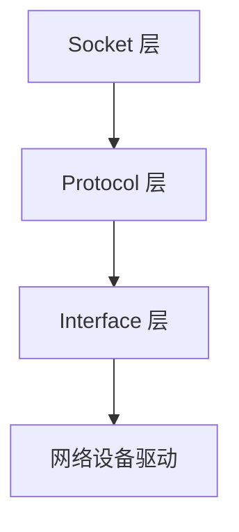
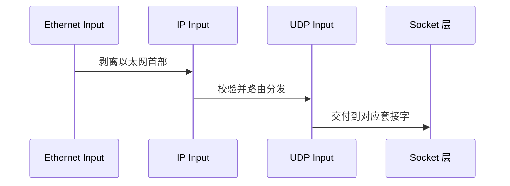

# 4.4BSD 网络支持与应用接口概述

4.4BSD 是 TCP/IP 协议栈的“活化石”与参考实现。在学习网络编程时，你是否想过：当你在代码里调用 `socket()` 后，内核到底在背后做了什么？数据包又是如何从网卡一步步送到你的应用程序的？

## 支持的协议族与应用接口

4.4BSD 并非只支持 TCP/IP。根据教材 P7，它支持以下 ==四个通信协议族==：
1. **TCP/IP**（Internet 协议族）
2. **XNS**（Xerox Network Systems）
3. **OSI protocols**（OSI 协议族）
4. **Unix domain protocols**（本地进程间通信）

> [!NOTE]
> Unix domain protocols 不经过物理网卡，专门用于同一台主机上的进程间高效通信。

编写使用 Internet 协议的程序时，最流行的两种应用编程接口（API）是 ==Socket== 和 ==TLI（Transport Layer Interface）==。本课程主要围绕 Socket API 展开。

## 内核网络代码的三层架构

如果所有网络逻辑都揉在一起，内核将难以维护。因此，4.4BSD 将内核网络代码严格划分为 ==三层==：

- **Socket layer（套接字层）**：提供统一的系统调用接口，屏蔽底层协议差异。
- **Protocol layer（协议层）**：实现具体的协议逻辑（如 IP、TCP、UDP）。
- **Interface layer（接口层）**：包含直接与网络设备通信的 ==设备驱动程序==。

## 数据输入处理流程

当一个数据包到达网卡时，它会自底向上穿过这三层。在 4.4BSD-Lite 发行版中，各层的 Input 函数分工明确：

- **Ethernet Input**：接收来自设备驱动的帧，检查目的 MAC 地址，剥离以太网首部，根据类型字段（如 IPv4）将数据交给上层协议。
- **IP Input**：验证 IP 首部校验和与版本号，判断数据包是发给本机还是需要转发，然后剥离 IP 首部，根据协议字段（如 $17$ 代表 UDP）交给传输层。
- **UDP Input**：根据目的端口号查找匹配的 Socket，将数据放入该 Socket 的接收队列中。

> [!WARNING]
> Net/3（4.4BSD-Lite 的网络子系统）**不实现**路径 MTU 发现（Path MTU Discovery）算法，无法动态探测到目的地路径上所有中间网络支持的最大传输单元。

## Socket 创建与描述符寻址

当进程调用 `socket()` 系统调用时，内核会创建三个核心数据结构：==`filedesc`、`socket`、`vnode`==。

`socket()` 返回的是一个整型描述符（descriptor）。那么，后续调用 `sendto()` 时，内核如何通过这个整数找到对应的 `socket` 结构体？

> [!TIP]
> 寻址链路：`descriptor` $\xrightarrow{\text{索引}}$ `fd_ofiles` 数组 $\rightarrow$ `file` 结构体 $\rightarrow$ `vnode` $\rightarrow$ `socket` 结构体。

## mbuf 与 `m_pullup` 的易错点

内核使用 **mbuf**（memory buffer）来管理网络数据。在 `sendto` 调用中，第五个参数指向 Internet socket 地址结构体，第六个参数指定其长度（$16$ 字节）。Socket 层会先验证指针合法性，然后将地址结构体复制到 mbuf 中。

> [!IMPORTANT]
> 存放 socket 地址结构体的 mbuf，其 `m_type` 成员的值必须是 ==`MT_SONAME`==（表示 socket name），而不是普通的数据类型。

在处理不连续内存块时，常需调用 `m_pullup` 将数据拉取到连续的 mbuf 中。若失败则返回 `NULL`。除了课件提到的两个原因外，查阅源码 `uipc_mbuf.c` 可知，`m_pullup` 失败共有 ==三个原因==：

| 失败原因 | 说明 |
| :--- | :--- |
| 请求长度越界 | 请求合并的长度大于单个 mbuf 最大容量（`MHLEN` 或 `MLEN`） |
| 内存分配失败 | 需要分配新 mbuf 但内核内存耗尽 |
| 源链长度不足 | mbuf 链中实际可用数据的总长度小于请求拉取的长度 |
