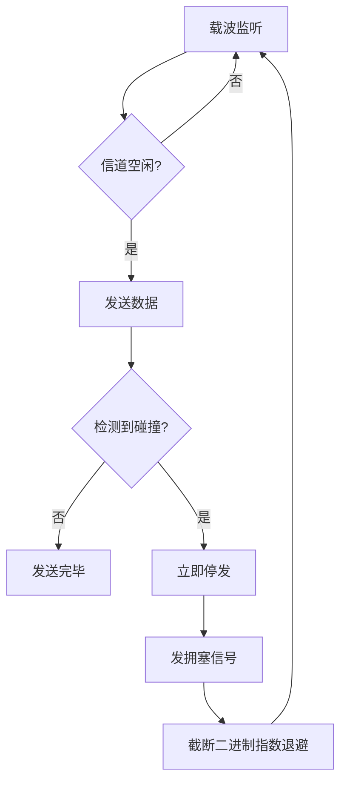

# CSMA/CD 介质访问控制机制

> [!IMPORTANT]
> CSMA/CD（Carrier Sense Multiple Access with Collision Detection，载波监听多点接入/碰撞检测）是传统共享式以太网（Shared Ethernet）解决多节点争用同一传输介质的==核心介质访问控制协议==。

## 为什么需要它

想象一条只有一条车道的单行线：如果所有车都不看路况直接冲进去会怎样？必然相撞。总线型以太网同理——所有站点挂接在同一条总线上，若不加控制地随意发送，信号叠加就会发生**碰撞（Collision）**，导致帧损坏。我们需要一套规则让各站点“有序”使用信道，CSMA/CD 正是为此而生。

## 怎么做

CSMA/CD 的工作流程可概括为三步口诀：**先听后发、边听边发、冲突停发**。

1. **载波监听（Carrier Sense）**：发送前先检测总线电平。若忙则持续监听；若空闲则准备发送。
2. **碰撞检测（Collision Detection）**：发送过程中持续比较发送信号与接收信号。一旦发现不一致（即碰撞），==立即停止发送==，并发送 48 bit 的强化干扰信号（Jam Signal）确保全网感知碰撞。
3. **截断二进制指数退避（Truncated Binary Exponential Backoff）**：碰撞后不能马上重传，需随机等待。第 $r$ 次碰撞后，从 $\{0, 1, \dots, 2^k - 1\}$ 中随机选一个整数 $r$，等待时间为 $r \times \text{Slot Time}$，其中 $k = \min(\text{碰撞次数}, 10)$。连续碰撞 16 次则丢弃该帧并向上层报错。

## 关键参数：争用期

为什么发送端必须保证在发送完一帧之前能检测到碰撞？因为信号传播有延迟。最坏情况下，两端同时发送，信号到达对端再反射回来，所需时间即为**争用期（Contention Period / Slot Time）**。

$$\tau = \frac{\text{总线最大长度}}{\text{信号传播速率}}$$

$$\text{Slot Time} = 2\tau$$

> [!WARNING]
> 以太网最小帧长（64 Byte = 512 bit）的设计正是由争用期决定的！==发送一帧的时间必须 $\ge 2\tau$==，否则碰撞发生时帧已发完，发送端将无法检测到碰撞。

## 算对了的例子

**题目**：某 10 Mbps 以太网，总线长度为 2 km，信号传播速率为 $2 \times 10^8$ m/s。求争用期（Slot Time）及对应的比特数。

**解答**：
1. 单程传播时延：$\tau = \frac{2000}{2 \times 10^8} = 10 \, \mu s$
2. 争用期：$2\tau = 20 \, \mu s$
3. 对应比特数：$10 \times 10^6 \, \text{bps} \times 20 \times 10^{-6} \, \text{s} = 200 \, \text{bit}$

> [!TIP]
> 计算技巧：先把带宽换算成 bit/$\mu s$（如 10 Mbps = 10 bit/$\mu s$），再乘 $2\tau$（单位 $\mu s$），不易出错。

## 与相近概念的区别

| 特性 | CSMA/CD | CSMA/CA |
|---|---|---|
| 应用场景 | 有线以太网（IEEE 802.3） | 无线局域网（IEEE 802.11） |
| 核心机制 | ==碰撞检测==（Detect） | ==碰撞避免==（Avoidance） |
| 原因 | 有线介质收发可同时进行 | 无线存在隐蔽终端且收发难同频 |

> [!CAUTION]
> 常见误区：认为全双工交换式以太网也用 CSMA/CD。实际上，现代点对点全双工链路无碰撞可能，==CSMA/CD 已被废弃==，仅存在于历史共享式集线器（Hub）网络中。
