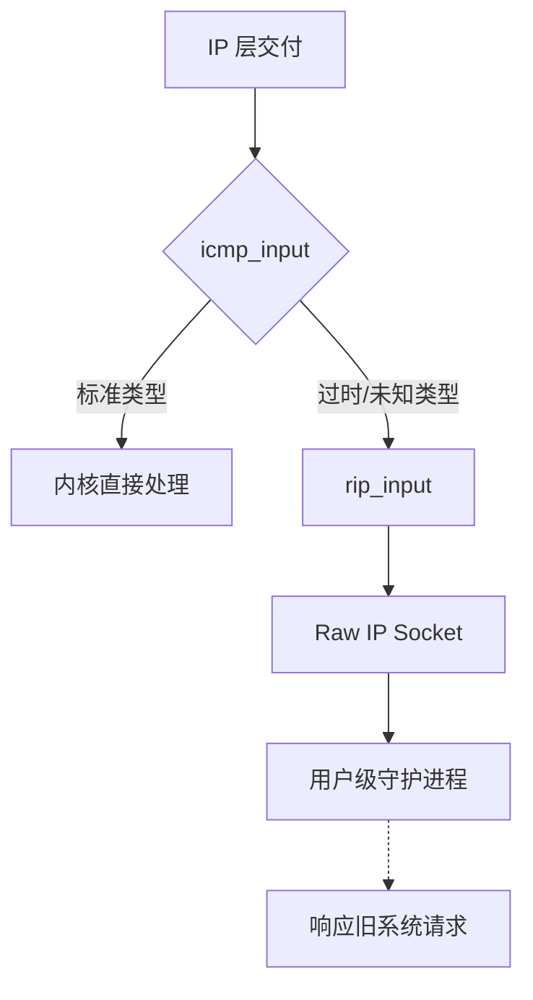

# icmp_input 函数处理流程及过时 Information Request 传递给 rip_input 的原因

## icmp_input 处理流程与过时报文兼容机制

在 TCP/IP 协议栈中，`icmp_input` 是 ICMP 模块的入口函数。当 IP 层完成重组并将数据报交付给 ICMP 时，该函数负责解析类型字段并分发处理。对于标准的 Echo Request 或 Destination Unreachable，内核会直接响应或记录；但遇到 ==Information Request==（类型 15）等已过时的消息时，代码并未将其丢弃，而是转交给了 `rip_input`。

### 为什么过时报文不直接丢弃？

如果 ICMP Information Request 已经被标记为过时（Obsolete），按照常规逻辑似乎应该静默丢弃，为何 `icmp_input` 还要多此一举调用 `rip_input`？

> [!IMPORTANT]
> 核心结论：将过时报文传递给 `rip_input` 是为了 ==向后兼容==。通过原始 IP 套接字（Raw IP Socket），用户级守护进程可以捕获并响应这些报文，从而继续支持依赖此行为的旧系统。

这种设计体现了网络协议演进中的“鲁棒性原则”：内核不再主动处理过时功能，但保留了让应用层接管的能力，避免硬编码导致的兼容性断裂。

### rip_input 的角色辨析

理解这一机制的关键在于区分 `icmp_input` 与 `rip_input` 的职责边界：

| 特性 | icmp_input | rip_input |
| :--- | :--- | :--- |
| **处理对象** | 所有已知 ICMP 类型 | 未匹配特定协议的 IP 数据报 |
| **执行环境** | 内核空间 | 内核空间（作为 Raw Socket 接口） |
| **过时策略** | 识别但不处理 | 透传给绑定了相应类型的用户进程 |
| **典型用途** | Ping、路径 MTU 发现 | 路由协议实现、自定义 ICMP 处理 |

[!NOTE]
> `rip_input` 并非仅用于 RIP 路由协议。它是 BSD 内核中 Raw IP 协议的输入例程，任何通过 `SOCK_RAW` 创建且指定了 `IPPROTO_ICMP` 的套接字，都会经由它接收数据。

### 常见误区与考试要点

[!WARNING]
> 切勿认为“过时”等于“无效”。在简答题中，若只回答“为了兼容”过于笼统，必须明确指出 ==进程级守护进程（process-level daemon）== 和 ==rip_input== 这两个关键要素。

回顾经典考题：“If the ICMP information request is obsolete, why does `icmp_input` pass it to `rip_input` instead of discarding it?”

**标准作答逻辑：**
By passing the message to `rip_input`, a process-level daemon could respond and old systems that relied on this behavior could continue to be supported.

中文对应表述：通过将消息传递给 `rip_input`，进程级守护进程可以作出响应，依赖这一行为的旧系统也能继续得到支持。

[!TIP]
> 记忆锚点：**过时不丢，转交 Raw；守护进程，兼容旧家**。考试中看到“obsolete”与“rip_input”的组合，立即联想到“用户态接管”这一兼容性设计模式。

此外，需注意 `icmp_input` 的上游依赖：只有当 `ip_reass` 成功重组分片后，完整的 ICMP 报文才会到达此处；若 `ip_slowtimo` 超时丢弃了不完整分片，则根本不会触发上述兼容逻辑。
