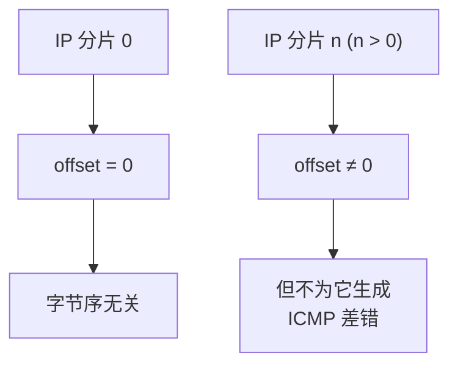

# Net/3 构造 ICMP 差错报文时不转换 IP 偏移量和长度字段字节序的原因分析

## ICMP 差错报文中的字节序问题

当主机或路由器在处理 IP 数据报时发现无法继续转发或交付，它会生成一个 ICMP 差错报文，把出错 IP 数据报的头部（有时还包括部分数据）嵌入 ICMP 报文的“原始数据报”字段中，让发送方知道是哪一个数据报出了问题。这个“嵌入”过程在 Net/3 中由 `icmp_error` 完成。

### 为什么需要字节序转换

IP 头部中有些字段在网络传输时用的是**网络字节序**（大端序），而 Net/3 在内部处理时可能以**主机字节序**存放它们。典型例子是**分片 ID（ip_id）**：在 `ip_forward` 中，数据报被转发前，IP 头刚从 mbuf 中读出来，`ip_id` 还是网络字节序；但内核某些操作会将其转换为主机字节序，所以在构造 ICMP 差错报文前又得转回网络字节序。

### 偏移量字段为什么可以不转换

这里的关键问题是：**ICMP 差错报文只会为 IP 数据报的第一个分片生成**，不会为后续分片生成。原因很直观——只有第一个分片才包含完整的传输层头部（如 TCP 或 UDP 的端口号），路由器才有可能识别出连接信息；更重要的是，路径上的路由器必须把整个原始数据报（或至少其核心标识）还给发送方，而分片信息只在第一个分片中完整呈现。

第一个分片的**分片偏移量（fragment offset）恒为 0**。0 这个值无论用大端序还是小端序表示，字节序列都是 `00 00`，完全相同。

### 长度字段的情况类似吗？

课件中同时提到了 **offset 和 length** 两个字段。我们来分别看：

| 字段 | 嵌入 ICMP 时的考虑 |
|---|---|
| `ip_off`（分片偏移与标志） | 仅第一个分片被嵌入，偏移恒为 0，`0` 的字节序无关，==无需转换== |
| `ip_len`（总长度） | 出错数据报长度在 `ip_forward` 中通常还保持网络字节序？？不，实际处理中它早已被 `ntohs` 转为主机序。但嵌入时若不转回，接收方看到的长度会错误 |

等等——这里要仔细。实际上 Net/3 的 `icmp_error` 在嵌入 IP 头时，**并不做任何字节序转换**。这看起来好像有问题：`ip_len` 在内核处理中通常已经是主机字节序了，直接把这种“主机序”的长度塞回网络报文里，接收方的 TCP/IP 栈很可能报出畸形数据报。

但事实上—— **Net/3 在 `ip_forward` 调用 `icmp_error` 之前，已经主动把 `ip_id` 转回网络字节序，却不对 `ip_len` 做同样的事**。这就引出了课件中的问题：为什么偏移量无关紧要？为什么长度也“经常”不受影响？

答案分两半：

1. **对 `ip_off` 而言**：只有第一个分片被嵌入，偏移为 0，字节序无所谓。
2. **对 `ip_len` 而言**：Net/3 在把数据报从 mbuf 中取出来转发时，`ip_len` 的值是直接来自原始报文的——它**从头到尾没有被转成主机字节序**，也就是说，它**一直保持着网络字节序**，所以嵌入 ICMP 时当然不需要再转换。

> [!NOTE]
> 真正被 `ip_forward` 转换的是 `ip_id`：它在分片重组或某些查找操作中会被 `ntohs`，所以在嵌入 ICMP 前必须转回 `htons`。`ip_off` 和 `ip_len` 则分别因为“恒为 0”和“从未被转为主机序”而不需要额外处理。

> [!WARNING]
> 这个结论的前提是：**ICMP 差错报文只针对第一个分片**。如果你在代码中试图为非首分片生成差错报文，`ip_off` 不为 0，字节序问题就会暴露出来。RFC 792 明确规定：除非是超时（Time Exceeded）需要报告“分片重组失败”，否则差错报文只应指向第一个分片。

### 一个“算对了”的实例

假设主机 $H_1$ 发送一个 1500 字节的数据报到 $H_2$，经过路由器 $R$ 时因为下一跳 MTU 为 576 且 DF 位被置位而无法转发。$R$ 决定发送 ICMP “需要分片但 DF 置位”差错报文。

- 被嵌入的 IP 头中：`ip_off = 0`（第一个分片），`ip_id = 0x4a3b`（假设），`ip_len = 1500 = 0x05dc`。
- 在 `ip_forward` 处理过程中，`ip_id` 被转换为主机字节序（小端机上变成 `0x3b4a`），而 `ip_len` 仍保持网络序 `0x05dc`。
- 调用 `icmp_error` 前，代码执行 `ip->ip_id = htons(ip->ip_id)` 转回 `0x4a3b`。
- `ip_off = 0` 无需转换；`ip_len` 本就是网络序也无需转换。

最终 ICMP 报文中的原始 IP 头与 $H_1$ 发送时完全一致。

> [!TIP]
> 记忆口诀：**“偏移零，长度原样，ID 来回转”**。偏移字段靠“首分片恒 0”豁免，长度字段靠“从未改动”豁免，只有 ID 字段因为内核内部确实动过它，所以必须手动转回。
