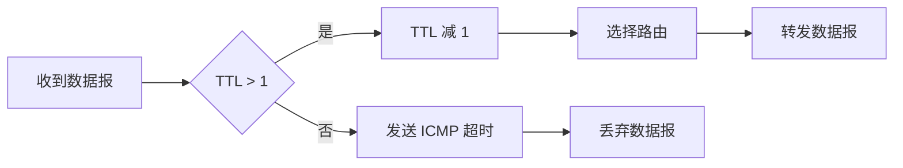

# IP 差错与 ICMP 差错报文汇总（不可达、超时、参数问题等）

## 差错报告机制

ICMP（Internet Control Message Protocol）是 IP 的差错报告与控制协议。当 IP 收包、转发、分片或重组出现异常时，路由器或主机可通过 ICMP 将问题通知源主机。ICMP 本身封装在 IP 数据报中，但其作用范围受限制：

> [!IMPORTANT]
> ==IP 本身是尽力而为服务，不保证送达、不保证顺序，也不自动修复错误。==  
> ICMP 只是提供诊断信息，不能代替 TCP 的可靠传输机制。

常见 ICMP 差错报文包括：

| ICMP 报文 | 触发原因 | 含义 |
|---|---|---|
| 目的不可达 | 无路由、主机不可达、禁止分片、网络不可达等 | 数据报无法送达目的端 |
| 超时 | TTL 减至 0，或分片重组定时器到期 | 数据报在网络中存活时间过长，或分片集合不完整 |
| 参数问题 | IP 首部字段无效或选项无法识别 | 首部存在错误，需由源主机修正 |
| 重定向 | 路由器发现同一网络上存在更优下一跳 | 建议源主机或相关路由器改进路由 |
| 源点抑制 | 队列拥塞或资源不足 | 建议源主机降低发送速率 |

## IP 处理中的差错

IP 转发时，如果数据报的 TTL 已减至 1，继续转发会使其变为 0，因此路由器丢弃数据报，并向源主机发送 **ICMP Time Exceeded（超时）** 报文：

如果找不到通往目的地址的路由，IP 层会产生 **Host Unreachable**，封装为 ICMP“目的不可达”报文。若报文太大、下一跳 MTU 不允许分片，而数据报的 DF 位为 1，则产生 **Need to Fragment**，同样属于 ICMP 目的不可达差错。

当收到第一个分片后启动重组定时器，如果后续分片未能在规定时间内到达，组合完整的数据报无法重组，系统向源主机发送 **ICMP Time Exceeded**。这一超时与“TTL 耗尽”使用相同的 ICMP 类型，但触发原因不同。

## `ip_output` 错误与 ICMP 映射

在 BSD 风格的 IP 实现中，`ip_output` 的错误码会被转换为相应的 ICMP 差错：

| `ip_output` 返回值 | 生成的 ICMP 报文 |
|---|---|
| `EMSGSIZE` | `ICMP_UNREACH_NEEDFRAG` |
| `ENOBUFS` | `ICMP_SOURCEQUENCH` |
| `EHOSTUNREACH`、`ENETDOWN`、`EHOSTDOWN`等 | `ICMP_UNREACH_HOST` |

例如，路由器转发一个大小为 2000 字节的数据报，下一跳接口 MTU 为 1500 字节，且 DF 位为 1。系统不能对该报文分片，于是 `ip_output` 返回 `EMSGSIZE`；IP 转发层将其转换为 `ICMP_UNREACH_NEEDFRAG`，通知源主机：“该报文不能在不分片的情况下转发”。

## 生成差错的限制

> [!WARNING]
> ==ICMP 差错报文只能针对数据报的第一个分片生成，不能针对后续分片生成。==

第一个分片的片偏移量始终为 0，因此 Net/3 在构造差错报文时不必转换该字段的字节序。片偏移最高位还是保留位，正常必须为 0；若被置 1，`icmp_error` 会丢弃该报文。

此外，处理 ICMP 时产生的错误不会再生成新的 ICMP 差错。否则，一次错误可能引发连续的错误报告，形成无限循环。典型情况是 `icmp_send` 不向调用者返回错误，而 `ip_forward` 也忽略其返回值。

## 路由错误与重定向

路由器发现存在更合适的下一跳且该下一跳位于源主机所在的同一网络时，可以发送 **ICMP Redirect（重定向）**，但应满足：

1. 路由不是默认路由；
2. 数据报不是由 ICMP 差错报文产生；
3. 下一跳必须位于源主机所在网络；
4. 所选路由不能是此前由 ICMP Redirect 创建或修改的路由，即不具有 `RTF_DYNAMIC | RTF_MODIFIED` 标志；
5. 发送重定向不会造成路由循环。

> [!TIP]
> 记忆口诀：==首片才报错，坏包不报错，ICMP错误不再报错，重定向不造成环路。==

其中，“IP 首部校验和错误时不返回 ICMP”尤其重要：首部已损坏，其中的源、目的地址也可能不可信。若据此构造差错报文，可能把错误报告发给错误的主机，甚至被攻击者用于伪造 ICMP。
