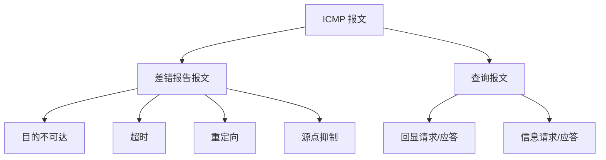
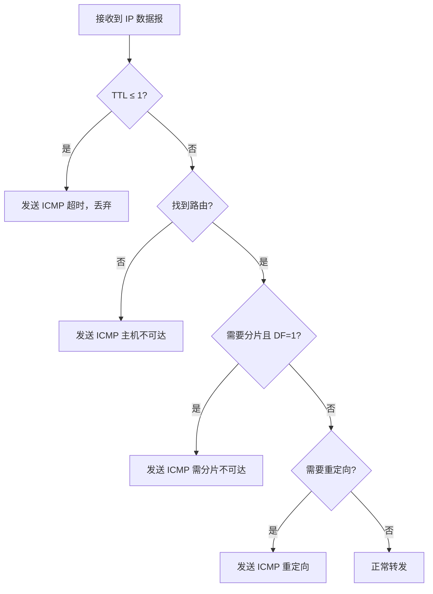

# ICMP 报文类型（差错报告与查询报文）概览

## ICMP 报文类型概览

ICMP（Internet Control Message Protocol）是 IP 层的差错报告与诊断机制。它本身不传输应用数据，而是让网络设备（主机与路由器）在 IP 分组处理失败或需要探询网络状态时，向源主机回送控制信息。ICMP 报文分为两大类：**差错报告报文**和**查询报文**。

> [!IMPORTANT]
> ICMP 差错报文**只针对 IP 数据报的初始分片**生成（偏移量为 0 的分片）。因此 Net/3 在把 IP 包嵌入差错报文时，偏移字段不做字节序转换也没有影响——初始分片的偏移值恒为 0，主机序与网络序相同。

---

## 为什么需要 ICMP

IP 协议本身是“尽力而为”的无连接协议：它只负责把数据报从源地址送到目的地址，不保证一定成功，也不向源端报告失败原因。如果路由器丢包后保持沉默，主机将永远不知道问题出在哪里。ICMP 填补了这个空白：

- 路由器发现无法转发数据报时，向源主机发送**差错报告**；
- 主机或路由器需要探测链路状态、延迟或可达性时，使用**查询报文**（如 `ping` 用的回显请求/应答）。

---

## 差错报告报文：触发条件与类型

在 TCP/IP 的 IP 处理流程中，以下几类异常会触发对应的 ICMP 差错报文：

| IP 处理环节 | 异常条件 | 发送的 ICMP 差错报文 |
| :--- | :--- | :--- |
| TTL 递减 | `ip_ttl` 减到 1 后再递减 | ICMP 超时（Time Exceeded） |
| 路由查找 | 找不到目的地的路由 | ICMP 目的不可达（主机不可达） |
| 分片处理 | DF 位禁止分片但包过大（`EMSGSIZE`） | ICMP 目的不可达（需分片） |
| 接口队列 | 接口队列满或内核内存不足（`ENOBUFS`） | ICMP 源点抑制（Source Quench） |
| 转发路径 | 源主机选错了第一跳路由器 | ICMP 重定向（Redirect） |
| 重组超时 | 已收到初始分片但定时器到期 | ICMP 超时（重组超时） |

用一张流程图把这些触发路径串起来：

> [!WARNING]
> 路由环路是触发 ICMP 重定向的一个隐蔽场景：两台路由器互认为对方是最佳下一跳时，数据报在两者之间来回弹跳。每台路由器都会向同一网络上的源主机发送 ICMP 重定向，直到原始数据报的 TTL 减至 0 被丢弃。==TTL 字段正是为防止此类环路导致的无限转发而设计的。==

---

## 作用转换表：从 `ip_output` 错误码到 ICMP 报文

Net/3 中，`ip_output` 返回的错误码会被映射为相应的 ICMP 报文类型：

| `ip_output` 错误码 | 生成的 ICMP 报文 | 说明 |
| :--- | :--- | :--- |
| `EMSGSIZE` | `ICMP_UNREACH_NEEDFRAG` | 报文过大且禁止分片 |
| `ENOBUFS` | `ICMP_SOURCEQUENCH` | 接口队列满或内存不足 |
| `EHOSTUNREACH` / `ENETDOWN` / `EHOSTDOWN` / 默认 | `ICMP_UNREACH_HOST` | 路由不可达、接口未运行等 |

> [!TIP]
> 记忆口诀：**“超时看 TTL，致命看分区，路由不达看主机，缓冲已满降速去。”** 这四类差错覆盖了 IP 转发中绝大多数的异常路径。

---

## 查询报文与“过时”的信息请求

查询报文不报告错误，而是用于主动诊断。最常见的两类是：

- **回显请求/应答**（Echo Request/Reply）：`ping` 命令的基础，用于测试目的主机的可达性与往返时延。
- **信息请求/应答**（Information Request/Reply）：早期用于主机发现自己的 IP 地址，如今已被 RARP、BOOTP、DHCP 取代，属于“过时”类型。

Net/3 对此的处理很有意思：当收到过时的 ICMP 信息请求时，`icmp_input` **并不直接丢弃**，而是把它交给 `rip_input`（路由信息协议输入例程）。

> [!NOTE]
> 这样做的原因是**向后兼容**：一些老旧的系统可能仍然依赖这种消息来获取地址信息。通过将其转发给用户级守护进程，Net/3 允许运行在用户态的程序继续响应这类请求，而内核本身无需维护完整的处理逻辑。丢弃是“最省事”的做法，但会破坏对旧系统的互操作性。

---

## 常见的坑

1. **“差错报文不再触发差错报文”**：`icmp_send` 的返回值被丢弃，ICMP 处理过程中新产生的错误也被静默丢弃。这是为了防止两个主机之间因一个错误而互相发送差错报文，形成无限循环。
2. **只报告初始分片**：后续分片遇到错误时不发送 ICMP 差错报文。原因有二：初始分片才能标识“一个数据报”的失败，避免多个分片触发多条重复差错。
3. **重定向的“不可修改”条件**：被选中的路由必须没有被 ICMP 重定向报文创建或修改过（标志位 `RTF_DYNAMIC | RTF_MODIFIED`），否则不会再次触发重定向，防止重定向环路。

> [!CAUTION]
> 不区分“初始分片”与“后续分片”是一个常见误区。ICMP 差错报告只看偏移量为 0 的那个分片——这也是 Net/3 跳过字节序转换的逻辑前提。
