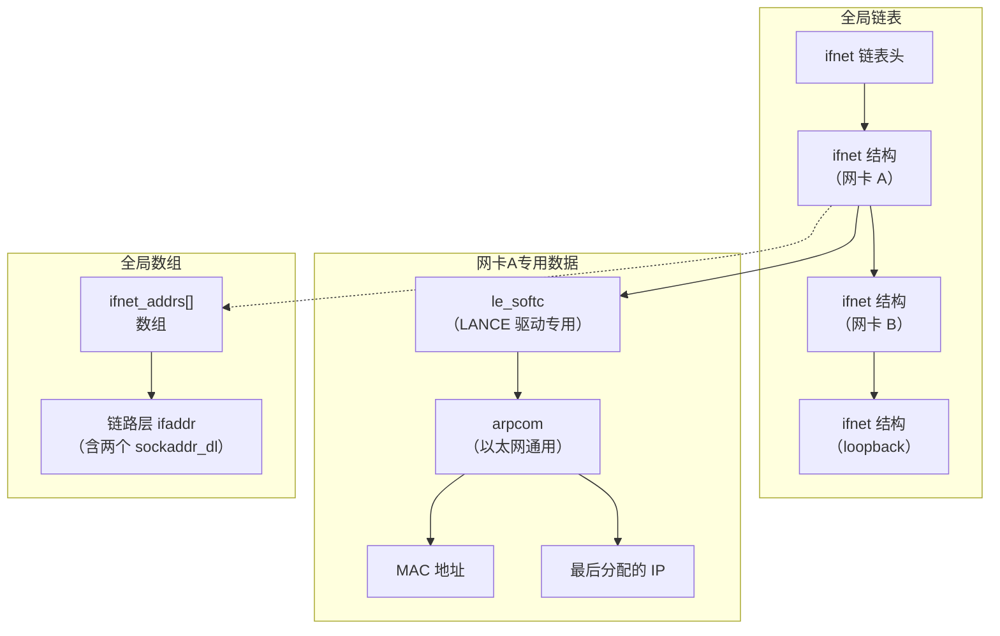
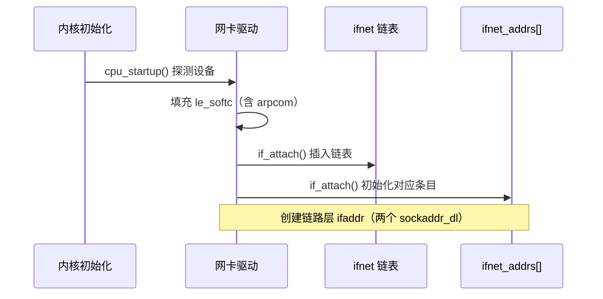

# 接口层 ifnet 结构体的作用与字段

## 它是什么——通用接口结构 `ifnet`

在 Net/3 中，每个网络接口（以太网卡、环回接口等）在内核中都有一个对应的 `ifnet` 结构。它把不同厂商、不同类型网卡的差异抽象成一个统一的“接口视图”，让上层协议（IP、ARP）不需要关心底层硬件细节就能收发数据包。

> [!IMPORTANT]
> `ifnet` 是接口层通用的数据结构，所有网络接口共用一个 `ifnet` 链表，每个接口的专用数据（如以太网的 `arpcom`）都嵌入在 `ifnet` 后面。

来看它是怎么组织和管理的：

## 为什么需要它——解耦与多态

如果没有 `ifnet`，IP 层输出数据包时就要写 `if (网卡A) ... else if (网卡B) ...`，每加一种新网卡就得改 IP 层代码。引入了 `ifnet` 后，所有网卡驱动只需填充一个统一的 `ifnet` 结构，注册自己的输出函数指针即可。

上层只需要记住一个指针：
> 接口输出函数（如 `ether_output`）==仅持有指向 `ifnet` 的指针==，不持有指向 `ifaddr` 的指针。

这意味着发送数据时，协议栈得想办法拿到一个可以用的源 IP 地址。Net/3 的做法是直接取 `arpcom` 结构里保存的“最后一个分配的 IP”，省去了遍历 `ifaddr` 链表的开销。

## 各字段的含义与关联结构

为了理解 `ifnet`，需要同时认识三个配套结构：

| 结构 | 作用 | 特殊字段 |
|------|------|----------|
| `ifnet` | 通用接口描述 | `if_next`（链表指针）、`if_output`（输出函数）、`if_addrlist`（地址列表） |
| `ifaddr` | 通用地址（链路层 / IP 层均可） | `ifa_addr`（本接口地址）、`ifa_netmask`、`ifa_next` |
| `in_ifaddr` | IP 专用地址结构 | 以 `ia_ifa` 开头（`ifaddr` 子类），后有 IP 专用成员，链入 `in_ifaddr` 全局链表 |
| `arpcom` | 以太网通用部分 | MAC 地址、`ac_ipaddr`（最后一个 IP） |
| `le_softc` | LANCE 驱动专用 | 内嵌 `arpcom`，外加 DMA 描述符等硬件相关字段 |

两个全局指针的职责也要分清：

> [!NOTE]
> **`in_ifaddr`**：指向全局 IP 地址链表（所有接口的所有 IP 地址都链在一起）。
> **`ifnet_addrs`**：一个数组，按接口索引存放==链路层地址（MAC）==对应的 `ifaddr` 结构（含两个 `sockaddr_dl`）。

## 分配时机与初始化流程

你不禁要问：这些结构是什么时候创建和链接起来的？

1. 系统初始化时，`cpu_startup` 发现并初始化所有硬件，包括网络接口。
2. 每个网卡驱动初始化一个专用 `ifnet` 结构（以太网驱动用 `le_softc`），然后调用 `if_attach`。
3. 每次 `if_attach` 被调用，完成三件事：
   - 把 `ifnet` 插入全局 `ifnet` 链表；
   - 创建链路层 `ifaddr`（内含两个 `sockaddr_dl` 结构，分别表示本机 MAC 和广播 MAC）；
   - 初始化 `ifnet_addrs` 数组中对应项。
4. 当用 `ifconfig` 给接口配置 IP 时，分配 `in_ifaddr` 结构，链入接口的 `ia_next` 和全局 `in_ifaddr` 链表。

## 一个常见的坑

注意 `arpcom` 里的 IP 地址是“接口最后分配的 IP”。在多 IP 场景（一个网卡绑多个 IP）下，`ether_output` 用这个地址作为源 IP 可能不是你想要的那个。这是简化设计带来的取舍——免去了查路由表选源地址的开销，代价是“默认源 IP”不总是最合适。

## 和相近概念的区别

- **`ifnet` vs `ifaddr`**：`ifnet` 描述接口本身（状态、MTU、输出函数），`ifaddr` 描述接口上绑定的地址。一个 `ifnet` 可以有多个 `ifaddr`。
- **`ifaddr` vs `in_ifaddr`**：`ifaddr` 是通用地址结构（链路层和 IP 层都能用），`in_ifaddr` 是 IP 地址的具体实现，开头嵌入 `ifaddr`，实现“继承”——IP 地址可以放在需要 `ifaddr` 指针的任何地方。

> [!TIP]
> 记忆口诀：**网卡用 ifnet，地址用 ifaddr，IP 地址用 in_ifaddr，MAC 地址从 ifnet_addrs 找。**

## 动手算——TTL 与 ICMP 分片的字节序问题

教材里提到一个有趣的例子：Net/3 在构造 ICMP 差错报文时，不把原始 IP 包的偏移量和长度字段转成网络字节序。这在 IP 偏移量上为什么没问题？

因为==ICMP 差错报文只针对原始数据报的第一个分片==发送，而第一个分片的偏移量恒为 0。0 无论是大端还是小端表示都一样，所以字节序无关紧要。TTL 的存在也与此相关——路由环路中包在两个路由器间反复弹跳，每跳 TTL 减 1，最终归零被丢弃，ICMP 超时报文正是靠 TTL 机制触发的。
