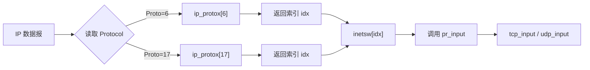

# ip_init 初始化内容与 ip_protox 数组的作用

## ip_init 初始化与 ip_protox 数组

在 Net/3 内核中，IP 层不仅是网络层协议的核心，更是连接链路层与传输层的枢纽。理解 `ip_init` 的初始化工作和 `ip_protox` 的分发机制，是掌握 IP 数据报处理流程的关键。

### ip_init：系统启动时的“奠基”

当系统初始化时，`domaininit` 会调用 `ip_init` 函数。它的主要任务不是建立连接，而是为 IP 协议的运行准备基础数据结构：

1.  **初始化重组队列**：清空并初始化 IP 分片重组队列 `ipq`，确保后续能正确组装被分片的数据报。
2.  **设置 ID 种子**：从系统时钟获取当前值作为种子，初始化 `ip_id`。这保证了本机发出的每个 IP 数据报拥有唯一的标识符，用于分片重组。
3.  **限制输入队列**：将 IP 输入队列 `ipintrq` 的最大长度 `ipqmaxlen` 设置为 **50**。这是一种流控机制，防止在网络拥塞时内核缓冲区无限膨胀。

> [!IMPORTANT]
> `ip_init` 不负责协议映射，它只负责**资源初始化**。协议映射由 `ip_protox` 完成。

### ip_protox：协议号的“翻译官”

IP 层收到数据报后，必须知道将其交给上层哪个协议（TCP、UDP 还是 ICMP？）。这就是**多路分解（Demultiplexing）**。

`ip_protox` 数组充当了**协议号到 `inetsw` 表项索引**的映射表。
-   **输入**：IP 首部中的协议字段（Protocol Number，如 6 代表 TCP）。
-   **输出**：`inetsw` 数组的下标索引。
-   **作用**：通过 `inetsw[ip_protox[protocol]]` 快速定位到对应的 `protosw` 结构体，从而调用相应的输入处理函数（如 `tcp_input`）。



> [!TIP]
> 记忆口诀：**Proto 查表得索引，索引找到 inetsw，inetsw 里有函数。**

### 代码逻辑与常见误区

在 `ipintr`（IP 输入处理）中，核心逻辑如下：

```c
// 伪代码逻辑
if (ip->ip_p >= IPPROTO_MAX || 
    (pr = inetsw[ip_protox[ip->ip_p]]) == NULL) {
    // 错误处理：未知协议或无处理程序
    m_freem(m);
    return;
}
// 调用对应协议的输入函数
(*pr->pr_input)(m, hlen);
```

**常见坑点辨析：**

| 概念 | 易混点 | 正确理解 |
| :--- | :--- | :--- |
| `ip_protox` | 认为它直接存函数指针 | 它存的是 **`inetsw` 的索引**，间接指向 `protosw` |
| `inetsw` | 认为下标即协议号 | `inetsw` 下标是套接字类型顺序，需通过 `ip_protox` 转换 |
| `ip_init` | 认为它初始化了映射表 | 映射表是在编译时静态定义或在 `domaininit` 阶段构建的 |

> [!WARNING]
> 若 `ip_protox` 中某协议号对应的值为 0 或无效，且没有 RAW Socket 兜底，该数据报将被丢弃。例如，若未加载 ICMP 模块，Ping 包将无法响应。

**典型例题回顾：**
在选择题中，若问 `pffindtype(PF_INET, SOCK_RAW)` 返回 `inetsw` 哪一项？根据映射关系，RAW IP 通常对应 `inetsw[6]`（具体取决于实现版本，但在南邮课件语境下，需注意 IP 协议本身在 `inetsw` 中有多个入口，包括用于 RAW 的入口）。理解 `ip_protox` 如何将这些分散的入口统一映射，是解题关键。
