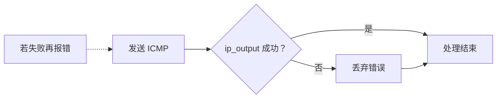

# 为什么在特定代码路径中丢弃 ip_output 的返回值

## 问题出在哪条路径

图 11.39 对应的是 ICMP 报文的发送路径：`icmp_send` 构造好 ICMP 报文后，调用 `ip_output` 把报文交给 IP 层发送，但代码没有接收、判断或向上传递 `ip_output` 的返回值。

这里要区分两个层次：

- **函数接口层面**：`icmp_send` 本身不向调用者返回发送错误，因此保留 `ip_output` 的返回值也不能直接交给上层处理。
- **协议设计层面**：更重要的是，==ICMP 处理过程中产生的发送错误必须被丢弃，不能再用新的 ICMP 差错报文报告==，否则可能形成无休止的差错报文序列。

## 为什么不能“出错就再报错”

通常，本机生成的数据报发送失败时，错误可以沿协议栈返回。例如，`ip_output` 因 DF 位禁止分片而丢弃过大的数据报，并返回 `EMSGSIZE`；本机 UDP 等传输协议可据此向进程报告错误，转发路径则由 `ip_forward` 生成相应的 ICMP 目的不可达报文。

但当前发送的本身就是 **ICMP 报文**。如果每次发送 ICMP 失败，都再生成一个 ICMP 差错报文，而新报文又发送失败，就可能不断重复：



因此，正确做法是终止这条“对错误继续报错”的链条，而不是把错误再次转换为 ICMP 报文。

> [!IMPORTANT]
> 图 11.39 丢弃返回值，并不表示 `ip_output` 不会失败，也不表示失败无需关注；它表示==该 ICMP 发送路径不把失败继续向上返回或触发新的差错报文==，核心目的是避免差错报文无限循环。

## 与相近路径的区别

| 场景 | `ip_output` 出错后的处理 | 原因 |
|---|---|---|
| 本机生成的普通数据报 | 传输协议可把错误返回进程 | 上层能够处理发送失败 |
| 被转发的数据报 | `ip_forward` 可生成 ICMP 目的不可达报文 | 需要通知源站转发失败 |
| 图 11.39 的 ICMP 发送 | 丢弃返回值，不再报错 | 防止差错报文循环产生 |

还要注意，`ip_forward` 因 `ip_output` 失败而发送 ICMP，是**转发普通数据报时的处理**；不能把它套用到所有 ICMP 发送过程。网络拥塞等通常不产生 ICMP 差错的情况，也属于另一类抑制规则。

## 一个具体例子

假设某 ICMP 报文需要发送，但其长度满足

```c
if ((u_short) ip->ip_len > ifp->if_mtu) { …… }
```

同时 DF 位禁止分片，则 `ip_output` 丢弃该报文并返回 `EMSGSIZE`。在图 11.39 中，这个返回值不被继续处理：==不能因该 ICMP 报文发送失败，再生成一个 ICMP 差错报文==。这样本次处理直接结束，不会形成“发送失败—生成差错—再次失败—再生成差错”的循环。

> [!WARNING]
> 简答题不要只答“因为 `icmp_send` 不返回错误”。这只是接口层面的原因；必须补上“避免产生无穷无尽的差错报文序列”，才答到核心。
