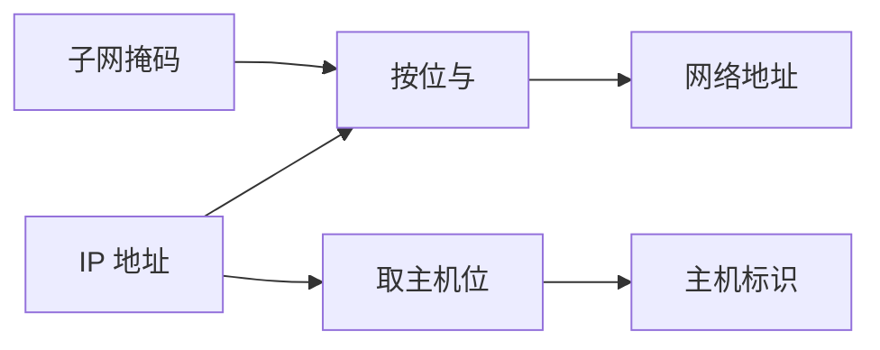

# IP 地址分类（A/B/C/D/E 类）与子网掩码

## 为什么需要分类与掩码

IPv4 地址是 32 位无符号整数，通常写成点分十进制，例如 `192.168.1.10`。它包含两层信息：**网络部分**标识“属于哪个网络”，**主机部分**标识“网络中的哪台主机”。路由器只需根据网络部分选择转发方向，不必记录全球每台主机。

早期分类编址（classful addressing）按首字节高位划分 A/B/C/D/E 类；子网掩码则进一步说明哪些位属于网络及子网、哪些位属于主机。

## A/B/C/D/E 类地址

| 类别 | 起始位 | 首字节范围 | 默认网络/主机位数 | 默认掩码 | 主要用途 |
|---|---:|---:|---|---|---|
| A | `0` | 1～126 | 8 / 24 | `255.0.0.0`，即 `/8` | 大型单播网络 |
| B | `10` | 128～191 | 16 / 16 | `255.255.0.0`，即 `/16` | 中型单播网络 |
| C | `110` | 192～223 | 24 / 8 | `255.255.255.0`，即 `/24` | 小型单播网络 |
| D | `1110` | 224～239 | 不划分子网 | 无默认主机掩码 | 组播 |
| E | `1111` | 240～255 | 不划分子网 | 无默认主机掩码 | 实验、保留 |

> [!IMPORTANT]
> A/B/C 类用于传统单播编址；D 类用于组播，E 类保留。==首字节为 127 的地址用于环回，不属于可分配的 A 类接口地址==，典型地址是 `127.0.0.1`。

分类编址的网络边界固定在字节边界上：A 类在第 1 字节后，B 类在第 2 字节后，C 类在第 3 字节后。这也解释了课程中 `in_addr` 早期为何设计为结构体：地址可以方便地按 8 位字节、16 位字或整个 32 位地址访问。RFC 950 引入子网划分，后来 CIDR 又允许任意前缀长度，这种固定字节划分便不再适用。

## 子网掩码怎样工作

传统子网掩码中，连续的 `1` 表示网络与子网位，连续的 `0` 表示主机位。例如 `/26` 表示前 26 位为 `1`，对应：

$$
/26 \Longleftrightarrow 255.255.255.192
$$

给定地址 $I$ 和掩码 $M$，计算方法是：

$$
\text{网络地址}=I\mathbin{\&}M
$$

其中 $\&$ 是按位与。主机位数为 $32-$ 前缀长度；传统子网内可分配主机数通常为：

$$
N_{\text{host}}=2^{32-p}-2
$$

减去的两个地址分别是网络地址和该子网的定向广播地址。

## 一个完整计算例

某接口地址为 `192.168.1.130`，掩码为 `255.255.255.192`，即 `/26`。首字节 192 表明它按分类编址属于 C 类，但 `/26` 又向原来的主机部分借用了 2 位作为子网位。

只看最后一个字节：`130` 的二进制是 `10000010`，`192` 的二进制是 `11000000`，按位与得到 `10000000`，即 128。因此：

| 项目 | 结果 |
|---|---|
| 网络地址 | `192.168.1.128/26` |
| 可用主机范围 | `192.168.1.129`～`192.168.1.190` |
| 定向广播地址 | `192.168.1.191` |
| 地址总数 | $2^6=64$ |
| 传统可用主机数 | $64-2=62$ |

`192.168.1.130` 与 `192.168.1.190` 属于同一子网；`192.168.1.192` 已进入下一个子网。

> [!WARNING]
> 不要只凭首字节判断实际网络范围。`192.168.1.130/26` 虽然“看起来是 C 类”，其实际网络不是 `/24`，而是 `/26`。==分类决定历史默认边界，掩码或前缀决定当前计算边界==。

## 与相近概念的区别

| 概念 | 含义 | 易混点 |
|---|---|---|
| 分类编址 | 按首几位确定 A/B/C 类及默认边界 | 是历史规则，不等于现代实际前缀 |
| 子网划分 | 从原主机位借位，增加子网数量 | 每个传统子网的主机数会减少 |
| CIDR | 用 `/p` 表示任意长度前缀，不再依赖类别 | 可跨越原来的 A/B/C 字节边界 |
| 超网/路由聚合 | 将多个相邻网络概括为更短前缀 | 与子网划分方向相反 |
| 网络地址 | 主机位全 0，标识整个网络 | 传统上不分配给普通主机 |
| 定向广播地址 | 主机位全 1 | 不等于受限广播 `255.255.255.255` |

> [!TIP]
> 做题先写“地址/前缀”，再算掩码、块大小和所在块。`/26` 的块大小为 $256-192=64$，末字节网络起点依次为 0、64、128、192；130 落在 128～191 内，可迅速核对结果。
