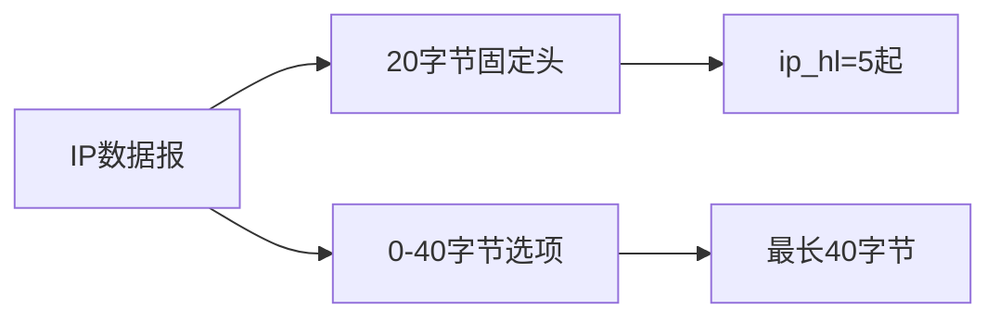
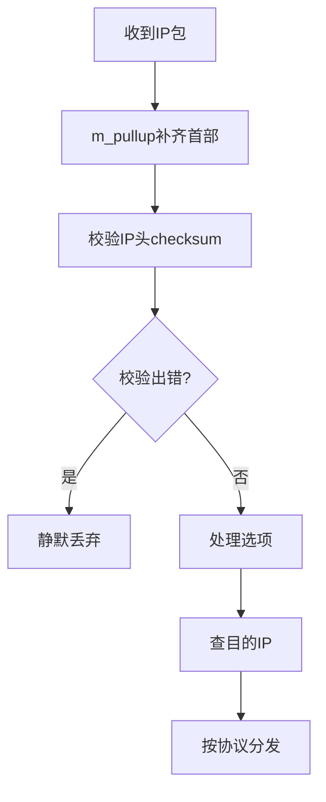

# IP 头部长度、字段解析与校验和错误处理

## 它是什么：IP 头部长度与字段

在 *TCP/IP 网络设计与实现（双语）* 的 Chapter 8 中，IP 数据报由首部和数据组成。**标准 IP 头部长度为 20 字节**；首部中还有一个 4 位的 `ip_hl`（header length）字段，以“32 位字”为单位给出真正的首部长度。

先想一个问题：为什么不能永远假设首部就是 20 字节？

因为 IP 首部后面可以跟选项。`ip_hl` 最小是 5（即 $5 \times 4 = 20$ 字节），最大是 15（即 $15 \times 4 = 60$ 字节），所以 **选项最多 40 字节**。

## IP 输入怎么处理这些字段

在 4.4BSD-Lite 的 IP input routine 中，收到一个 mbuf 里的 IP 数据报后要做几件关键事：

1. 检查首部是否完整。若第一个 mbuf 的 `m_len` 小于最小 IP 头 20 字节，就调用 `m_pullup` 把后续 mbuf 中的首部拉到一起。
2. **验证 IP 头部校验和（IP header checksum）**。
3. 处理 IP 选项。
4. 比较目的 IP 与本机地址，判断是否送达正确主机。
5. 若是路由器且目的不是本机，则 `ip_forward` 转发；其中 `ip_ttl` 减到 1（`IPTTLDEC`）时，返回 **ICMP time exceeded** 并丢弃。
6. 到达终点后，按 `ip_p`（protocol field）分发给 ICMP、IGMP、TCP 或 UDP。

## 为什么校验和出错不回消息

这里正好接上复习提纲里的简答题：为什么 IP 包到达时校验和出错不向发送者返回错误？

因为==头部已经损坏，源/目的地址都不可信==，你根本不知道该把 ICMP 差错发给谁，也无法保证能构造出合法报文给原发送者。所以内核只做 `==静默丢弃==`，不产生 ICMP 差错。

## 一个算对了的例子

题目：标准 IP 头长度？最大选项？大数据报怎么办？

- 标准 IP 头：20 字节；
- `ip_hl` = 5 → 20 字节；若 `ip_hl` = 15 → 60 字节，故选项最大 $= 60-20 = 40$ 字节；
- 大数据报超过接口 MTU 时，IP 进行 `fragment`（分片），在最终目的主机 `reassemble`（重组），因为“只有目的主机有机会看到所有分片”。

## 常见坑

| 概念 | 正确结论 | 易错写法 |
|---|---|---|
| 首部长度单位 | `ip_hl` 以 4 字节字为单位 | 直接当成字节 |
| 校验和失败 | 不回 ICMP，静默丢 | 以为回“参数错” |
| 分片重组位置 | 仅目的主机重组 | 以为路由器也重组 |
| `ip_off` 最高位 | 保留且必须为 0 | 设为 1 会被丢 |

[!WARNING]
`ip_off` 的最高有效位保留必须为 0；若被设置，`icmp_error` 会丢弃该包，而不是转发或正常处理。

[!TIP]
记住：`ip_hl×4` 才是真正字节数；TTL 变 1 发 ICMP，checksum 坏不发 ICMP。
