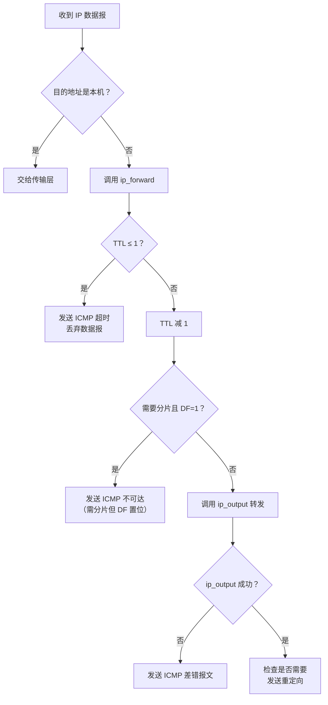

# 路由器转发逻辑与 ip_forward 中的字节序转换

## 路由器转发逻辑

当一个 IP 数据报到达路由器时，如果它的目的地址不是本机的任何一个接口地址，系统就需要将它转发出去。这个转发动作由 `ip_forward` 函数完成。

### 为什么需要 ip_forward？

你可能会想：路由表不是已经知道下一跳了吗，为什么还要一个专门的函数来处理？因为转发不仅仅是“查表然后丢出去”，它涉及一系列必须严格遵守的协议规则。一台主机只有在被配置为路由器（开启了 IP 转发功能）时，才会调用 `ip_forward`。否则，非本机的数据报会被直接丢弃。

`ip_forward` 的调用路径是：`ipintr` 处理收到的 IP 包 → 发现目的地址不是本机 → 调用 `ip_forward`。

### ip_forward 做了什么？

> [!IMPORTANT]
> ==TTL 的递减发生在比较之后，而不是之前==。代码先判断 `ip_ttl` 是否已经等于 1（递减后就会变为 0），如果是则发送 ICMP 超时报文并丢弃；否则才执行 `ip_ttl -= IPTTLDEC`。这样做的目的是防止接收到的 TTL=0 的包被错误地减为 255。

### 转发中的 bytesex 转换：为什么只转 fragment ID？

在 `ip_forward` 调用 `icmp_error` 发送 ICMP 差错报文时，需要把出错数据报的 IP 首部附带在 ICMP 报文中。此时有一个细节：==分片 ID（`ip_id`）从主机字节序转换为网络字节序，但分片偏移量（`ip_off`）不转换==。为什么？

答案出人意料地简单：ICMP 差错报文只针对数据报的第一个分片生成，而第一个分片的偏移量始终为 0。0 无论在主机字节序还是网络字节序中表示都一样，所以不需要转换。

### 转发的两个常见坑

**坑一：DF 位与分片冲突**

如果数据报设置了 DF（Don't Fragment）位，但输出接口的 MTU 比数据报小，`ip_output` 会拒绝分片并返回 `EMSGSIZE`。此时行为取决于数据报的来源：
- 本机生成 → 传输层把错误返回给进程
- 转发数据报 → `ip_forward` 生成 ICMP 目的不可达报文，代码为“需要分片但 DF 置位”

> [!WARNING]
> 这个 ICMP 差错报文是路径 MTU 发现机制的关键。如果防火墙错误地过滤了这类 ICMP，TCP 连接可能会卡死在“能建立但传不了数据”的状态。

**坑二：源路由时的重定向抑制**

当 `ip_forward` 的参数 `srcrt` 为真（表示该数据报携带源路由选项），系统会==禁止发送重定向报文==。源路由意味着发送方已经明确指定了路径，路由器不应该“纠正”它。

> [!NOTE]
> 原文 Five 中的描述存在双重否定：“redirects are not suppressed when… `srcrt` is False”。拆解后就是：`srcrt` 为假（没有源路由）时，重定向不被抑制——即正常发送重定向。`srcrt` 为真时，重定向被抑制。

### 一个算例

假设路由器收到一个数据报：TTL=2，DF=1，长度 2000 字节，输出接口 MTU=1500。

1. TTL 检查：2 > 1，通过；递减后 TTL=1
2. 2000 > 1500，需要分片；但 DF=1，禁止分片
3. `ip_output` 失败返回 `EMSGSIZE`
4. 这是转发的数据报，`ip_forward` 构造 ICMP 目的不可达报文（类型 3，代码 4，“需要分片但 DF 置位”）
5. 调用 `icmp_error` 前，把原始 IP 首部中的 `ip_id` 从主机序转为网络序，`ip_off` 不动（本来就是 0）
6. 发送 ICMP 报文给源主机，转发数据报丢弃
