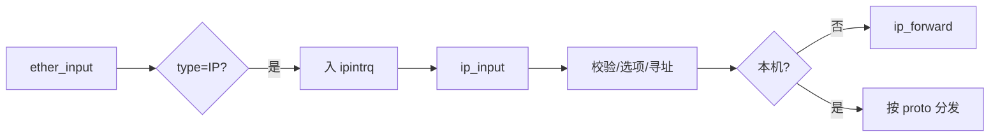
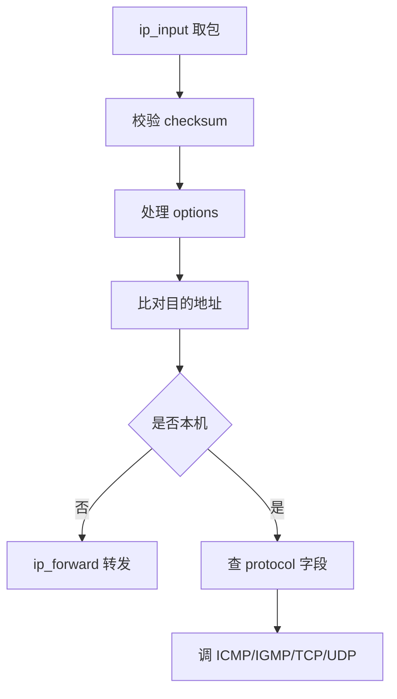

# IP 输入（ip_input）在 4.4BSD-Lite 发行版中的处理流程

## 它是什么

在 4.4BSD-Lite 里，`ip_input` 就是 ==IP 输入例程==：当以太网卡收到帧、`ether_input` 按类型字段发现是 IP 数据报后，会把它排进 `ipintrq` 队列，再由软件中断调用 `ip_input` 逐个处理。它是 IP 层收包的“总入口”。

## 为什么需要

链路层只管把帧交给“上层类型”，但 IP 层要负责：是不是发错了主机？头有没有坏？要不要续传？该给 TCP、UDP 还是 ICMP？没有 `ip_input`，内核就不知道一个 IP 包该扔、该转，还是该送进哪个协议。

## 怎么做

`ip_input` 按下面几步处理每个数据报：

1. 校验 IP 头部检验和（checksum），坏了就丢；
2. 处理 IP 选项（options）；
3. 拿目的 IP 和本机所有 IP 比，判断是不是“给自己的”；
4. 若系统配成 router 且包是去别的主机的，就调用 `ip_forward` 转发；
5. 若已到终点，就按头部 `protocol` 字段，通过 `ip_protox` / `inetsw` 交给 ICMP、IGMP、TCP 或 UDP 的 input 例程——例如 UDP 数据报就调 `udp_input`。

> [!IMPORTANT]
> `ip_input` 不再单纯“收包”，而是同时决定 ==丢弃、转发还是向上解复用== 三种命运。

## 和相近概念的区别

| 概念 | 角色 |
|---|---|
| `ether_input` | 按以太类型把包入队，触发软中断 |
| `ip_input` | 真正处理 IP 头、寻址、转发或分发 |
| `ip_forward` | 只管“不是本机”时的 TTL 与路由输出 |

## 常见的坑

- 校验和错时 ==不返回 ICMP==：头已坏，源地址都不可信，没法构造差错报文；
- TTL 到 1 再转发时，会发 ==ICMP time exceeded== 并丢弃，而不是先减再从 0 掉到 255；
- 若第一 mbuf 里连 20 字节 IP 头都不全，要先 `m_pullup` 把后续链上数据拉齐；
- 解复用不是查端口，而是先查 IP 头里的 `protocol`，再进传输层。

## 算对了的例子（简答 23 型）

问：What does the IP Input do in 4.4BSD-Lite?  
答要点：先 verify checksum、process options、比对 dest address；不是本机且开了路由就 `ip_forward`；是本机就按 `protocol` 调 ICMP/IGMP/TCP/UDP 的 input——例程里 UDP 数据报最终交给 `udp_input`。这四个动作写全，就拿到了这题的分。
