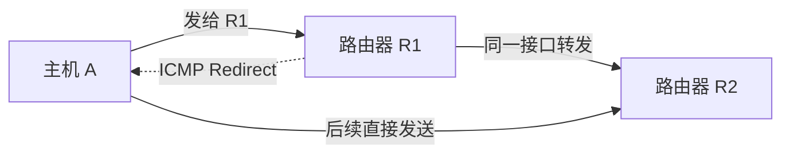
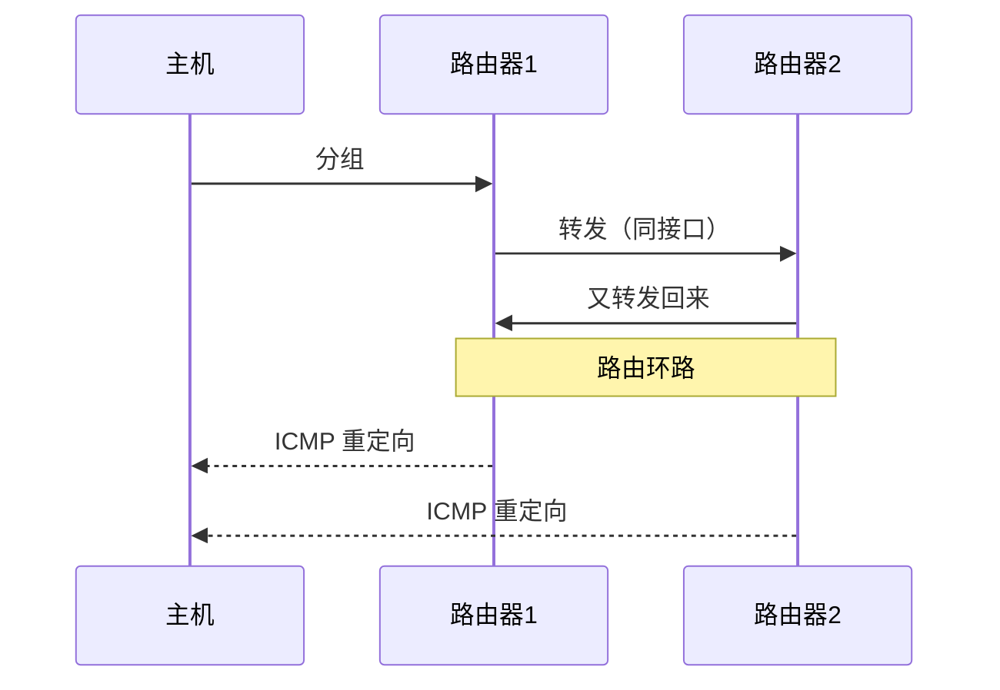

# IP 重定向的产生条件与 ICMP 重定向报文发送

## 什么是 ICMP 重定向

当路由器把从一个接口收到的 IP 分组，又从**同一个接口**转发出去时，它意识到：==源主机完全可以直接把分组发给下一跳路由器，而不必经过自己==。这时路由器向源主机发送 ICMP 重定向报文，告诉它"以后把这类分组直接发给那个更好的下一跳"。

## 发送重定向的五个条件

`ip_forward` 中必须**同时满足**以下条件才会发送：

| 条件 | 代码依据 | 含义 |
|---|---|---|
| 同接口收发 | `rt_ifp == rcvif` | 分组从同一接口进来又出去 |
| 路由未被重定向修改 | `!(rt_flags & (RTF_DYNAMIC\|RTF_MODIFIED))` | 防止重定向环路 |
| 非默认路由 | `rt_key != 0.0.0.0` | 默认路由不触发 |
| 系统授权 | `ipsendredirects == 1` | 管理员允许发送 |
| 非源路由 | `srcrt == 0` | 源路由分组不重定向 |

> [!IMPORTANT]
> 五个条件缺一不可，考试常考"漏掉其中某一条是否还发"。

## 为什么限制这些条件

- **同接口**：如果进出接口不同，说明路由器确实在跨网段转发，不存在更优路径。
- **路由未被修改**：如果路由本身来自之前的重定向，再发重定向可能形成环路。
- **默认路由例外**：默认路由是"兜底"路径，不应被重定向替换。
- **源路由例外**：源路由是发送方明确指定的路径，路由器无权更改。

> [!WARNING]
> 若主机选择了与出站接口不同的源地址（弱端系统模型），下一跳路由器看到的源地址不在本子网，**不会发送重定向**（RFC 1122）。

## 两个路由器互为下一跳的情况

路由更新期间路由表暂时不一致时，两个路由器互相认为对方是最佳下一跳，原始分组在两者之间弹跳，同时各自向源主机发送重定向。
