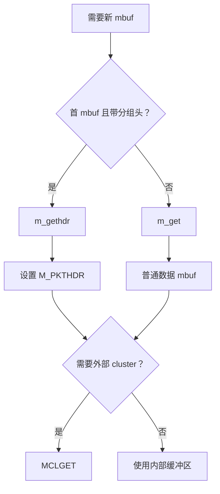

# 分配 mbuf 的函数（如 m_get、m_gethdr）

## 为什么需要专门的分配函数

内核不能直接用通用 `malloc` 处理网络数据：分组可能跨越多个 mbuf，协议层还要频繁添加首部、拼接链表或引用 cluster。因此，Net/3 用 `m_get`、`m_gethdr` 等函数统一完成 **mbuf 描述符分配、字段初始化和类型设置**。它们只解决“拿到一个 mbuf”，不等于已经取得足够的数据空间。



## `m_get`：分配普通 mbuf

课件中的结论是：==分配 mbuf 的函数是 `m_get`==。典型调用形式为：

```c
m = m_get(wait, type);
```

- `wait`：常用 `M_WAIT` 或 `M_DONTWAIT`，表示无法立即分配时能否等待。中断等不能睡眠的路径通常使用 `M_DONTWAIT`。
- `type`：写入 `m_type`，说明 mbuf 中数据的用途，如 `MT_DATA` 表示普通数据，`MT_SONAME` 表示 socket 地址结构。
- 返回值：成功时返回 mbuf 指针；失败时返回空指针，调用者必须检查。

`m_get` 初始化的是 mbuf 结构本身，包括 `m_next`、`m_nextpkt`、`m_len`、`m_data`、`m_flags` 和 `m_type` 等。它**不会自动分配 cluster**；若数据放不下，还需通过 `MCLGET` 等操作取得外部存储。

例如，`sendto` 将目的 socket 地址复制进 mbuf 后，该 mbuf 的 `m_type` 是 `MT_SONAME`，而不是 `MT_DATA`。

## `m_gethdr`：分配分组的首 mbuf

当一个 mbuf 链表示一个完整分组时，首 mbuf 需要保存分组级信息，如总长度和接收接口，因此使用：

```c
m = m_gethdr(wait, type);
```

它与 `m_get` 的关键区别是：==首 mbuf 设置 `M_PKTHDR`，并使用 `m_pkthdr` 区域==。其中 `m_pkthdr.len` 表示整个分组的总长度，不要与当前 mbuf 的 `m_len` 混淆。

| 对比项 | `m_get` | `m_gethdr` |
|---|---|---|
| 主要用途 | 普通 mbuf 或链中后续 mbuf | 一个分组的首 mbuf |
| `M_PKTHDR` | 通常不设置 | 设置 |
| 分组头信息 | 不按分组头使用 | 初始化并使用 `m_pkthdr` |
| 是否自动带 cluster | 否 | 否 |

> [!IMPORTANT]
> `M_PKTHDR` 表示“这是带分组头的首 mbuf”，并不表示其中一定含有 IP 首部和 UDP 首部，也不表示整个分组都存放在这个 mbuf 中。

## 与 `m_devget`、`m_pullup` 的区别

接收以太网帧时，设备驱动调用的是 `m_devget`：它根据帧长创建合适的 **mbuf 链**，必要时使用一个或多个 cluster，并把设备中的帧复制进去。因此，`m_devget` 是面向接收帧的完整构造过程，而 `m_get` 只是底层分配动作。

`m_pullup` 则完全不负责“新分组的接收”：它把链首至少 $N$ 字节整理为连续数据，要求 $N\leq \text{MHLEN}=100$。其失败原因包括：`MGET` 失败、链中总数据不足 $N$ 字节，以及请求超过 100 字节。

## 一个正确例子

UDP 输出需要在 150 字节用户数据前加入 UDP 首部和 IP 首部。若原 mbuf 前面没有足够空间，可以分配另一个 mbuf 放首部，再把它接到原链前面；若新 mbuf 成为整个分组的首 mbuf，就应保证分组头及 `M_PKTHDR` 语义正确，并维护 `m_pkthdr.len`。这里不能简单调用 `m_get` 后假定“空间一定够”，也不能把 `m_devget` 当作发送路径的通用分配函数。

> [!WARNING]
> 常见失分点：把 `m_get` 写成 `m_devget`；认为 `m_get` 自动分配 cluster；把 `m_len` 当成整包长度；看到首部就设置 `M_PKTHDR`。答题时先分清“分配一个 mbuf”“构造接收帧的 mbuf 链”“整理连续首部”这三件事。
