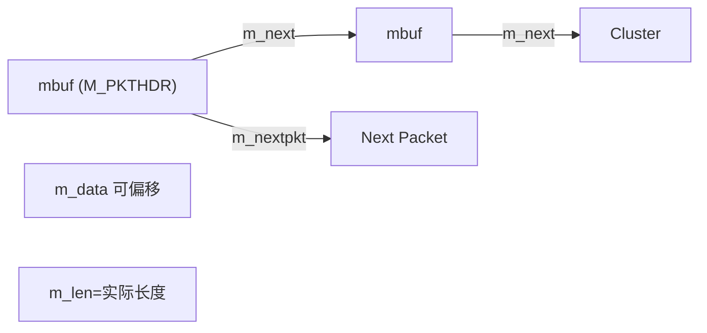

# mbuf 的用途及基本结构（m_data、m_len 等）

## mbuf 的用途与核心定位

在内核网络协议栈中，数据如何在进程、协议层与网卡驱动间高效传递？如果每次都分配大块连续内存并频繁拷贝，性能将急剧下降。mbuf（Memory Buffer）正是为解决这一问题而设计的==内核级动态缓冲单元==。

> [!IMPORTANT]
> mbuf 不仅用于承载用户数据，还存储源/目的地址、套接字选项等杂项信息。它是协议栈内部数据流转的“通用货币”。

当调用 `sendto` 时，Socket 层会将目的地址结构体复制到一个 mbuf 中，此时该 mbuf 的 `m_type` 字段被设置为 `MT_SONAME`；而用户数据则被复制到另一个 mbuf 链表中。这种设计实现了控制信息与数据的解耦。

## mbuf 基本结构与关键字段

每个 mbuf 是一个固定大小（通常 128 字节）的结构体，其核心字段决定了数据的存储方式与链表组织形式。

| 字段 | 含义 | 关键点 |
| :--- | :--- | :--- |
| `m_next` | 指向下一个 mbuf | 构成单个分组的 mbuf 链 |
| `m_nextpkt` | 指向下一个分组 | 构成队列中的多个分组 |
| `m_data` | 数据起始指针 | ==可指向缓冲区任意位置==，不必是头部 |
| `m_len` | 当前 mbuf 有效数据长度 | 协议头解析依赖此值 |
| `m_flags` | 状态标志位 | `M_PKTHDR` 表示含分组头 |
| `m_type` | 数据类型 | 如 `MT_DATA`, `MT_SONAME` |

> [!NOTE]
> `m_data` 指针具有灵活性。在添加协议头时，可通过向前移动 `m_data` 并增加 `m_len` 实现零拷贝 prepend，避免数据搬移。

## 数据分配策略与 m_devget

当设备驱动接收帧时，调用 `m_devget()` 创建 mbuf 链。该函数根据数据大小采取四种分配策略：

1.  数据 < `MLEN`：直接存入 mbuf 内部缓冲区。
2.  数据 ≥ `MINCLBYTES`（208B）：分配外部 Cluster（通常 1024/2048B）。
3.  数据介于两者之间：根据系统负载动态选择 mbuf 或 Cluster。
4.  超长数据：分配多个 Cluster 并通过 `m_next` 链接。

> [!TIP]
> 记忆口诀：“小用 mbuf，大用 Cluster，中间看情况，超长串起来”。`m_get()` 仅分配单个 mbuf 结构，不包含数据空间决策逻辑。

## 常见陷阱与经典例题解析

> [!WARNING]
> `dtom` 宏在数据位于 Cluster 时可能失效，因为 Cluster 无反向指针且可能被多个 mbuf 共享。此外，`m_pullup` 失败有三因：`MGET` 失败、链总长不足、==首 mbuf 无法容纳请求的连续字节数==。

**例题**：在 `sendto` 发送 150 字节 UDP 数据时，内核对用户数据共进行了几次完整遍历？

**解析**：答案是 ==3 次==。
1.  **第一次**：从用户缓冲区拷贝到内核 mbuf；
2.  **第二次**：计算 UDP 校验和；
3.  **第三次**：接口输出时将 mbuf 数据（含 14B ETH + 20B IP + 8B UDP + 150B Data = 192B）拷贝至网卡发送缓冲区。

此例说明 mbuf 虽减少了不必要的拷贝，但受限于硬件接口与协议处理，仍无法完全消除数据遍历。理解这三次拷贝是掌握 mbuf 实际运行机制的关键。
