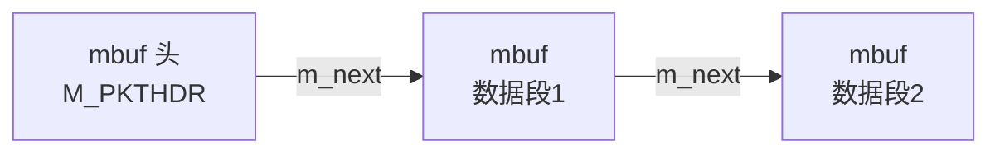
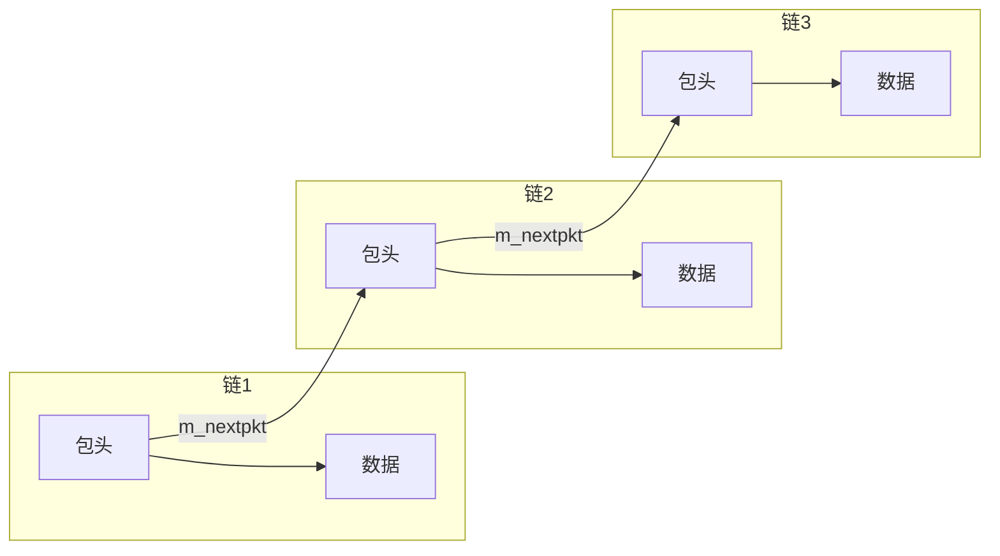

# m_next 与 m_nextpkt 指针的作用与区别

## Mbuf 链与队列：`m_next` 与 `m_nextpkt`

在 FreeBSD 内核的网络协议栈中，mbuf 是管理网络数据的基本内存单元。一个 mbuf 固定大小（通常 128 字节），但一个以太网帧最大可达 1518 字节，单个 mbuf 往往装不下。于是内核需要一种机制，把多个 mbuf 拼成一个完整的“包”，这个机制就是 `m_next` 指针。

### `m_next`：链接同一个包

当一个数据包长度超过单个 mbuf 的容量时，内核会分配多个 mbuf，用 `m_next` 指针把它们串成一条链。这条链称为 **mbuf 链**。链中**第一个 mbuf** 有一个特殊的标志：它的 `m_flags` 字段被置为 `M_PKTHDR`，表示这个 mbuf 是“数据包头”。

> [!IMPORTANT]
> `m_next` 链接的是属于==同一个数据包==的多个 mbuf。判断是否包头，看 `m_flags` 中是否有 `M_PKTHDR`。

为什么需要专门的“包头 mbuf”？因为内核在接收到一个包时，需要记录这个包的**总长度**、**校验和**、**接收接口**等信息。这些元数据放在 `pkthdr` 结构里，而 `pkthdr` 只存在于链的第一个 mbuf 中。如果每个 mbuf 都冗余存储这些信息，内存浪费就太大了。

### `m_nextpkt`：链接多个包

`m_next` 解决了一个包内部的数据拼接问题，但内核在接收路径上往往一次收到**多个**包。例如，网卡中断处理程序一次 DMA 了 10 个以太网帧进内存，这些帧各自由一条 mbuf 链表示。内核要把这 10 条链组织起来，一个一个处理，就需要第二个指针——`m_nextpkt`。

上图中有三条 mbuf 链，每条链内部由 `m_next` 串联，链与链之间由 `m_nextpkt` 串联。整体形成的是一个**队列**——先进先出，协议层从队头取包处理，处理完释放后移动到下一个包。

### 对比总结

| 特性 | `m_next` | `m_nextpkt` |
|------|----------|-------------|
| 作用对象 | 同一个包内的 mbuf | 不同包（每条 mbuf 链）之间 |
| 链接后形成 | mbuf 链 | mbuf 队列 |
| 首个 mbuf 的特点 | `m_flags` 有 `M_PKTHDR` | 各自链首都有 `M_PKTHDR` |
| 方向 | 单向 | 单向 |
| 常见使用场景 | 拼接数据段 | 接收队列、发送队列 |

> [!WARNING]
> 一个 mbuf **不能同时**既属于“同一个包的下一段”，又属于“下一个包的起点”。`m_next` 和 `m_nextpkt` 的语义不同，混用会导致内核遍历链表时出错。

### 一个具体例子

假设网卡收到一个 600 字节的 UDP 数据报。以太网帧总长 = 14（以太网头）+ 20（IP 头）+ 8（UDP 头）+ 600（数据）= 642 字节。单个 mbuf 的数据区约 100 字节可用（实际取决于簇的使用），这里假设内核用 **簇** 来存数据。

内核分配过程：

1. 分配第一个 mbuf，设置 `m_flags = M_PKTHDR`，在 `pkthdr` 中记录总长度 642 字节。
2. 数据太大，分配一个 **簇** 挂到第一个 mbuf 上，`m_next` 为 `NULL`；或分成多个 mbuf，用 `m_next` 链接。
3. 将这个 mbuf 链挂到接口的接收队列 `ipintrq` 上，队列通过 `m_nextpkt` 管理。

当 IP 层处理该队列时：

- 取队列头，即通过 `m_nextpkt` 拿到第一条链。
- 沿 `m_next` 遍历链上的数据，重组出完整 IP 包。
- 根据 IP 头中的协议号（17 UDP），交给 UDP 层，UDP 层再通过目的端口找到对应的 socket（通过 `inpcb` 结构中的 `inp_socket` 指针）。

### 常见误区

- **以为 `m_nextpkt` 是 `m_next` 的别名**：两者完全独立，不能互相替代。
- **判断包边界**：不要靠 `m_next == NULL` 判断“包结束了”，要结合 `M_PKTHDR` 和 `pkthdr.len` 或遍历时的长度累计来确认边界。
- **忽略 `M_PKTHDR` 的副作用**：只有带 `M_PKTHDR` 的 mbuf 才有 `pkthdr` 字段，访问非首 mbuf 的 `pkthdr` 是未定义行为。

> [!TIP]
> 记忆口诀：**一个包内看 `m_next`，包间排队看 `m_nextpkt`**。判断链头看 `M_PKTHDR`。
