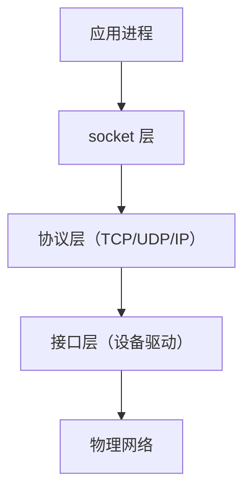
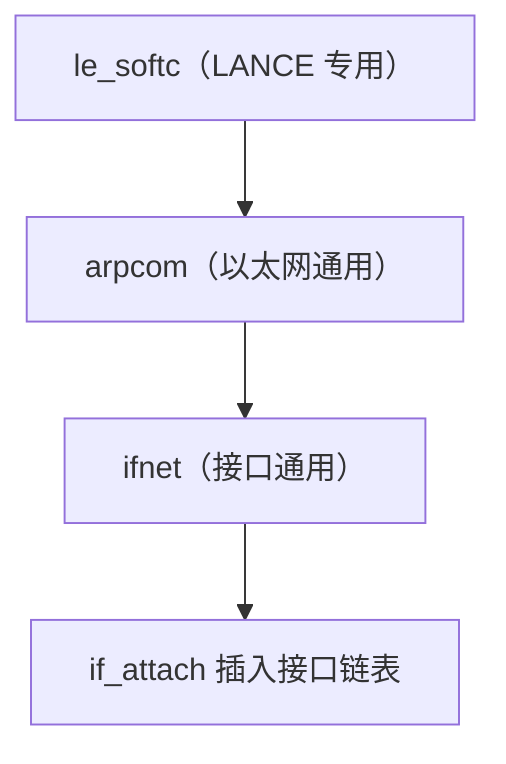

# Net/3 代码的组织层次与体系结构
Net/3 是 4.4BSD 内核中的网络协议栈实现。要读懂它的源码，首先要理解它如何把数十个协议、若干接口驱动和上层的 socket 机制组织成一套可编译、可扩展的体系。Net/3 的答案是一套“域 + 协议交换表 + 分层调用”的结构。

### 从一个问题开始：内核如何找到某个协议的处理函数？

假设内核收到一个 IPv4 的 TCP 报文，它需要依次完成：从以太网帧中剥出 IP 包、交给 IP 层处理、根据协议号找到 TCP 的输入函数、再根据端口号把数据送到对应 socket 的接收队列。问题在于：**内核在编译时不可能为每一种可能的协议组合硬编码调用路径**。它需要一张表，让协议栈能够在运行时按协议族和协议号查出对应的处理函数。

Net/3 的核心思路是：把相关协议分组到同一个“域”里，每个域用协议族常量标识；域内的每个协议各有一个 `protosw` 结构描述其操作；系统初始化时把这些表链接起来，收发路径上按表查找即可。

### 三层架构：socket 层、协议层、接口层

| 层次 | 职责 | 典型数据结构 |
|------|------|-------------|
| socket 层 | 提供系统调用接口，管理 `socket`/`mbuf` | `struct socket` |
| 协议层 | 实现协议语义：分片、重传、校验、路由 | `struct protosw`、`struct domain` |
| 接口层 | 收发链路层帧，管理网卡 | `struct ifnet`、`struct arpcom`、`le_softc` |

> [!IMPORTANT]
> Net/3 将相关协议分组到 ==域（domain）== 中，每个域用 ==协议族常量（protocol family constant）== 标识。例如 IPv4 协议族对应常量 `AF_INET`。

### 域的初始化：`domaininit` 做了什么

在系统初始化时，`domaininit` 将各域链接到全局的 `domains` 链表中，然后依次调用：

1. 每个域的初始化函数（例如 `inetdomain` 的初始化函数）；
2. 域内各协议 `protosw` 结构中的 `pr_init`；
3. 快超时（`pr_fasttimo`）和慢超时（`pr_slowtimo`）函数的注册。

### `protosw` 结构：协议交换表

在编译时，Net/3 为内核中的每个协议分配并初始化一个 `protosw` 结构，并将同一域内所有协议的这些结构放入一个数组中。以 IPv4 域为例，数组名为 `inetsw`。每个 `protosw` 至少包含：

- 协议类型（如 `SOCK_STREAM`、`SOCK_DGRAM`）；
- 协议号（如 IP 头中的协议字段值）；
- 输入函数（`pr_input`）、输出函数（`pr_output`）、控制函数（`pr_ctlinput`）等。

> [!TIP]
> 记忆口诀：==“域管协议族，protosw 描述协议，inetsw 是 IPv4 协议数组”==。看到 `inetsw[0]`、`inetsw[1]` 这样的下标，就知道是在查 IPv4 域内的协议交换表。

### 同一协议可以有多个 `protosw` 条目

内核可以通过提供多个 `protosw` 条目为同一协议提供多个接口。在 Net/3 内核的 `inetsw` 数组中，==IP 协议拥有 3 个 `protosw` 结构==。为什么？

IP 协议需要同时向两个方向提供接口：

- 向上：向 TCP、UDP 等传输层协议交付载荷，这对应 `SOCK_RAW` 类型的一个服务入口；
- 向下：从数据链路层接收数据包，这需要一个内部的输入入口；
- 旁路：允许用户进程直接收发原始 IP 包，这对应 `SOCK_RAW` 加协议号 `IPPROTO_RAW` 的另一个入口。

因此，IP 在 `inetsw` 中占用 3 个 `protosw` 表项，分别服务于不同的“使用方式”。这也是 Net/3 设计中“同一协议提供多个接口”的典型例子。

> [!NOTE]
> 这 3 个 `protosw` 的存在说明：一个 `protosw` 不是“一个协议”的唯一代表，而是“一种访问该协议的接口”。同一协议完全可以挂多个 `protosw`。

### 接口层的分层数据结构

接口层由网络接口的设备驱动组成。每个驱动初始化一个专门的 `ifnet` 结构，并调用 `if_attach` 将其插入接口链表中。以 LANCE 以太网驱动为例：

- `le_softc`：LANCE 驱动的专用 `ifnet` 结构，包含芯片寄存器地址、DMA 描述符等硬相关状态；
- `arpcom`：所有以太网驱动通用的结构，包含 MAC 地址、ARP 缓存等信息。

这种“专用结构包含通用结构”的嵌套方式是 Net/3 在 C 语言中实现面向对象风格继承的惯用技巧：通过结构体首地址相同的约定，可以将 `le_softc` 指针安全地转换为 `arpcom` 或 `ifnet` 指针。

### 一个算对了的例子：mbuf 簇的引用计数

mbuf 是 Net/3 中用于承载网络数据的核心缓冲区结构。当数据被多个协议层共享时，需要有引用计数来追踪释放时机。但是 mbuf 簇的大小是 2 的幂（典型值是 1024 或 2048 字节），簇内没有空间存引用计数。

查阅 Net/3 源码 `<sys/mbuf.h>` 中的宏 `MCLALLOC` 和 `MCLFREE` 可以看到：引用计数存储在一个名为 `mclrefcnt` 的数组中。该数组在内核初始化时在 `machdep.c` 文件中分配。

这个例子展示了 Net/3 组织方式的一个实际约束：**数据缓冲区与元数据分离存储**。mbuf 头部包含指针、长度和标志，而簇的引用计数放在数组里，通过簇的物理地址计算数组下标来访问。

> [!WARNING]
> 容易混淆：mbuf 头部本身不含簇的引用计数；`mclrefcnt` 是独立于簇内存的全局数组。如果一个 mbuf 指向某个簇，释放该 mbuf 时需要通过 `MCLFREE` 宏去递减 `mclrefcnt` 中对应元素的值。

### ICMP 差错报文中的字节序问题

Net/3 在将原始 IP 包装入 ICMP 差错报文时，不把原始 IP 头的偏移量和长度字段转换为网络字节序。对于长度字段，接收方需要按网络字节序来解释；但对于 ==IP 偏移量字段，这种“保持原样”的做法不会引起问题==，因为偏移量字段的语义本身是收发双方各自独立解析的：ICMP 差错报文的接收者拿到原始 IP 头后，会按网络字节序重新解析整个 IP 头，因此偏移量字段在被复制时是否提前转换并不重要——它最终都按网络字节序解析。

这反映了 Net/3 设计中的一个实用主义原则：**复制时不必处处转换，只要最终解析点能正确解释字节序即可**。
