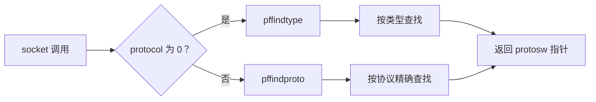

# pffindproto 和 pffindtype 函数的功能、调用示例及返回值说明

当进程调用 `socket(family, type, protocol)` 创建套接字时，内核不能只凭 `PF_INET` 就决定使用 TCP、UDP 还是原始 IP。它需要在协议族的 `protosw` 数组中定位具体表项，这项查找工作由 `pffindproto` 和 `pffindtype` 完成。

## 两个函数的作用

`protosw` 是协议交换表项，记录套接字类型、协议号以及该协议提供的操作函数。Internet 协议族对应的数组是 `inetsw`。

| 函数 | 查找依据 | 典型使用场景 |
|---|---|---|
| `pffindproto(family, protocol, type)` | 协议族、协议号、套接字类型 | `protocol` 非 0，需要精确匹配协议 |
| `pffindtype(family, type)` | 协议族、套接字类型 | `protocol` 为 0，由类型选择默认协议 |

因此，调用 `socket(PF_INET, SOCK_STREAM, 0)` 时，通常按 `SOCK_STREAM` 找到 TCP；调用 `socket(PF_INET, SOCK_DGRAM, 0)` 时，通常按 `SOCK_DGRAM` 找到 UDP。若创建原始套接字并明确给出协议号，则更适合使用 `pffindproto` 精确查找。

> [!IMPORTANT]
> 创建套接字时，==`pffindproto` 和 `pffindtype` 用于定位合适的 `protosw` 表项==；前者强调“协议号＋类型”，后者强调“按类型找默认协议”。

## 调用示例与返回值

两个函数查找成功时，都返回指向匹配 `protosw` 结构的指针，而不是协议号、描述符或表项下标；找不到匹配项时返回空指针，套接字创建随后报告协议不受支持等错误。

以课件采用的 `inetsw` 编号为例：

| 调用 | 返回结果 | 含义 |
|---|---|---|
| `pffindproto(PF_INET, 27, SOCK_RAW)` | 指向 `inetsw[6]` | 精确找到 RAW IP 表项 |
| `pffindtype(PF_INET, SOCK_STREAM)` | 指向 `inetsw[1]` | 找到 TCP 表项 |
| `pffindtype(PF_INET, SOCK_DGRAM)` | 指向 `inetsw[2]` | 找到 UDP 表项 |
| `pffindtype(PF_INET, SOCK_RAW)` | 指向 `inetsw[6]` | 找到原始套接字默认表项 |

一个可直接核对的例子是：题目问哪个调用返回 `inetsw[6]`，应选择 `pffindproto(PF_INET, 27, SOCK_RAW)`。判断时先看函数名，再看三个参数是否共同指向 RAW IP，最后才对应数组下标。

> [!WARNING]
> 不要混淆 `SOCK_STREAM` 与 `SOCK_DGRAM`：前者通常对应 TCP，后者通常对应 UDP。复习资料中若把二者与 `inetsw[1]`、`inetsw[2]` 交叉写反，应按课件指定口径记题，同时理解正常的类型映射。

## 与相近概念的区分

`pffindproto`、`pffindtype` 发生在==创建套接字、选择协议表项==的阶段；`ip_init`（或课件中的 `ipinit`）负责 IP 模块初始化，并不替进程查找套接字协议。`ip_protox` 则用于按 IP 协议号快速定位相关协议处理信息。三者都与协议组织有关，但调用时机和返回值用途不同。

> [!TIP]
> 解题口诀：`proto` 看协议号，`type` 看套接字类型；返回的是 `protosw *`，不是 `inetsw` 的整数下标。
