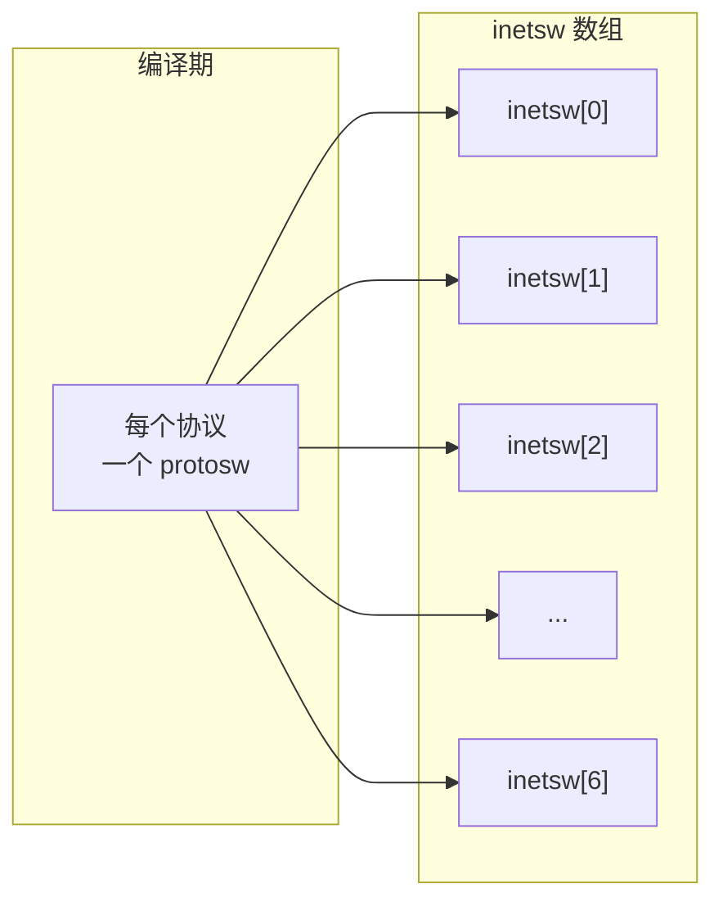
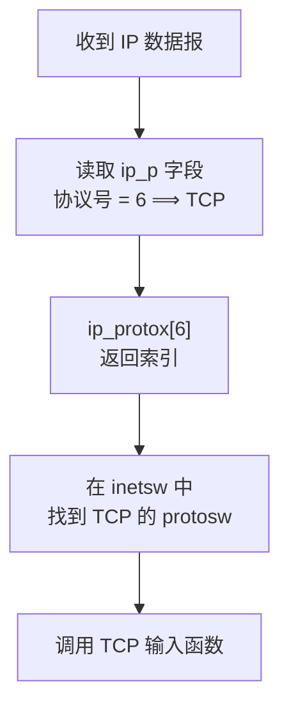

# protosw 结构的分配、初始化及 inetsw 数组中的多个条目

## `protosw` 结构的分配与初始化

先回答一个基本问题：内核收到一个 IP 数据报后，怎么知道把它交给 TCP、UDP 还是 ICMP？进程调用 `socket(PF_INET, SOCK_STREAM, 0)` 时，内核又怎么知道该用哪一套函数来收发数据？

答案都指向同一个数据结构：`protosw`（protocol switch，协议切换表）。它是 Net/3 中**协议与套接字层之间的“接线表”**——每个协议在表中占一行，记录该协议支持的套接字类型、协议号和入口函数指针。

> [!IMPORTANT]
> 在编译时，Net/3 为内核中的每个协议分配并初始化一个 `protosw` 结构，并将同一域内所有协议的结构放入一个数组中。Internet 域的数组叫 `inetsw[]`。

## 为什么 IP 有 3 个 `protosw` 条目

一个协议可以服务于多种套接字类型，因此内核允许同一个协议在 `inetsw[]` 中出现多次。典型例子就是 **IP 协议本身**：它同时提供 `SOCK_DGRAM`（UDP 承载体）、`SOCK_STREAM`（TCP 承载体）和 `SOCK_RAW`（原始 IP）三种接口，==IP protocol 在 `inetsw` 中占有 3 个 `protosw` 结构==（题中为 `inetsw[0]`、`inetsw[3]`、`inetsw[6]`）。

| 协议 | 套接字类型 | 对应条目 |
|------|-----------|----------|
| UDP | `SOCK_DGRAM` | `inetsw[0]` |
| TCP | `SOCK_STREAM` | `inetsw[1]` 附近 |
| IP（原始） | `SOCK_RAW` | `inetsw[6]` |
| IP（承载 TCP/UDP） | 其他类型 | 多个条目 |

## 套接字创建时的查找：`pffindproto` 与 `pffindtype`

进程创建套接字时，内核需要==同时用协议号、族和套接字类型==来定位唯一的 `protosw` 条目。Net/3 提供了两个函数：

- **`pffindproto(family, protocol, type)`**：按 **族 + 协议号 + 类型** 三条件精确匹配。
- **`pffindtype(family, type)`**：按 **族 + 类型** 匹配，协议号不指定（取该类型的默认协议）。

以题中索引为例：

| 调用 | 返回 |
|------|------|
| `pffindproto(PF_INET, 27, SOCK_RAW)` | `inetsw[6]`（协议号 27 = IP + `SOCK_RAW`） |
| `pffindtype(PF_INET, SOCK_STREAM)` | TCP 对应的条目 |
| `pffindtype(PF_INET, SOCK_DGRAM)` | UDP 对应的条目 |
| `pffindtype(PF_INET, SOCK_RAW)` | `inetsw[6]` |

> [!WARNING]
> `pffindtype` 匹配 `SOCK_RAW` 时返回 `inetsw[6]`；但 `pffindproto` 只有在协议号也匹配时才返回该条目。若协议号传错（如 17 而非 27），结果可能是 UDP 或空指针。

## 接收路径上的协议分发：`ip_protox` 数组

套接字创建解决了“进程到协议”的映射，但接收数据报时方向相反：==从 IP 头中的协议号出发，找到对应的 `protosw` 条目==。这由 `ip_protox[]` 完成。

`ip_protox` 是 `inetsw[]` 索引的映射表：`ip_protox[协议号] = inetsw下标`。它在系统初始化时由 `domaininit` 调用 `ip_init()` 构建。

> [!NOTE]
> 存在两个方向的查找：**创建套接字时**用 `pffindproto` / `pffindtype` 从参数找到 `protosw`；**接收数据报时**用 `ip_protox` 从 IP 头协议号找到 `protosw`。前者由进程发起，后者由中断上下文触发，方向相反，不可混用。

## 一个算对了的例子

进程执行 `socket(PF_INET, SOCK_RAW, 27)`。内核调用 `pffindproto(PF_INET, 27, SOCK_RAW)`，在 `inetsw[]` 中逐行比对：族必须为 `PF_INET`、协议号为 27、类型为 `SOCK_RAW`。匹配到 `inetsw[6]` 后返回其指针；后续所有 `send` / `recv` 都经由该条目中注册的函数完成。若协议号误写为 17（UDP），则三个条件无法同时满足，返回空指针，`socket()` 调用失败。
