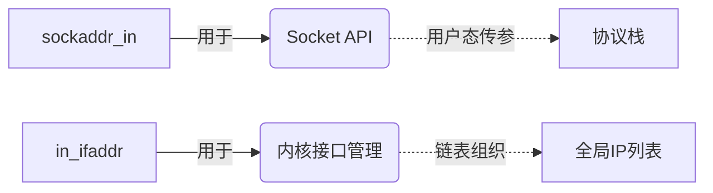

# IPv4 地址结构 sockaddr_in
在编写 Socket 程序时，我们为何不能直接传递一个 32 位整数作为 IP 地址，而必须将其封装在 `sockaddr_in` 结构体中？这涉及到网络编程的==协议无关性设计==。通用套接字 API 需要支持多种协议族，因此定义了通用的 `struct sockaddr`，而 `sockaddr_in` 正是其在 IPv4 下的具体实现。

> [!IMPORTANT]
> `sockaddr_in` 是 ==IPv4 协议专用的套接字地址结构==，用于在应用层与内核之间传递 Internet 地址信息。它必须与通用结构 `sockaddr` 保持内存布局兼容，以便通过类型转换传入 `bind()`、`connect()` 等系统调用。

### 结构体定义与关键字段

`sockaddr_in` 包含三个核心成员，其设计兼顾了历史兼容性与功能完整性：

| 成员 | 类型 | 说明 |
| :--- | :--- | :--- |
| `sin_family` | `sa_family_t` | 协议族，IPv4 固定为 `AF_INET` |
| `sin_port` | `in_port_t` | 端口号，==必须使用网络字节序== |
| `sin_addr` | `struct in_addr` | IPv4 地址，嵌套结构体 |

> [!NOTE]
> **为什么 `sin_addr` 最初被定义为结构体而非直接的 `uint32_t`？**
> 早期 BSD 实现中，IP 地址曾计划支持多种格式（如旧式分类地址、子网掩码组合等）。将其封装为 `struct in_addr` 提供了==抽象层==，使得后续修改内部表示时不会破坏外部 API 兼容性。尽管现代实现中它仅含一个 `s_addr` 字段，但这一设计沿用至今。

### 与 in_ifaddr 的区别

复习时常将 `sockaddr_in` 与 `in_ifaddr` 混淆，二者用途截然不同：



-   **`sockaddr_in`**：面向==应用程序==，描述通信端点（IP + Port），是 Socket 调用的参数载体。
-   **`in_ifaddr`**：面向==内核==，是 IP 协议专用的接口地址结构。它以通用接口地址 `ia_ifa` 开头，后跟 IP 特有成员。每个分配给接口的 IP 地址对应一个 `in_ifaddr`，并链接到全局链表 `in_ifaddr` 及接口地址列表中。

> [!WARNING]
> 切勿认为 `ifnet_addrs` 存储的是 IP 地址！该数组指向的是==数据链路层地址==（如 MAC 地址对应的 `sockaddr_dl`），而 IP 地址由独立的全局链表 `in_ifaddr` 管理。这是 P126 图表的核心考点。

### 正确使用示例

以下代码展示了 `sockaddr_in` 的标准初始化流程，注意字节序转换：

```c
struct sockaddr_in serv_addr;
memset(&serv_addr, 0, sizeof(serv_addr));

serv_addr.sin_family = AF_INET;
// 端口必须转为网络字节序
serv_addr.sin_port = htons(8080);
// IP地址字符串转网络字节序二进制
inet_pton(AF_INET, "192.168.1.1", &serv_addr.sin_addr);

// 传入通用指针，长度参数不可省略
sendto(sockfd, buf, len, 0,
       (struct sockaddr*)&serv_addr,
       sizeof(serv_addr));
```

> [!TIP]
> 在 `sendto` 调用中，第五个参数指向 `sockaddr_in`，第六个参数指定其长度。内核会将该结构复制到 mbuf 中（`m_type` 为 `MT_SONAME`），随后调用对应协议层例程（如 UDP 的 `udp_output`）。==忘记 `htons`/`htonl` 是最常见的运行时错误==，务必养成条件反射。
